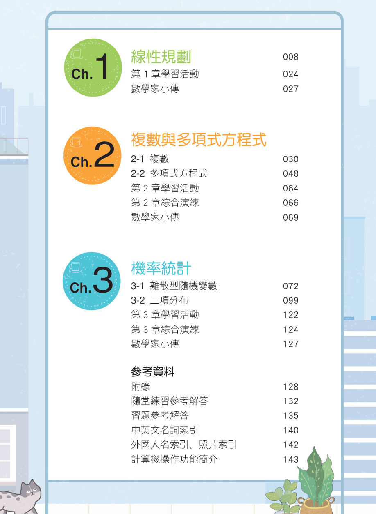

# 📚 普通高級中學 選修數學乙(下)

[📚 目錄總覽](README.md) ｜ **首頁** ｜ [下一頁 ➡️](02_選修數學乙(下)_CH1_線性規劃.md) ｜ [⏭️ 最終頁](15_選修數學乙(下)_習題參考解答.md)

---

> [!NOTE]
> **章節快速跳轉**：
> - **Ch 1 線性規劃**：[1 線性規劃](02_選修數學乙(下)_CH1_線性規劃.md) ｜ [第 1 章學習活動](03_選修數學乙(下)_CH1_學習活動.md) ｜ [數學家小傳（丹齊格）](04_選修數學乙(下)_CH1_數學家小傳_丹齊格.md)
> - **Ch 2 複數與多項式方程式**：[2-1 複數](05_選修數學乙(下)_CH2-1_複數.md) ｜ [2-2 多項式方程式](06_選修數學乙(下)_CH2-2_多項式方程式.md) ｜ [第 2 章學習活動](07_選修數學乙(下)_CH2_學習活動.md) ｜ [第 2 章綜合演練](08_選修數學乙(下)_CH2_綜合演練.md) ｜ [數學家小傳（阿貝爾）](09_選修數學乙(下)_CH2_數學家小傳_阿貝爾.md)
> - **Ch 3 機率統計**：[3-1 離散型隨機變數](10_選修數學乙(下)_CH3-1_離散型隨機變數.md) ｜ [3-2 二項分布](11_選修數學乙(下)_CH3-2_二項分布.md) ｜ [第 3 章學習活動](12_選修數學乙(下)_CH3_學習活動.md) ｜ [第 3 章綜合演練](13_選修數學乙(下)_CH3_綜合演練.md)
> - **參考資料**：[隨堂練習參考解答](14_選修數學乙(下)_隨堂練習參考解答.md) ｜ [習題參考解答](15_選修數學乙(下)_習題參考解答.md)

---

  
   
  <b>最新部定課程綱要 普通高級中學 三下用書</b> 
  <b>作者：游森棚、林延輯、柯建彰、洪士薰、洪育祥、張宮明</b>

---

[TOC]

---

## 📖 編輯大意

本書係依據教育部民國 107 年發布之「十二年國民基本教育課程綱要國民中小學暨普通型高級中等學校–數學領域」編輯而成。

十二年國民基本教育強調學科整合與素養導向的整體學習，亦鼓勵使用計算機作為學習計算之輔具。本書力求符合課綱精神，兼顧數學思考推理與實際應用。本書除了要求形式操作的熟練外，並鼓勵學生結合計算機之使用（在本書以專用符號呈現）。除部分例題與習題之外，各章的學習活動更引進來自各個領域之主題，以突顯數學與其他領域的連結。教學或學習時，可適時自由穿插使用，以體會數學為科學基本語言與基本工具的精神。各節習題編排由基本到綜合，循序漸進，最後的素養題連結情境、活化課本內容或探討理論，給同學自我挑戰，以期能使各個層面的同學都有收穫。

本冊分為三章，每章分為數小節。各節並細分為數個條目，以使教師與學生容易快速掌握核心概念與學習進度。各章主題如下：

- **第 1 章 線性規劃**
- **第 2 章 複數與多項式方程式**
- **第 3 章 機率統計**

良好數學的學習有賴於清楚的觀念理解，推理與形式操作，以及適度的練習。本書各章節的習題中，基本題鞏固基本概念與操作，進階題磨練解題能力，素養題則提供深度思考與應用理論的機會。章後並有統整習題，並介紹與內容相應的數學家，以期使師生從數學史中體會並欣賞數學的文化與累積的進程。

---

## ✍️ 序言 (Preface)

本書依據教育部所頒發的「十二年國民基本教育課程綱要國民中小學暨普通型高級中等學校–數學領域」所編纂。

數學的學習中，最重要的，也最困難的是數學概念的形成。概念形成必定由實際的經驗開始，抽象為數學的語言。因此我們堅信數學的學習一定要從實際經驗出發，才能理解概念形成的動機。理解符號的意義，從而熟練數學的語言。我們也堅信數學的美，在熟練數學語言後，會有更深一層的體會。

課本是教學和學習過程中最重要的根本之一。我們希望編寫一本難易適中，課堂上教師容易教學，學生課後也容易自修讀懂的課本。把核心觀念以及理論深入淺出說清楚，並有適度的練習。各章節內文的材料是核心的內容，每節後的習題從基礎到進階，章末並有統整性問題。

數學的用處廣闊無涯，理論浩大無比。面對未來的重要能力是終身學習與學科整合。數學是基礎學問，其影響力滲透到每一個領域。因此在每一章的最後，我們以主題的方式編寫學習活動，選材包羅萬象，從生活中的數學、自然科學或社會科學的連結，到人文學科與藝術。

我們期待同學研讀這本課本後，不僅能理解觀念與公式的由來，更能對章節結構有完整的概念，整體地學習高中數學。進而能運用數學知識解決問題，用數學的邏輯思考決策，欣賞數學的大用，與數學與科學的真與美。

<b>游森棚</b> 謹誌

---

## 📑 全書目次 (Contents)

  

### [Ch. 1 線性規劃](02_選修數學乙(下)_CH1_線性規劃.md)
* **[1 線性規劃](02_選修數學乙(下)_CH1_線性規劃.md)**（課本 P.008）
  * 平行直線系
  * 二元一次不等式
  * 線性規劃（頂點法、平行線法）
* **[第 1 章 學習活動：白河鎮的蓮花](03_選修數學乙(下)_CH1_學習活動.md)**（課本 P.024）
* **[數學家小傳：丹齊格 (George Bernard Dantzig)](04_選修數學乙(下)_CH1_數學家小傳_丹齊格.md)**（課本 P.027）

---

### [Ch. 2 複數與多項式方程式](05_選修數學乙(下)_CH2-1_複數.md)
* **[2-1 複數](05_選修數學乙(下)_CH2-1_複數.md)**（課本 P.030）
  * $i$ 代表 $\sqrt{-1}$
  * 複數的四則運算
  * 複數平面與絕對值
* **[2-2 多項式方程式](06_選修數學乙(下)_CH2-2_多項式方程式.md)**（課本 P.048）
  * 一元二次方程式的解與判別式
  * 代數基本定理
  * 虛根成對定理
* **[第 2 章 學習活動：根的位置與幾何構造](07_選修數學乙(下)_CH2_學習活動.md)**（課本 P.064）
* **[第 2 章 綜合演練](08_選修數學乙(下)_CH2_綜合演練.md)**（課本 P.066）
* **[數學家小傳：阿貝爾 (Niels Henrik Abel)](09_選修數學乙(下)_CH2_數學家小傳_阿貝爾.md)**（課本 P.069）

---

### [Ch. 3 機率統計](10_選修數學乙(下)_CH3-1_離散型隨機變數.md)
* **[3-1 離散型隨機變數](10_選修數學乙(下)_CH3-1_離散型隨機變數.md)**（課本 P.072）
  * 隨機變數與機率分布
  * 期望值
  * 變異數與標準差
  * 期望值與變異數的性質
* **[3-2 二項分布](11_選修數學乙(下)_CH3-2_二項分布.md)**（課本 P.099）
  * 白努利試驗與二項分布
  * 二項分布的期望值與變異數
  * 二項分布的圖形與大數法則
  * 統計推論與信賴檢驗
* **[第 3 章 學習活動：夜市的彈珠檯](12_選修數學乙(下)_CH3_學習活動.md)**（課本 P.122）
* **[第 3 章 綜合演練](13_選修數學乙(下)_CH3_綜合演練.md)**（課本 P.124）
* **數學家小傳：白努利家族與貝氏統計**（課本 P.127）

---

### 📚 參考資料與解答
* **附錄**（課本 P.128）
* **[隨堂練習參考解答](14_選修數學乙(下)_隨堂練習參考解答.md)**（課本 P.132）
* **[習題參考解答](15_選修數學乙(下)_習題參考解答.md)**（課本 P.135）
* **中英文名詞索引**（課本 P.140）
* **外國人名索引、照片索引**（課本 P.142）
* **計算機操作功能簡介**（課本 P.143）

---

[📚 目錄總覽](README.md) ｜ **首頁** ｜ [下一頁：Ch 1 線性規劃 ➡️](02_選修數學乙(下)_CH1_線性規劃.md)

