# 📐 第 1 章 線性規劃

[📚 目錄總覽](README.md) ｜ [⏮️ 第一頁](01_選修數學乙(下)_編輯大意與目次.md) ｜ [⬅️ 上一頁：編輯大意與目次](01_選修數學乙(下)_編輯大意與目次.md) ｜ [下一頁：第 1 章學習活動 ➡️](03_選修數學乙(下)_CH1_學習活動.md) ｜ [⏭️ 最終頁](15_選修數學乙(下)_習題參考解答.md)

---

> [!NOTE]
> **章節快速跳轉**：
> - **Ch 1 線性規劃**：**1 線性規劃** ｜ [第 1 章學習活動](03_選修數學乙(下)_CH1_學習活動.md) ｜ [數學家小傳（丹齊格）](04_選修數學乙(下)_CH1_數學家小傳_丹齊格.md)
> - **Ch 2 複數與多項式方程式**：[2-1 複數](05_選修數學乙(下)_CH2-1_複數.md) ｜ [2-2 多項式方程式](06_選修數學乙(下)_CH2-2_多項式方程式.md) ｜ [第 2 章學習活動](07_選修數學乙(下)_CH2_學習活動.md) ｜ [第 2 章綜合演練](08_選修數學乙(下)_CH2_綜合演練.md) ｜ [數學家小傳（阿貝爾）](09_選修數學乙(下)_CH2_數學家小傳_阿貝爾.md)
> - **Ch 3 機率統計**：[3-1 離散型隨機變數](10_選修數學乙(下)_CH3-1_離散型隨機變數.md) ｜ [3-2 二項分布](11_選修數學乙(下)_CH3-2_二項分布.md) ｜ [第 3 章學習活動](12_選修數學乙(下)_CH3_學習活動.md) ｜ [第 3 章綜合演練](13_選修數學乙(下)_CH3_綜合演練.md)
> - **參考資料**：[隨堂練習參考解答](14_選修數學乙(下)_隨堂練習參考解答.md#ch-1-線性規劃) ｜ [習題參考解答](15_選修數學乙(下)_習題參考解答.md#ch-1-線性規劃習題解答)

---

[TOC]

---

## 🌟 章首引言

生活上及科技上的許多實際問題，常常是需要在某些限制條件之下求某個量的最大值或最小值。這也是數學的重要應用之一。

本章的線性規劃，就是要處理這一類問題，能夠在一些特殊的情況下求出最佳解。線性規劃在經濟學、商業、管理、作業研究等領域中都有大量的應用，如物流路線設計、商品庫存、合金冶煉比例等問題，都可以用線性規劃來描述並求解。

本章核心架構：
- **平行直線系**
- **二元一次不等式**
- **線性規劃（平行線法、頂點法）**

---

## 1. 平行直線系

在第一冊中曾經介紹過兩平行直線的斜率相等，反之，斜率相等的兩相異直線必平行。第一冊中也介紹過直線平移只會改變直線的位置，不會改變斜率。因此，將一直線平移後可得到一系列互相平行的直線，這些直線稱為**平行直線系**。

  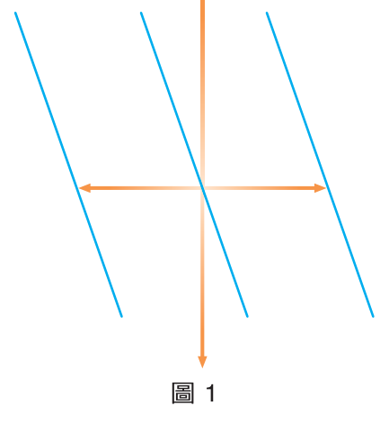
   
  <b>圖 1：直線平移與成績加權實例示意</b>

**[例題 1：直線向右平移]**
設 $L_0$ 的方程式為 $x - y = 0$。將直線 $L_0$ 分別向右平移 $1$ 單位、 $2$ 單位、 $3$ 單位，得直線 $L_1、L_2、L_3$，試在坐標平面上畫出直線 $L_1、L_2、L_3$，並求其方程式。

<table style="border: none; width: 100%;">
  <tr style="border: none;">
    <td style="border: none; vertical-align: top; width: 55%;">
      <b>【解】</b> 
      如圖 3 所示，直線 $L_0$ 為過原點 $O(0, 0)$ 且斜率為 $1$ 的直線。 
      將直線 $L_0$ 分別向右平移 $1,2,3$ 單位，得直線 $L_1,L_2,L_3$： 
      <ul>
        <li>$L_1$ 為過點 $(1, 0)$ 且斜率為 $1$ 的直線，其方程式為 $x - y = 1$。</li>
        <li>$L_2$ 為過點 $(2, 0)$ 且斜率為 $1$ 的直線，其方程式為 $x - y = 2$。</li>
        <li>$L_3$ 為過點 $(3, 0)$ 且斜率為 $1$ 的直線，其方程式為 $x - y = 3$。</li>
      </ul>
    </td>
    <td style="border: none; text-align: center; vertical-align: top; width: 45%;">
      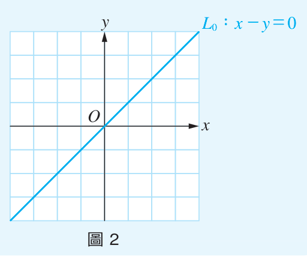 
      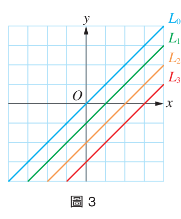 
      <b>圖 2、圖 3：直線平移</b>
    </td>
  </tr>
</table>
:::

**[隨堂練習 1]**
承例題 1，將直線 $L_0$ 分別向左平移 $1$ 單位、 $2$ 單位、 $3$ 單位，得直線 $L_4,L_5,L_6$，試在坐標平面上畫出直線 $L_4,L_5,L_6$，並求其方程式。

  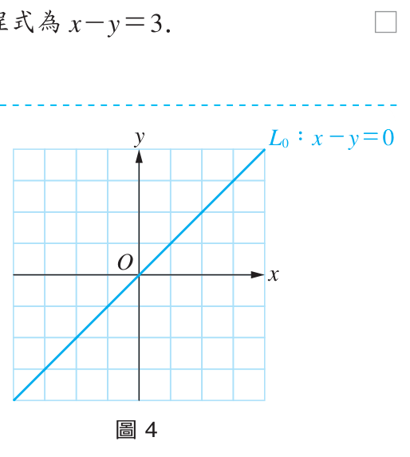
   
  <b>圖 4：坐標平面</b>

👉 [💡 查看隨堂練習解答](14_選修數學乙(下)_隨堂練習參考解答.md#p9-隨堂練習)
:::

:::info [觀念歸納：平行直線系方程式]
從例題 1 中，我們知道直線 $x-y=0$、 $x-y=1$、 $x-y=2$、 $x-y=3$ 這些直線都是互相平行的。

另外，因為直線 $L:ax+by+c=0$ ($b \neq 0$) 的斜率為 $-\frac{a}{b}$，所以如果維持 $x, y$ 的係數不變，只改變常數項，如此可得一系列斜率相等、位置不同的直線，稱為**平行直線系**。

  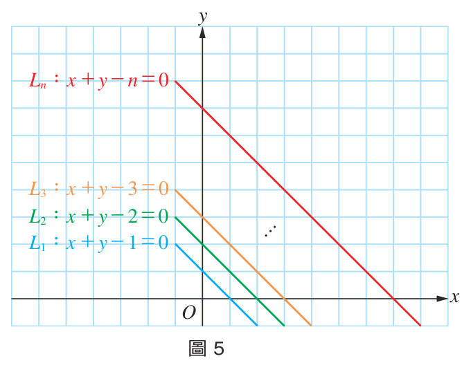
   
  <b>圖 5：平行直線系</b> $x+y-k=0$

在圖 5 中，直線 $L_1$ 往上方平行移動得到 $L_2,L_3,\dots,L_n$，其 $x$ 截距會愈來愈大，$y$ 截距也會愈來愈大，截距的變化跟常數項的改變有直接的關係。
:::

**[例題 2：比較截距大小]**
已知坐標平面上有三直線 $L_1:2x+y=2$， $L_2:2x+y=4$， $L_3:2x+y=6$。設直線 $L_1,L_2,L_3$ 與 $x$ 軸的交點分別為 $(a_1,0),(a_2,0),(a_3,0)$，試比較 $a_1,a_2,a_3$ 的大小關係。

<table style="border: none; width: 100%;">
  <tr style="border: none;">
    <td style="border: none; vertical-align: top; width: 55%;">
      <b>【解】</b> 
      如圖 6 所示： 
      直線 $L_1$ 與 $x$ 軸交點為 $(1, 0)$，得 $a_1 = 1$。 
      直線 $L_2$ 與 $x$ 軸交點為 $(2, 0)$，得 $a_2 = 2$。 
      直線 $L_3$ 與 $x$ 軸交點為 $(3, 0)$，得 $a_3 = 3$。 
      因此得 $a_1 < a_2 < a_3$。
    </td>
    <td style="border: none; text-align: center; vertical-align: top; width: 45%;">
      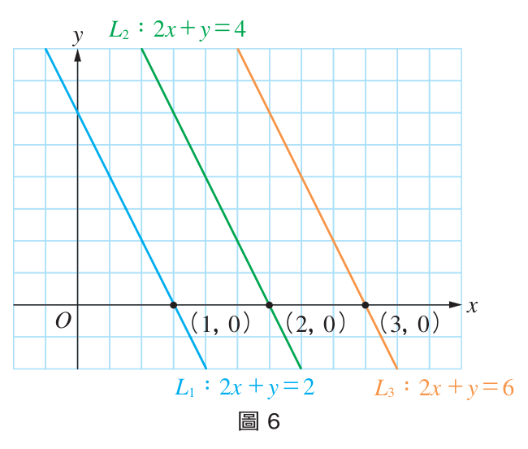 
      <b>圖 6：截距比較</b>
    </td>
  </tr>
</table>
:::

**[隨堂練習 2]**
承例題 2，設直線 $L_1,L_2,L_3$ 與 $y$ 軸的交點分別為 $(0,b_1),(0,b_2),(0,b_3)$，試比較 $b_1,b_2,b_3$ 的大小關係。

👉 [💡 查看隨堂練習解答](14_選修數學乙(下)_隨堂練習參考解答.md#p11-隨堂練習)
:::

---

## 2. 二元一次不等式

在第一冊中我們已經介紹過二元一次不等式及其圖形。例如：$x+y=2$ 的圖形是直線 $L$，$x+y>2$ 的圖形是半平面 $E_1$， $x+y<2$ 的圖形是半平面 $E_2$。

  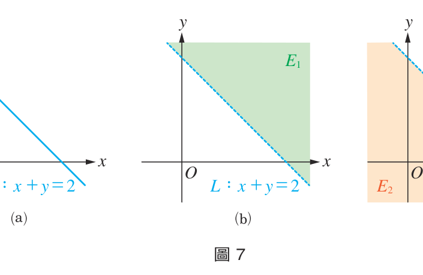
   
  <b>圖 7：二元一次不等式的半平面圖形（圖 7a, 7b, 7c）</b>

如果將半平面 $E_1$ 與直線 $L$ 合起來，就是 $x+y\ge 2$ 的圖形（如圖 8a）；將半平面 $E_2$ 與直線 $L$ 合起來，就是 $x+y\le 2$（如圖 8b）。

  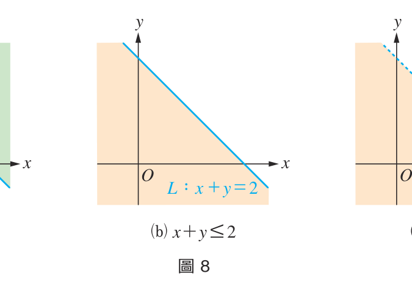
   
  <b>圖 8：包含界線與不含界線的半平面（實線與虛線之分）</b>

> [!IMPORTANT]
> **界線繪製原則**：
> - 當不等式**含等號**（$\ge,\le$）時，圖形包含界線 $L$，直線 $L$ 以**實線**表示。
> - 當不等式**不含等號**（$>,<$）時，圖形不包含界線 $L$，直線 $L$ 以**虛線**表示。
> - **半平面選取法**：先畫出直線方程式，選取基準點（通常取原點 $(0,0)$ 代入檢驗）。若不等式成立，則該半平面即為解區域；反之則為不包含該點的另一側半平面。

**[例題 3：聯立不等式的圖形]**
試在坐標平面上，畫出下列不等式的圖形：
1. 二元一次不等式 $x-2y+2\le 0$。
2. 二元一次聯立不等式：
   $$\begin{cases}x-2y+2\le 0\\x+y+2>0\end{cases}$$

**【解】**
1. 先畫出直線 $L_1: x - 2y + 2 = 0$。將原點 $O(0, 0)$ 代入得 $0 - 0 + 2 = 2 > 0$。故不等式 $x - 2y + 2 \le 0$ 的圖形為不含原點 $O(0, 0)$ 的半平面與 $L_1$（如圖 9 所示）。
2. 畫出直線 $L_2: x + y + 2 = 0$。將原點代入得 $0 + 0 + 2 = 2 > 0$，故 $x + y + 2 > 0$ 為含原點的半平面（如圖 10 所示）。
上述兩圖形的共同交集部分，即為聯立不等式的圖形（如圖 11 陰影部分所示）。

  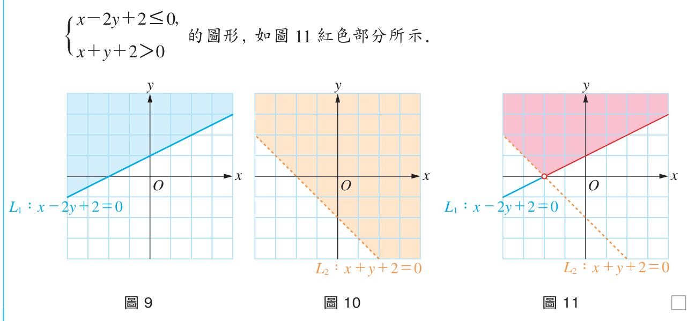
  
  
   
  <b>圖 9、圖 10、圖 11：聯立不等式之作圖步驟與交集區域</b>

:::

**[隨堂練習 3]**
1. 試在圖 12 的坐標平面上，畫出二元一次不等式 $2x - y - 2 \le 0$ 的圖形。
2. 試在圖 13 的坐標平面上，畫出二元一次聯立不等式：
   $$\begin{cases} 2x - y - 2 \le 0 \\ x + 3y - 3 > 0 \end{cases}$$

  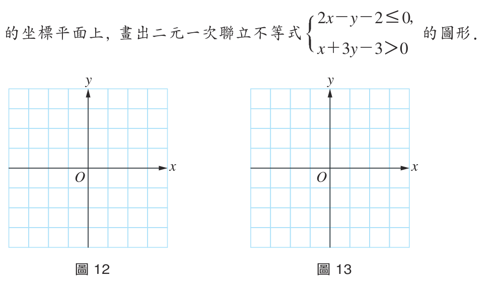
  
   
  <b>圖 12、圖 13：練習繪圖坐標系</b>

👉 [💡 查看隨堂練習解答](14_選修數學乙(下)_隨堂練習參考解答.md#p14-隨堂練習)
:::

---

## 3. 線性規劃

許多日常生活中所產生的現實問題都和二元一次聯立不等式有關。例如商人在有限資源限制下，尋找資源最佳分配的生產方法，以獲得最大利潤。

### 核心名詞定義
- **限制條件 (Constraints)**：由二元一次聯立不等式所組成的限制式。
- **可行解 (Feasible Solution)**：滿足所有限制條件的數對 $(x, y)$。
- **可行解區域 (Feasible Region)**：所有可行解在坐標平面上所圍成的區域。
- **目標函數 (Objective Function)**：欲求最大值或最小值的多項式函數，如 $P(x, y) = ax + by$。
- **最佳解 (Optimal Solution)**：使目標函數達到最大值或最小值的可行解坐標 $(x, y)$。

  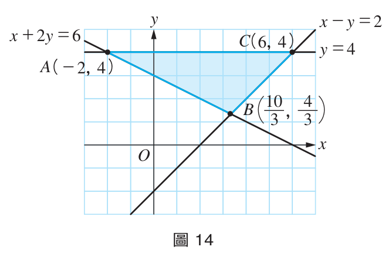
  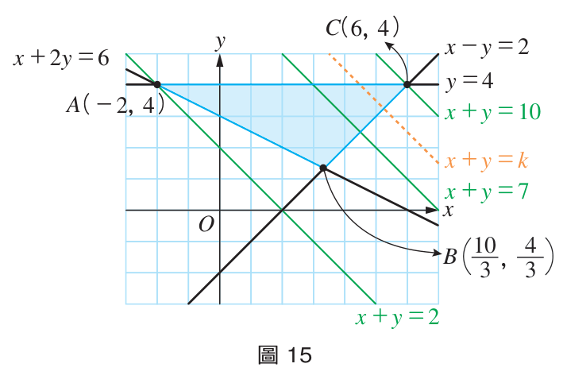
   
  <b>圖 14：可行解區域 $\triangle ABC$ ｜ 圖 15：目標函數平行直線系 $x + y = k$ 掃動</b>

當目標函數為 $x + y = k$ 時，這是一條斜率為 $-1$ 的直線。平行直線系往右上平移時 $k$ 值愈大，往左下平移時 $k$ 值愈小。當直線通過點 $C(6, 4)$ 時得到最大值 $10$；通過點 $A(-2, 4)$ 時得到最小值 $2$。

---

### 解法一：平行線法 (Parallel Line Method)
建立目標函數 $ax + by = k$ 的直線系，將直線平行移動掃過可行解區域。直線接觸可行解區域的最後一個點（或邊界）即為產生極值的點。

**[例題 4：平行線法求極值]**
在限制條件：
$$\begin{cases} x + 2y \le 6 \\ 2x + y \le 6 \\ x \ge 0 \\ y \ge 0 \end{cases}$$
的可行解區域中，試求目標函數 $x + 3y$ 的最大值及最小值。

  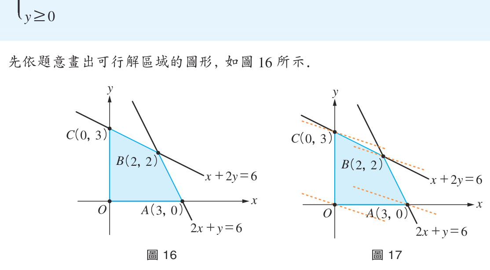
  
   
  <b>圖 16：可行解區域 ｜ 圖 17：平行線法求極值</b>

**【解】**
先依題意畫出可行解區域如圖 16。將直線 $x + 3y = k$ 平行移動通過可行解區域（如圖 17）：
- 直線通過點 $C(0, 3)$ 時，$k$ 達到最大值 $x + 3y = 0 + 3(3) = 9$。
- 直線通過原點 $O(0, 0)$ 時，$k$ 達到最小值 $x + 3y = 0$。
故最大值為 $9$，最小值為 $0$。
:::

**[隨堂練習 4]**
在限制條件：
$$\begin{cases} x + y \ge 10 \\ x - y \le 0 \\ y \le 10 \end{cases}$$
的可行解區域中，試求目標函數 $2x + y$ 的最大值及最小值。

👉 [💡 查看隨堂練習解答](14_選修數學乙(下)_隨堂練習參考解答.md#p16-隨堂練習)
:::

---

### 解法二：頂點法 (Corner-Point Method)
> [!TIP]
> **頂點法定理**：
> 如果可行解區域為一個**有界凸多邊形**，且目標函數為一次函數，則線性規劃問題的最大值與最小值必定出現在可行解區域的**頂點**上！
> 因此，只要解出所有頂點坐標，分別代入目標函數計算比較數值，最大的即為最大值，最小的即為最小值！

  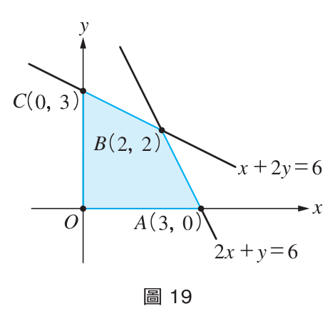
   
  <b>圖 19：頂點坐標代入分析</b>

以例題 4 為例，頂點分別為 $(0, 0), (3, 0), (2, 2), (0, 3)$，列表計算：

| 頂點 $(x, y)$ | $(0, 0)$ | $(3, 0)$ | $(2, 2)$ | $(0, 3)$ |
| :---: | :---: | :---: | :---: | :---: |
| **$x + 3y$** | **$0$ (最小值)** | $3$ | $8$ | **$9$ (最大值)** |

---

## 4. 線性規劃的生活應用實例

**[例題 5：精油提煉最佳產量]**
用一公噸原料 $A$ 和一公噸原料 $B$ 分別可提煉精油 $25$ 公斤和 $12$ 公斤。但生產過程中會產生廢棄物，每公噸原料 $A$ 和原料 $B$ 分別會產生 $75$ 公斤和 $25$ 公斤的廢棄物。
已知原料 $A$ 和原料 $B$ 每公噸的成本分別為 $15$ 萬元和 $12$ 萬元。今若希望成本不超過 $240$ 萬元，而廢棄物不超過 $750$ 公斤，試問最多可提煉多少公斤的精油？

<table style="border: none; width: 100%;">
  <tr style="border: none;">
    <td style="border: none; vertical-align: top; width: 55%;">
      <b>【解】</b> 
      設原料 $A$ 用 $x$ 公噸，原料 $B$ 用 $y$ 公噸。 
      限制條件：
      $$\begin{cases} 15x + 12y \le 240 \implies 5x + 4y \le 80 \\ 75x + 25y \le 750 \implies 3x + y \le 30 \\ x \ge 0, y \ge 0 \end{cases}$$
      目標函數 $P = 25x + 12y$（精油產量）。 
      解兩直線交點得頂點 $\left(\frac{40}{7}, \frac{90}{7}\right)$。 
      代入得最大產量：
      $$P = 25\left(\frac{40}{7}\right) + 12\left(\frac{90}{7}\right) = \frac{2080}{7} \approx 297.14 \text{ (公斤)}$$
    </td>
    <td style="border: none; text-align: center; vertical-align: top; width: 45%;">
      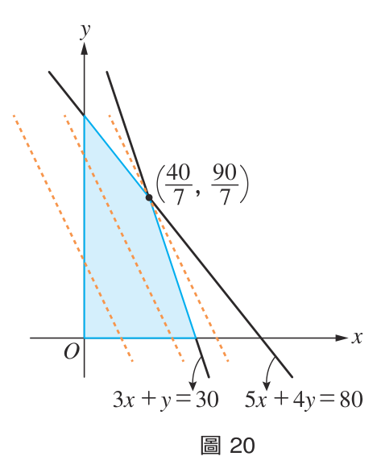 
      <b>圖 20：精油提煉可行解區域</b>
    </td>
  </tr>
</table>
:::

**[隨堂練習 5]**
大禹鍛冶工廠使用礦砂為原料生產兩種合金：$A$ 合金每公斤使用紅色礦砂 $50$ 公克、黃色礦砂 $40$ 公克，利潤 $50$ 元；$B$ 合金每公斤使用紅色礦砂 $20$ 公克、黃色礦砂 $40$ 公克，利潤 $30$ 元。現進貨紅色礦砂 $900$ 公克、黃色礦砂 $1200$ 公克。試問最多可賺多少元？

👉 [💡 查看隨堂練習解答](14_選修數學乙(下)_隨堂練習參考解答.md#p19-隨堂練習)
:::

**[例題 6：合金生產最低成本]**
某公司有兩工廠生產合金：
- 甲工廠每百公克含 $A$ 金屬 $2$ 公克、$B$ 金屬 $6$ 公克，成本 $60000$ 元；
- 乙工廠每百公克含 $A$ 金屬 $4$ 公克、$B$ 金屬 $3$ 公克，成本 $40000$ 元。
訂單需求至少含 $A$ 金屬 $16$ 公克、$B$ 金屬 $30$ 公克。試問兩廠各需生產多少百公克合金，才能達成需求並使成本最低？

<table style="border: none; width: 100%;">
  <tr style="border: none;">
    <td style="border: none; vertical-align: top; width: 55%;">
      <b>【解】</b> 
      設甲廠生產 $x$ 百公克，乙廠生產 $y$ 百公克。 
      限制式：
      $$\begin{cases} 2x + 4y \ge 16 \implies x + 2y \ge 8 \\ 6x + 3y \ge 30 \implies 2x + y \ge 10 \\ x \ge 0, y \ge 0 \end{cases}$$
      目標函數 $P = 60000x + 40000y$。 
      頂點為 $(0, 10), (4, 2), (8, 0)$，代入比較： 
      <ul>
        <li>$(0, 10) \implies 400000$ 元</li>
        <li>$(4, 2) \implies 320000$ 元（最低！）</li>
        <li>$(8, 0) \implies 480000$ 元</li>
      </ul>
      故甲工廠生產 $4$ 百公克，乙工廠生產 $2$ 百公克，最低成本為 $320000$ 元。
    </td>
    <td style="border: none; text-align: center; vertical-align: top; width: 45%;">
      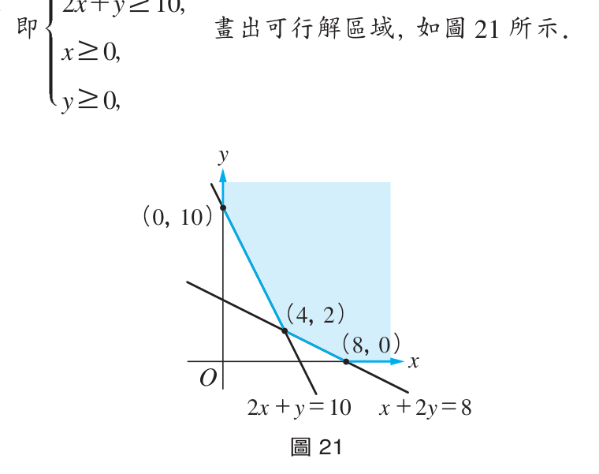 
      <b>圖 21：成本可行解區域</b>
    </td>
  </tr>
</table>
:::

**[隨堂練習 6]**
甲、乙兩工廠生產 $A, B$ 兩種產品：
- 甲廠每天生產 $A$ 產品 $4$ 公噸、$B$ 產品 $2$ 公噸，成本 $10000$ 元；
- 乙廠每天生產 $A$ 產品 $2$ 公噸、$B$ 產品 $7$ 公噸，成本 $20000$ 元。
訂單需求 $A$ 至少 $16$ 公噸、$B$ 至少 $20$ 公噸。各運轉幾天可使成本最低？

👉 [💡 查看隨堂練習解答](14_選修數學乙(下)_隨堂練習參考解答.md#p20-隨堂練習)
:::

---

## 📝 習題 1

[📖 查看習題完整解答與詳細解析](15_選修數學乙(下)_習題參考解答.md#ch-1-線性規劃習題解答)

### 一、基本題
1. 在坐標平面上畫出聯立不等式 $\begin{cases} 3x + 2y - 12 \le 0 \\ x + y - 2 > 0 \end{cases}$ 的圖形。
2. 若二元一次聯立不等式的解集合如下圖紅色區域所示，試寫出此聯立不等式。
   
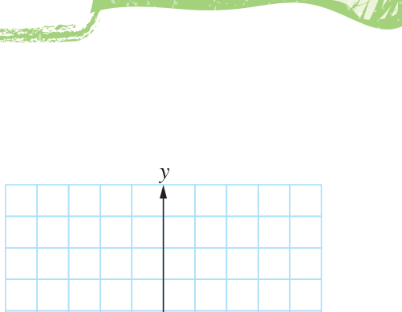

3. 已知直線 $L_1: 2x - y = 1$，$L_2: 2x - y = 3$：
   - (1) 若 $L_1$ 向右平移 $k$ 單位得 $L_2$，則 $k$ 值為何？
   - (2) 若 $L_2$ 向上平移 $h$ 單位得 $L_1$，則 $h$ 值為何？
4. 下圖為 $A, B, C, D$ 四點及直線 $L: x - 2y = 0$，將四點代入 $x - 2y = k$，哪一點所得 $k$ 值最大？
   
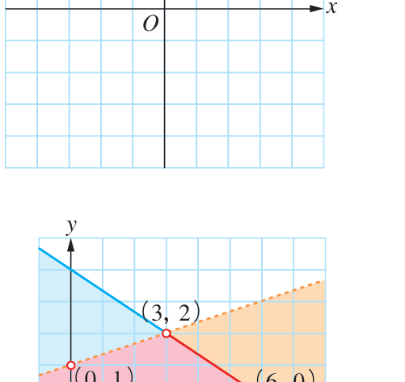

5. 已知 $x, y$ 為整數，滿足 $\begin{cases} 3x + 2y \le 6 \\ x \ge 0, y \ge 0 \end{cases}$ 的 $(x, y)$ 共有幾組？

---

### 二、進階題
6. 設 $L_1: ax + by = c_1, L_2: ax + by = c_2, L_3: ax + by = c_3$，若 $a < 0$：
   - (1) $b$ 是正數或負數？
   - (2) $c_1, c_2, c_3$ 的大小關係為何？
   
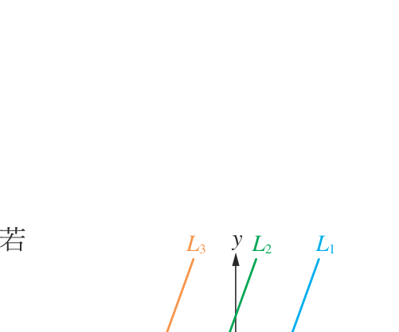

7. 下圖為正六邊形 $ABCDEF$，若直線 $L: 3x - 2y - k = 0$，通過哪一個頂點時 $k$ 值最大？
   
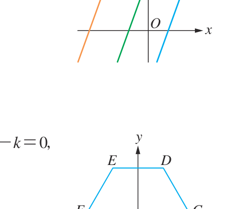

8. 某公司有甲、乙兩貨倉，儲存原料各 $50, 60$ 公噸。接到 $A, B$ 工廠各訂購 $40, 50$ 公噸。各倉運費如下表，如何運送運費最少？

| 運費 | $A$ 工廠 | $B$ 工廠 |
| :---: | :---: | :---: |
| **貨倉甲** | $500$ 元 | $600$ 元 |
| **貨倉乙** | $650$ 元 | $700$ 元 |

9. 如圖，可行解區域為 $\triangle ABC$ 及其內部，目標函數為 $x + ky$，且在 $(5, 3)$ 與 $(7, 7)$ 同時達到最大值，求 $k$ 值。
   
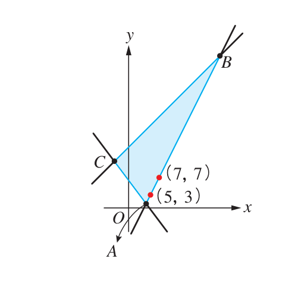

---

### 三、素養題
10. 為預防禽流感，雞場每天必須提供至少 $84$ 單位營養素 $A$、至少 $72$ 單位營養素 $B$、至少 $60$ 單位營養素 $C$。
- 第一種飼料每公斤 $5$ 元，含營養素 $A, B, C$ 各 $7, 3, 3$ 單位；
- 第二種飼料每公斤 $4$ 元，含營養素 $A, B, C$ 各 $2, 6, 2$ 單位。
設使用第一種飼料 $x$ 公斤、第二種飼料 $y$ 公斤：
1. 寫下 $x, y$ 滿足的聯立不等式。
2. 寫出最低飼料成本的目標函數。
3. 最少的飼料成本為多少元？

👉 [查看習題詳細參考解答](15_選修數學乙(下)_習題參考解答.md#ch-1-線性規劃習題解答)

---

[⬅️ 上一頁：編輯大意與目次](01_選修數學乙(下)_編輯大意與目次.md) ｜ [🔝 回到頂端](#) ｜ [📚 目錄總覽](README.md) ｜ [下一頁：第 1 章學習活動 ➡️](03_選修數學乙(下)_CH1_學習活動.md)

