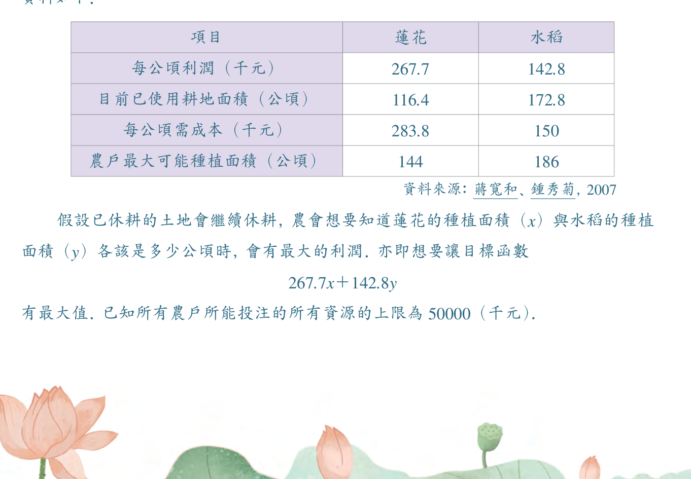

# 🌸 第 1 章 學習活動：白河鎮的蓮花

[📚 目錄總覽](README.md) ｜ [⏮️ 第一頁](01_選修數學乙(下)_編輯大意與目次.md) ｜ [⬅️ 上一頁：1 線性規劃](02_選修數學乙(下)_CH1_線性規劃.md) ｜ [下一頁：數學家小傳（丹齊格） ➡️](04_選修數學乙(下)_CH1_數學家小傳_丹齊格.md) ｜ [⏭️ 最終頁](15_選修數學乙(下)_習題參考解答.md)

---

> [!NOTE]
> **章節快速跳轉**：
> - **Ch 1 線性規劃**：[1 線性規劃](02_選修數學乙(下)_CH1_線性規劃.md) ｜ **第 1 章學習活動** ｜ [數學家小傳（丹齊格）](04_選修數學乙(下)_CH1_數學家小傳_丹齊格.md)
> - **Ch 2 複數與多項式方程式**：[2-1 複數](05_選修數學乙(下)_CH2-1_複數.md) ｜ [2-2 多項式方程式](06_選修數學乙(下)_CH2-2_多項式方程式.md) ｜ [第 2 章學習活動](07_選修數學乙(下)_CH2_學習活動.md) ｜ [第 2 章綜合演練](08_選修數學乙(下)_CH2_綜合演練.md) ｜ [數學家小傳（阿貝爾）](09_選修數學乙(下)_CH2_數學家小傳_阿貝爾.md)
> - **Ch 3 機率統計**：[3-1 離散型隨機變數](10_選修數學乙(下)_CH3-1_離散型隨機變數.md) ｜ [3-2 二項分布](11_選修數學乙(下)_CH3-2_二項分布.md) ｜ [第 3 章學習活動](12_選修數學乙(下)_CH3_學習活動.md) ｜ [第 3 章綜合演練](13_選修數學乙(下)_CH3_綜合演練.md)
> - **參考資料**：[隨堂練習參考解答](14_選修數學乙(下)_隨堂練習參考解答.md) ｜ [習題參考解答](15_選修數學乙(下)_習題參考解答.md)

---

[TOC]

---

## 🌾 活動背景：白河蓮花產業的轉型與規劃

在這個學習活動中，我們利用本章所學的**線性規劃**來分析一個真實世界中的在地農業決策實例。

約三十年前，臺南縣白河鎮（現為臺南市白河區）開始大量栽種蓮花，成為臺灣最知名的「蓮花之鄉」。全盛時期種植面積高達四百五十公頃，占全國的三分之二。每一公頃的蓮子與藕粉產值近一百萬新臺幣，成為白河鎮極為重要的經濟命脈。

1995 年更開辦白河蓮花節，每年吸引大量觀光遊客。然而隨著其他鄉鎮紛紛推出特色農產節慶，白河蓮花的種植面積也逐漸下滑，現在只約有兩百公頃。

當地農民的土地利用主要有三種選擇：**種植蓮花**、**種植水稻**，或者**休耕**。

根據 2007 年農會調查所得的農作統計資料如下：

  

### 📊 農業經濟數據對照表

| 項目 | 蓮花 | 水稻 |
| :--- | :---: | :---: |
| **每公頃利潤（千元）** | $267.7$ | $142.8$ |
| **目前已使用耕地面積（公頃）** | $116.4$ | $172.8$ |
| **每公頃所需成本（千元）** | $283.8$ | $150$ |
| **農戶最大可能種植面積（公頃）** | $144$ | $186$ |

> *資料來源：蔣寬和、鍾秀菊，2007*

---

## 🎯 決策問題與數學建模

假設原本已休耕的土地在短期內繼續維持休耕狀態，農會管理部門想要知道：
> **蓮花的種植面積（令為 $x$ 公頃）與水稻的種植面積（令為 $y$ 公頃）各該規劃為多少公頃時，全區能獲取最大的總利潤？**

### 1. 目標函數 (Objective Function)
想要讓農民總利潤 $P(x, y)$ 達到最大：
$$P(x, y) = 267.7x + 142.8y \quad (\text{單位：千元})$$

### 2. 資源與限制條件 (Constraints)
- 全體農戶所能投注的所有生產資源成本上限為 $50,000$（千元）。
- 原有可耕地與農戶種植能力上限如表格所示。

---

## ✍️ 同學想一想 (思考與演算)

:::info [問題 1：列出限制條件]
分別按照下列提示，寫出該線性規劃問題的所有限制式：
1. **蓮花的種植面積為非負，且有上限**：
   $$0 \le x \le 144$$
2. **水稻的種植面積為非負，且有上限**：
   $$0 \le y \le 186$$
3. **兩者種植面積總和有上限**（以目前已使用總耕地 $116.4 + 172.8 = 289.2$ 公頃為限）：
   $$x + y \le 289.2$$
4. **成本不能超過總預算**（每公頃蓮花成本 $283.8$ 千元、水稻 $150$ 千元，總預算 $50000$ 千元）：
   $$283.8x + 150y \le 50000$$
:::

:::success [問題 2：求解最佳規劃面積]
試就上述條件與目標函數解此線性規劃問題。當獲得最大利潤時，蓮花與水稻的種植面積各是多少公頃？（四捨五入至整數位）

**【提示與分析】**
1. 在坐標平面上畫出由四個不等式所圍成的可行解多邊形區域（凸多邊形）。
2. 求出可行解區域的所有頂點坐標。
3. 利用**頂點法**或**平行線法**，將各頂點代入目標函數 $P(x, y) = 267.7x + 142.8y$，比較其大小求出最大值！

👉 [點此查看習題解答中相關線性規劃詳細作圖與頂點驗證](15_選修數學乙(下)_習題參考解答.md#ch1-學習活動參考解)
:::

---

## 🚀 數學之用：從二維到多維空間

由這些精確的數學計算，農會就可以依據數據對未來的土地利用做出科學規劃，並與農民溝通協調種植面積，以期獲得最佳經濟效益。

> [!TIP]
> **延伸思考：三個變數的線性規劃**
> 
> 上述模型是調整種蓮花或水稻的面積，暫時假定休耕土地維持現狀。
> 
> 但在實際的農業經濟學分析中，休耕土地亦有政府補助款與轉作其他作物的彈性，必須一併納入整體考量。此時，我們需要同時考慮蓮花 ($x$)、水稻 ($y$) 與休耕 ($z$) 三個變數的線性規劃：
> 
> 仿照平面（二維）中利用平行直線掃過可行凸多邊形邊界求極值的情形，在三維空間中，三個變數的線性規劃是**利用一個平面平行掃過而碰觸空間中的一個凸多面體可行解區域**。
> 
> 當變數擴展到數十個甚至數千個時，空間幾何無法直接繪製，但透過丹齊格發明的**單體法（Simplex Method）**與現代電腦演算法，依然能精確高效地求出最佳解！

---

[⬅️ 上一頁：1 線性規劃](02_選修數學乙(下)_CH1_線性規劃.md) ｜ [🔝 回到頂端](#) ｜ [📚 目錄總覽](README.md) ｜ [下一頁：數學家小傳（丹齊格） ➡️](04_選修數學乙(下)_CH1_數學家小傳_丹齊格.md)

