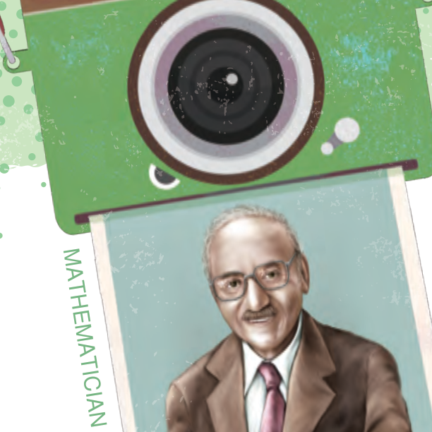

# 👨‍🏫 數學家小傳：丹齊格 (George Bernard Dantzig)

[📚 目錄總覽](README.md) ｜ [⏮️ 第一頁](01_選修數學乙(下)_編輯大意與目次.md) ｜ [⬅️ 上一頁：第 1 章學習活動](03_選修數學乙(下)_CH1_學習活動.md) ｜ [下一頁：2-1 複數 ➡️](05_選修數學乙(下)_CH2-1_複數.md) ｜ [⏭️ 最終頁](15_選修數學乙(下)_習題參考解答.md)

---

> [!NOTE]
> **章節快速跳轉**：
> - **Ch 1 線性規劃**：[1 線性規劃](02_選修數學乙(下)_CH1_線性規劃.md) ｜ [第 1 章學習活動](03_選修數學乙(下)_CH1_學習活動.md) ｜ **數學家小傳（丹齊格）**
> - **Ch 2 複數與多項式方程式**：[2-1 複數](05_選修數學乙(下)_CH2-1_複數.md) ｜ [2-2 多項式方程式](06_選修數學乙(下)_CH2-2_多項式方程式.md) ｜ [第 2 章學習活動](07_選修數學乙(下)_CH2_學習活動.md) ｜ [第 2 章綜合演練](08_選修數學乙(下)_CH2_綜合演練.md) ｜ [數學家小傳（阿貝爾）](09_選修數學乙(下)_CH2_數學家小傳_阿貝爾.md)
> - **Ch 3 機率統計**：[3-1 離散型隨機變數](10_選修數學乙(下)_CH3-1_離散型隨機變數.md) ｜ [3-2 二項分布](11_選修數學乙(下)_CH3-2_二項分布.md) ｜ [第 3 章學習活動](12_選修數學乙(下)_CH3_學習活動.md) ｜ [第 3 章綜合演練](13_選修數學乙(下)_CH3_綜合演練.md)
> - **參考資料**：[隨堂練習參考解答](14_選修數學乙(下)_隨堂練習參考解答.md) ｜ [習題參考解答](15_選修數學乙(下)_習題參考解答.md)

---

  
  <h3>丹齊格</h3>
  
<b>George Bernard Dantzig（1914 ～ 2005）</b> 
  <i>美國應用數學家、「線性規劃之父」</i>

---

## 🌟 生平與背景

美國應用數學家。丹齊格的父親原本是俄羅斯的猶太裔數學家，曾在法國學習，結婚後移民美國。中學時期丹齊格對幾何充滿興趣，父親也不時提攜他，引導他學習射影幾何中複雜的空間問題。

丹齊格原本在加州大學柏克萊分校（UC Berkeley）攻讀博士學位，但因第二次世界大戰的爆發而中斷。他擔任美國空軍總部的統計控制戰鬥分析處主任，負責解決軍隊中龐大的後勤補給與人員管理問題。

這份工作帶給他來自真實世界的大規模排程與資源分配問題，而他所開創的方法就是**線性規劃（Linear Programming）**。

戰後，丹齊格回到柏克萊大學完成博士學位，並於 1947 年發明了著名的**單體法（Simplex Method）**。配合戰後電子計算機（電腦）蓬勃發展的大量運算功能，成功解決了現實世界中許多大規模的最佳化問題。例如：
- **民航與航空業**：如何安排大量的飛機航程、機組員班表，在有限的時間與空間限制中運送最多的旅客與貨物。
- **煉油與石化業**：選擇煉油廠的最佳設廠位址，以及規劃不同用途管線的輸油路徑與產能配比，以達成最大經濟效益。
- **供應鏈物流**：全國性倉儲調度、原料採購與庫存控制的最佳化決策。

---

## 💡 黑板上未解的習題：激勵人心的傳奇

丹齊格在柏克萊求學時代，流傳著一則非常著名且勵志的故事：

有一天他上統計學家耶日·內曼（Jerzy Neyman）教授的課遲到了。走進教室時，教授已經在黑板上寫了兩道問題。丹齊格以為那是教授留給全班的課後家庭作業，便匆匆抄在筆記本上。

回家演算時，丹齊格覺得這兩道題目「比平常的習題稍微難了一點點」，花了好幾天的功夫苦思冥想，但最終還是做出來了，並在幾天後敲開教授辦公室的門把解答交了上去。

不料幾個星期後的一個清晨，內曼教授興奮地衝到丹齊格家敲門，激動地告訴他：
> **「你解開了統計學歷史上兩個長久未解的著名難題！」**

原來黑板上的題目根本不是作業，而是當時統計學界的懸案。內曼教授甚至直接將丹齊格對這兩道難題的解答整理成論文，作為丹齊格的博士畢業論文。

這則傳奇故事後來廣泛流傳，甚至成為電影《心靈捕手》（Good Will Hunting）的靈感來源之一。它成為正向思考的經典範例：**不給自己預設限制，勇於面對看似艱難的挑戰，堅持到底，往往能激發出意想不到的潛力與成就！**

---

[⬅️ 上一頁：第 1 章學習活動](03_選修數學乙(下)_CH1_學習活動.md) ｜ [🔝 回到頂端](#) ｜ [📚 目錄總覽](README.md) ｜ [下一頁：2-1 複數 ➡️](05_選修數學乙(下)_CH2-1_複數.md)

