# 🌀 第 2 章 複數與多項式方程式
## 2-1 複數

[📚 目錄總覽](README.md) ｜ [⏮️ 第一頁](01_選修數學乙(下)_編輯大意與目次.md) ｜ [⬅️ 上一頁：數學家小傳（丹齊格）](04_選修數學乙(下)_CH1_數學家小傳_丹齊格.md) ｜ [下一頁：2-2 多項式方程式 ➡️](06_選修數學乙(下)_CH2-2_多項式方程式.md) ｜ [⏭️ 最終頁](15_選修數學乙(下)_習題參考解答.md)

---

> [!NOTE]
> **章節快速跳轉**：
> - **Ch 1 線性規劃**：[1 線性規劃](02_選修數學乙(下)_CH1_線性規劃.md) ｜ [第 1 章學習活動](03_選修數學乙(下)_CH1_學習活動.md) ｜ [數學家小傳（丹齊格）](04_選修數學乙(下)_CH1_數學家小傳_丹齊格.md)
> - **Ch 2 複數與多項式方程式**：**2-1 複數** ｜ [2-2 多項式方程式](06_選修數學乙(下)_CH2-2_多項式方程式.md) ｜ [第 2 章學習活動](07_選修數學乙(下)_CH2_學習活動.md) ｜ [第 2 章綜合演練](08_選修數學乙(下)_CH2_綜合演練.md) ｜ [數學家小傳（阿貝爾）](09_選修數學乙(下)_CH2_數學家小傳_阿貝爾.md)
> - **Ch 3 機率統計**：[3-1 離散型隨機變數](10_選修數學乙(下)_CH3-1_離散型隨機變數.md) ｜ [3-2 二項分布](11_選修數學乙(下)_CH3-2_二項分布.md) ｜ [第 3 章學習活動](12_選修數學乙(下)_CH3_學習活動.md) ｜ [第 3 章綜合演練](13_選修數學乙(下)_CH3_綜合演練.md)
> - **參考資料**：[隨堂練習參考解答](14_選修數學乙(下)_隨堂練習參考解答.md#ch-2-1-複數) ｜ [習題參考解答](15_選修數學乙(下)_習題參考解答.md#ch-2-1-複數習題解答)

---

[TOC]

---

## 🌟 章首引言與歷史淵源

數線上的每一個點都對應到一個實數，然而並不是每個方程式都有實數解，例如我們找不到實數 $x$ 滿足 $x^2 = -1$。

到了十六世紀，義大利的學者卡當諾（Girolamo Cardano，1501～1576）在 1545 年出版的《大術》（*Ars Magna*）一書中研究方程式解法時發現了複數。他在書中提出一個問題：**能否找到兩個數，其和為 $10$、積為 $40$？**

<table style="border: none; width: 100%;">
  <tr style="border: none;">
    <td style="border: none; vertical-align: top; width: 70%;">
      設這兩數為 $x$ 與 $10 - x$，則：
      $$x(10 - x) = 40 \implies x^2 - 10x + 40 = 0$$
      配方法得：
      $$(x - 5)^2 = -15$$
      因為實數的平方不可能為負數，故該問題沒有實數解。但卡當諾形式上給出了答案：
      $$5 + \sqrt{-15} \quad \text{與} \quad 5 - \sqrt{-15}$$
      這兩個形式解雖然不是實數，但若按照一般運算規則：
      $$(5 + \sqrt{-15}) + (5 - \sqrt{-15}) = 10$$
      $$(5 + \sqrt{-15})(5 - \sqrt{-15}) = 25 - (-15) = 40$$
      乘積竟然恰好等於 $40$！這樣的數，就是本節所要引進的<b>複數</b>。
    </td>
    <td style="border: none; text-align: center; vertical-align: top; width: 30%;">
      
       
      <b>圖 1：卡當諾 (Cardano)</b>
    </td>
  </tr>
</table>

有了複數之後，高斯進一步證明了：**任何一個複係數 $n$ 次方程式在複數系中必恰有 $n$ 個根**（代數基本定理）。

---

## 1. 虛數單位 $i$ 代表 $\sqrt{-1}$

滿足 $f(x) = 0$ 的 $x$ 值稱為方程式的解或根。對於方程式 $x^2 + 1 = 0$，由 $x^2 = -1$ 得 $x = \pm\sqrt{-1}$。

:::info [虛數單位 $i$ 的定義]
1. 規定記號 $i = \sqrt{-1}$，滿足：
   $$i^2 = -1$$
2. 若 $a$ 為正實數（$a > 0$），則規定：
   $$\sqrt{-a} = \sqrt{a}i$$
:::

:::success [例題 1：一元二次方程式的虛數解]
試求下列各一元二次方程式的解：
1. $x^2 + 3 = 0$
2. $x^2 + 5 = 0$

**【解】**
1. 由 $x^2 + 3 = 0 \implies x^2 = -3 \implies x = \pm\sqrt{-3} = \pm\sqrt{3}i$。
2. 由 $x^2 + 5 = 0 \implies x^2 = -5 \implies x = \pm\sqrt{-5} = \pm\sqrt{5}i$。
:::

:::warning [隨堂練習 1]
試求 $x^2 + 6 = 0$ 的解。

👉 [💡 查看隨堂練習解答](14_選修數學乙(下)_隨堂練習參考解答.md#p31-隨堂練習)
:::

---

## 2. 複數與複數平面

### 複數的定義與標準式
:::info [定義：複數 (Complex Number)]
設 $a, b$ 為實數，$i = \sqrt{-1}$，則可表為如下形式的數稱為**複數**：
$$z = a + bi$$
- $a$ 稱為此複數的**實部 (Real Part)**，記作 $\mathrm{Re}(z) = a$。
- $b$ 稱為此複數的**虛部 (Imaginary Part)**，記作 $\mathrm{Im}(z) = b$。
- 全體複數所形成的集合記為 $\mathbb{C}$。
:::

  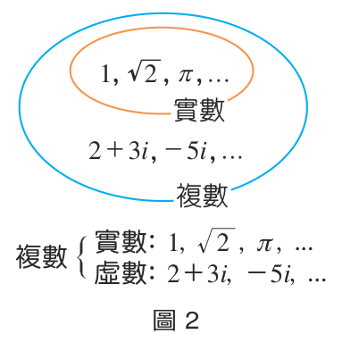
   
  <b>圖 2：數的體系擴充（實數包含於複數之中）</b>

- 當 $b \neq 0$ 時，稱為**虛數**。
- 當 $a = 0$ 且 $b \neq 0$ 時，形如 $bi$，稱為**純虛數**。
- 當 $b = 0$ 時，複數即為實數 $a$。因此，**實數是複數的一部分**，複數是數系的完備擴充。

### 複數的相等
:::info [複數相等]
若 $a, b, c, d$ 為實數，$z = a + bi$，$w = c + di$，則：
$$z = w \iff a = c \text{ 且 } b = d$$
即**實部等於實部，且虛部等於虛部**。
:::

:::warning [隨堂練習 2]
設 $a, b$ 為實數。若複數 $a - (a + 3)i = (b + 1) + bi$，試求 $a, b$ 的值。

👉 [💡 查看隨堂練習解答](14_選修數學乙(下)_隨堂練習參考解答.md#p32-隨堂練習)
:::

---

### 複數平面 (高斯平面，Complex Plane)
數線上的每一點對應一個實數；類似地，我們將複數 $z = a + bi$ 的實部和虛部組成有序數對 $(a, b)$，對應到平面直角坐標系上的點 $(a, b)$。

用來表示所有複數的平面稱為**複數平面（高斯平面）**：
- 橫軸上的點虛部為 $0$，稱為**實軸 (Real Axis)**。
- 縱軸上的點（原點除外）實部為 $0$，稱為**虛軸 (Imaginary Axis)**。

  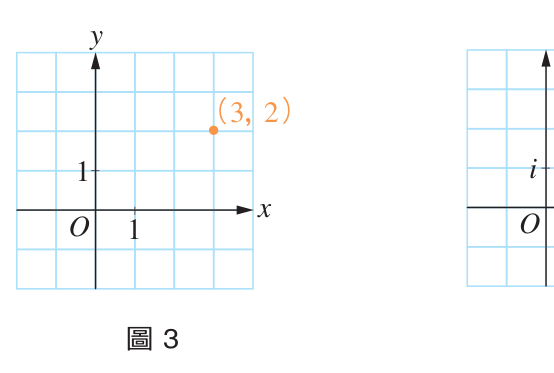
  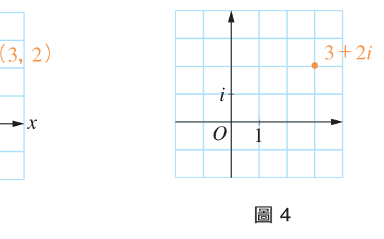
   
  <b>圖 3、圖 4：點 $(3, 2)$ 與複數 $3 + 2i$ 在複數平面上的對應</b>

:::success [例題 2：複數平面的點坐標]
1. 如圖 5 所示，寫出 $A, B, C, D$ 所代表的複數。
2. 在複數平面上描繪出下列複數：$z_1 = -3 + 4i, z_2 = -5 - 2i, z_3 = -2i, z_4 = \sqrt{5}$。

  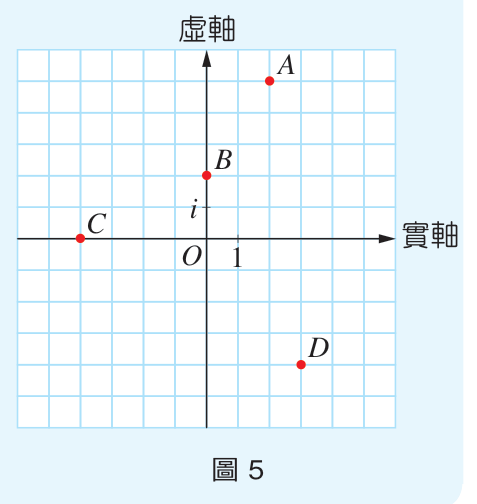
  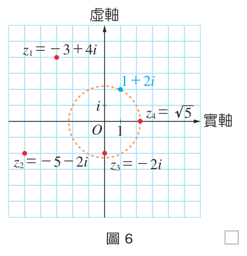
   
  <b>圖 5：複數點辨識 ｜ 圖 6：描繪複數位置</b>

**【解】**
1. $A(2, 5) \implies 2 + 5i$；$B(0, 2) \implies 2i$；$C(-4, 0) \implies -4$；$D(3, -4) \implies 3 - 4i$。
2. 描點如圖 6 所示。
:::

:::warning [隨堂練習 3]
1. 寫出圖 7 中 $A, B, C, D$ 所代表的複數。
2. 在圖 8 的複數平面上描繪：$z_1 = 1 - i$、$z_2 = \frac{1}{2} + \frac{\sqrt{3}}{2}i$、$z_3 = \sqrt{2}i$、$z_4 = -1$。

  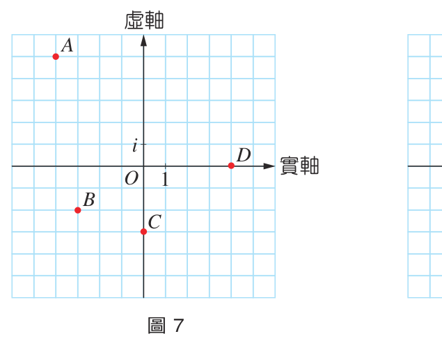
  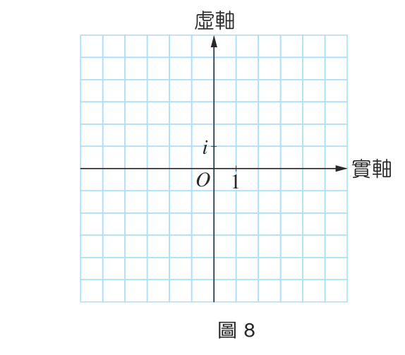
   
  <b>圖 7、圖 8：複數描點練習</b>

👉 [💡 查看隨堂練習解答](14_選修數學乙(下)_隨堂練習參考解答.md#p34-隨堂練習)
:::

---

### 共軛複數 (Complex Conjugate)
:::info [共軛複數]
設 $a, b$ 為實數，$z = a + bi$，將 $a - bi$ 稱為 $z$ 的**共軛複數**，記為 $\bar{z}$：
$$\bar{z} = \overline{a + bi} = a - bi$$
在複數平面上，$\bar{z}$ 的幾何位置即為將 $z$ **對實軸作線對稱（鏡射）**而得。
:::

  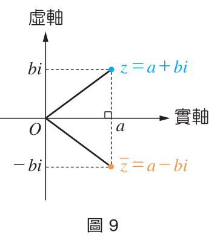
   
  <b>圖 9：共軛複數對實軸的鏡射關係</b>

- 性質：$\overline{\bar{z}} = z$（共軛兩次回到自身）。

:::warning [隨堂練習 4]
求下列各複數的共軛複數：
1. $2 - 5i$
2. $2 + 5i$
3. $3i$

👉 [💡 查看隨堂練習解答](14_選修數學乙(下)_隨堂練習參考解答.md#p35-隨堂練習)
:::

---

## 3. 複數的四則運算與其幾何意義

設 $z_1 = a + bi$，$z_2 = c + di$（$a, b, c, d \in \mathbb{R}$）：

### (1) 加法與減法（向量平行四邊形法則）
- **加法**：$z_1 + z_2 = (a + c) + (b + d)i$
- **減法**：$z_1 - z_2 = (a - c) + (b - d)i$

  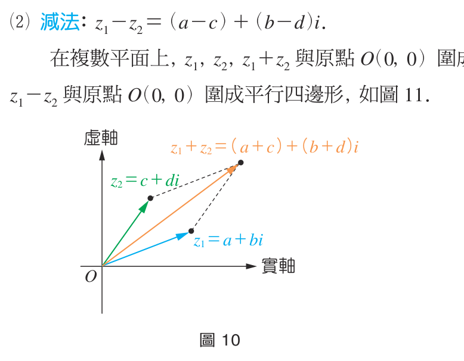
  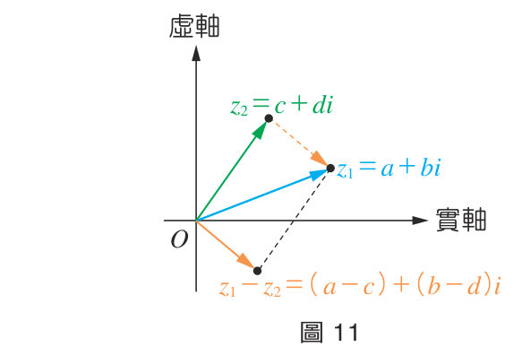
   
  <b>圖 10：複數加法平行四邊形法則 ｜ 圖 11：複數減法向量差</b>

複數加減法在複數平面上的位置，完全等價於平面向量的加法與減法運算：
$$z_1 \leftrightarrow \vec{v}_1 = (a, b), \quad z_2 \leftrightarrow \vec{v}_2 = (c, d) \implies z_1 + z_2 \leftrightarrow \vec{v}_1 + \vec{v}_2 = (a+c, b+d)$$

:::warning [隨堂練習 5]
設 $z_1 = 3 + 2i, z_2 = 2 - 4i$，求 $z_1 + z_2$ 與 $z_1 - z_2$。

👉 [💡 查看隨堂練習解答](14_選修數學乙(下)_隨堂練習參考解答.md#p36-隨堂練習)
:::

---

### (2) 乘法與乘法分配律
利用分配律並將 $i^2 = -1$ 代入：
$$(a + bi)(c + di) = (ac - bd) + (ad + bc)i$$

:::success [例題 3：複數乘法]
計算下列各式：
1. $(4 + 3i)(2 - i) = 8 - 4i + 6i - 3i^2 = 11 + 2i$
2. $(2 + 3i)(2 - 3i) = 2^2 - (3i)^2 = 4 + 9 = 13$
3. $(1 + i)^4 = [(1 + i)^2]^2 = (2i)^2 = -4$
:::

:::warning [隨堂練習 6]
計算下列各式：
1. $-5i(2 + 5i)$
2. $(2 - 5i)(2 + 5i)$
3. $(1 - i)^{10}$

👉 [💡 查看隨堂練習解答](14_選修數學乙(下)_隨堂練習參考解答.md#p37-隨堂練習)
:::

---

### (3) $i$ 的高次方週期性
虛數單位 $i$ 具有長度為 $4$ 的週期循環特性：
$$i^1 = i, \quad i^2 = -1, \quad i^3 = -i, \quad i^4 = 1$$
一般地，對任何整數 $k$：
$$i^{4k+1} = i, \quad i^{4k+2} = -1, \quad i^{4k+3} = -i, \quad i^{4k} = 1$$
連續四個次方的和恆為零：$i + i^2 + i^3 + i^4 = 0$。

:::warning [隨堂練習 7]
1. 化簡 $i^{17}$。
2. 化簡 $1 + i + i^2 + i^3 + \dots + i^{20}$。

👉 [💡 查看隨堂練習解答](14_選修數學乙(下)_隨堂練習參考解答.md#p38-上-隨堂練習)
:::

:::info [重要性質：複數與共軛相加與相乘]
設 $z = a + bi$：
1. $z + \bar{z} = (a + bi) + (a - bi) = 2a \in \mathbb{R}$（必為實數，等於兩倍實部）
2. $z\bar{z} = (a + bi)(a - bi) = a^2 + b^2 \ge 0$（必為非負實數）
:::

---

### (4) 除法與分母有理化
當 $z_2 = c + di \neq 0$ 時，分子分母同乘分母的共軛複數 $\bar{z}_2 = c - di$：
$$\frac{z_1}{z_2} = \frac{a + bi}{c + di} = \frac{(a + bi)(c - di)}{(c + di)(c - di)} = \frac{(ac + bd) + (bc - ad)i}{c^2 + d^2} = \frac{ac + bd}{c^2 + d^2} + \frac{bc - ad}{c^2 + d^2}i$$

:::success [例題 4：複數除法化簡]
計算下列各式：
1. $\frac{1}{2 - i} = \frac{2 + i}{(2 - i)(2 + i)} = \frac{2 + i}{5} = \frac{2}{5} + \frac{1}{5}i$
2. $\frac{1 + i}{2 - 4i} = \frac{(1 + i)(2 + 4i)}{2^2 + 4^2} = \frac{-2 + 6i}{20} = -\frac{1}{10} + \frac{3}{10}i$
:::

:::warning [隨堂練習 8]
計算下列各式：
1. $\frac{1}{2 + i}$
2. $\frac{1 - i}{4 + 3i}$

👉 [💡 查看隨堂練習解答](14_選修數學乙(下)_隨堂練習參考解答.md#p40-隨堂練習)
:::

---

### (5) 共軛複數的四則運算性質
:::info [共軛複數之運算分配性]
對任意複數 $z, w$：
1. $\overline{z + w} = \bar{z} + \bar{w}$
2. $\overline{z - w} = \bar{z} - \bar{w}$
3. $\overline{zw} = \bar{z} \cdot \bar{w}$
4. $\overline{\left(\frac{z}{w}\right)} = \frac{\bar{z}}{\bar{w}} \quad (w \neq 0)$
5. $\overline{z^n} = (\bar{z})^n \quad (n \in \mathbb{N})$
:::

---

## 4. 複數的絕對值 (Modulus)

:::info [複數絕對值的定義]
對於複數 $z = a + bi$，其在複數平面上與原點 $O(0, 0)$ 的距離稱為 $z$ 的**絕對值（模長）**，記為 $|z|$：
$$|z| = \sqrt{a^2 + b^2}$$
:::

  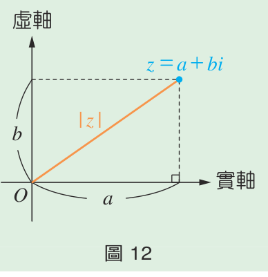
   
  <b>圖 12：絕對值 $|z|$ 即為點到原點的距離</b>

### 模長的代數性質
1. $z\bar{z} = |z|^2$
2. $|z_1 z_2| = |z_1| |z_2|$
3. $\left|\frac{z_1}{z_2}\right| = \frac{|z_1|}{|z_2|} \quad (z_2 \neq 0)$
4. $|\bar{z}| = |z|$

:::success [例題 5：模長計算]
若 $z = 3 + 4i$，$w = 5 + 12i$，求：
1. $|z| = \sqrt{3^2 + 4^2} = 5$，$|\bar{z}| = 5$
2. $z\bar{z} = |z|^2 = 25$
3. $|zw| = |z||w| = 5 \times 13 = 65$
4. $\left|\frac{z}{w}\right| = \frac{|z|}{|w|} = \frac{5}{13}$
:::

---

### 三角不等式 (Triangle Inequality)
由平面上三角形兩邊之和大於第三邊、兩邊之差小於第三邊的幾何關係：

  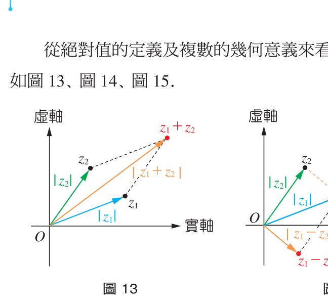
  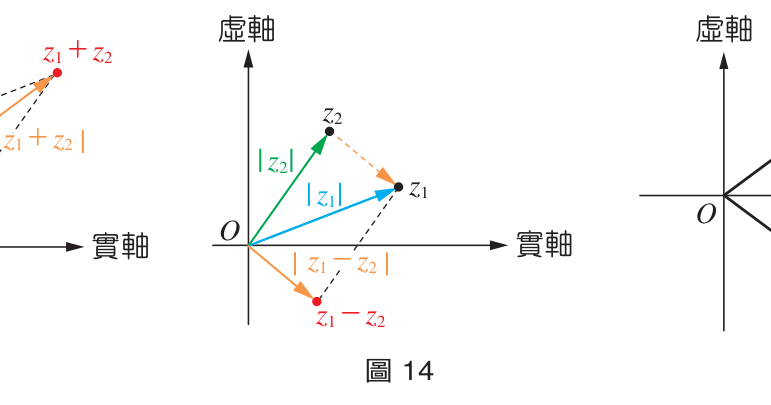
  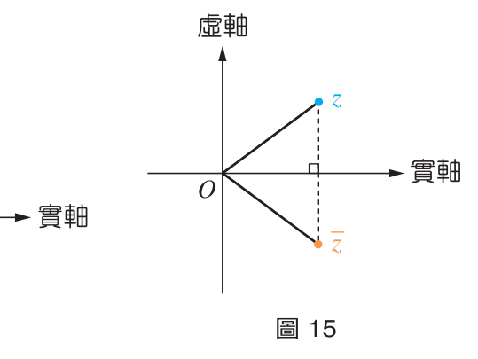
   
  <b>圖 13：$|z_1 + z_2| \le |z_1| + |z_2|$ ｜ 圖 14：$|z_1 - z_2|$ ｜ 圖 15：$|\bar{z}| = |z|$</b>

:::info [三角不等式]
對任意兩複數 $z_1, z_2$：
$$||z_1| - |z_2|| \le |z_1 \pm z_2| \le |z_1| + |z_2|$$
等號成立當且僅當原點 $O$ 與 $z_1, z_2$ 在同一直線上（同向或反向）。
:::

---

### 複數平面上的幾何圖形
1. **兩點距離**：$|z_1 - z_2|$ 表複數平面上 $z_1$ 與 $z_2$ 兩點間的直線距離（圖 16）。
2. **圓的方程式**：$|z - z_0| = r$ 表以 $z_0$ 為圓心、$r$ 為半徑的圓（圖 17、圖 18）。
3. **垂直平分線**：$|z - z_1| = |z - z_2|$ 表到 $z_1$ 與 $z_2$ 等距離的所有點軌跡，即連線段的垂直平分線（圖 19）。

  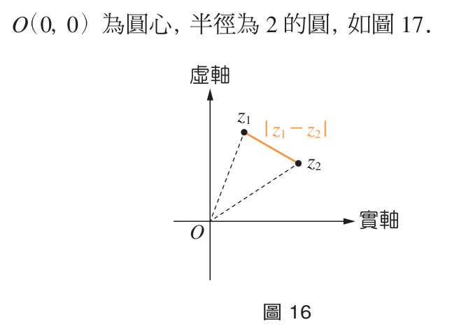
  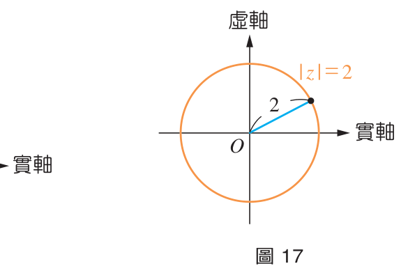 
  <b>圖 16：兩點距離 $|z_1 - z_2|$ ｜ 圖 17：圓 $|z| = 2$</b>  
  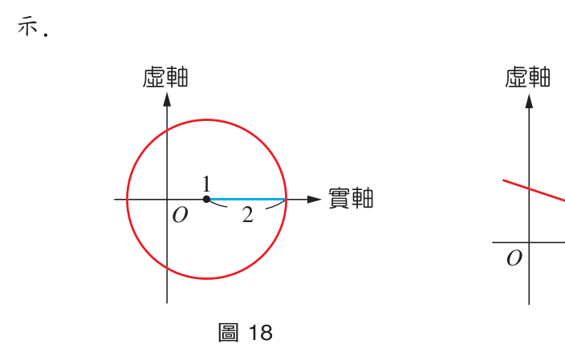
  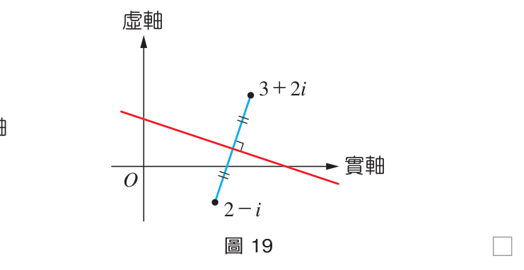 
  <b>圖 18：圓 $|z - 1| = 2$ ｜ 圖 19：垂直平分線 $|z - (2-i)| = |z - (3+2i)|$</b>

:::success [例題 6：軌跡方程式判讀]
求下列各式在複數平面上的圖形：
1. $|z - 1| = 2$ $\implies$ 以點 $1$ 為圓心、$2$ 為半徑的圓。
2. $|z - 2 + i| = |z - 3 - 2i| \implies |z - (2 - i)| = |z - (3 + 2i)|$ $\implies$ 點 $2 - i$ 與 $3 + 2i$ 連線段的垂直平分線。
:::

:::warning [隨堂練習 9]
求滿足下列各式的複數圖形：
1. $|z - 1 - i| = 2$
2. $\frac{|z + i|}{|z - i|} = 1$

👉 [💡 查看隨堂練習解答](14_選修數學乙(下)_隨堂練習參考解答.md#p45-隨堂練習)
:::

---

## 📝 習題 2-1

[📖 查看習題完整解答與詳細解析](15_選修數學乙(下)_習題參考解答.md#ch-2-1-複數習題解答)

### 一、基本題
1. 試解下列各方程式：
   - (1) $x^2 + 4 = 0$
   - (2) $x^4 - 16 = 0$
2. 已知兩複數 $z_1 = 2 + 3i, z_2 = 4 - 5i$，試求：
   - (1) $z_1 + z_2$
   - (2) $2z_1 - 3z_2$
   - (3) $|z_1 z_2|$
   - (4) $\frac{z_1}{z_2}$
3. 若 $a, b$ 為實數，且 $\frac{3 - i}{a - bi} = 1 + i$，試求 $a + bi$ 的值。
4. 複數平面上，試畫出所有滿足 $|z - 2 - i| = 3$ 的點所成的圖形。
5. 試求 $1 + i + i^2 + \dots + i^{99}$ 的值。

---

### 二、進階題
6. 已知複數 $z$ 滿足 $|z - \bar{z}| = 6$，試求 $z$ 的虛部。
7. 已知 $\omega$ 是 $x^2 + x + 1 = 0$ 的一根，試求下列各式的值：
   - (1) $\omega^2 + \omega^4$
   - (2) $1 + \omega + \omega^2 + \omega^3 + \omega^4 + \omega^5$
8. 設 $z$ 為一複數，且 $\frac{z - 1}{z + 1} = i$，試求 $|z|$ 的值。
9. 在複數平面上，已知 $ABCD$ 為平行四邊形，若 $A(2 + i), B(4 + 2i), C(6 + 4i), D(a + bi)$，其中 $a, b$ 為實數，試求 $a + b$ 的值。

---

### 三、素養題（兩平方和乘積性質）
10. 已知 $a, b, c, d$ 為整數：
- (1) 證明 $|a + bi|^2 = a^2 + b^2$，$|c + di|^2 = c^2 + d^2$。
- (2) 證明 $|(a + bi)(c + di)|^2 = (ac - bd)^2 + (bc + ad)^2$。
- (3) 證明若兩整數 $p, q$ 皆能寫成兩整數平方和，則其乘積 $pq$ 亦必能寫成兩整數平方和。
- (4) 試將 $(3^2 + 4^2)(7^2 + 24^2)$ 表示為兩整數的平方和。

👉 [查看習題詳細參考解答](15_選修數學乙(下)_習題參考解答.md#ch-2-1-複數習題解答)

---

[⬅️ 上一頁：數學家小傳（丹齊格）](04_選修數學乙(下)_CH1_數學家小傳_丹齊格.md) ｜ [🔝 回到頂端](#) ｜ [📚 目錄總覽](README.md) ｜ [下一頁：2-2 多項式方程式 ➡️](06_選修數學乙(下)_CH2-2_多項式方程式.md)

