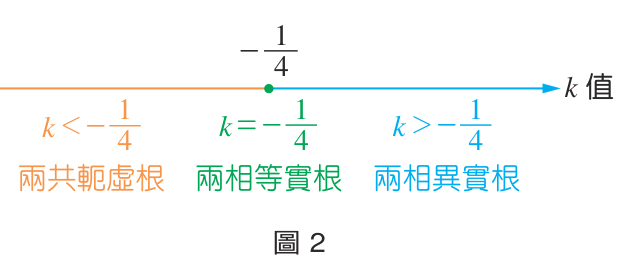
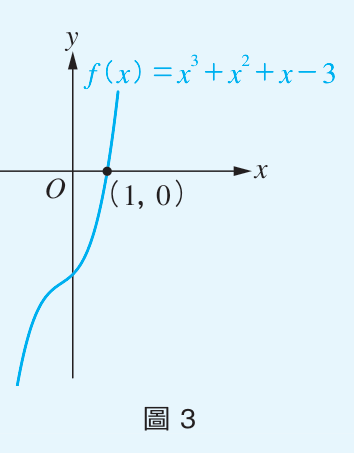
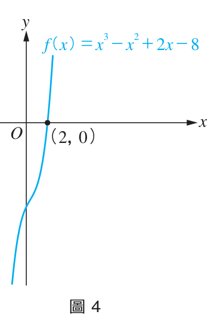
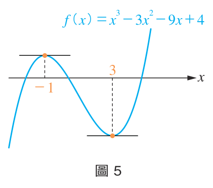

# 📐 第 2 章 複數與多項式方程式
## 2-2 多項式方程式

[📚 目錄總覽](README.md) ｜ [⏮️ 第一頁](01_選修數學乙(下)_編輯大意與目次.md) ｜ [⬅️ 上一頁：2-1 複數](05_選修數學乙(下)_CH2-1_複數.md) ｜ [下一頁：第 2 章學習活動 ➡️](07_選修數學乙(下)_CH2_學習活動.md) ｜ [⏭️ 最終頁](15_選修數學乙(下)_習題參考解答.md)

---

> [!NOTE]
> **章節快速跳轉**：
> - **Ch 1 線性規劃**：[1 線性規劃](02_選修數學乙(下)_CH1_線性規劃.md) ｜ [第 1 章學習活動](03_選修數學乙(下)_CH1_學習活動.md) ｜ [數學家小傳（丹齊格）](04_選修數學乙(下)_CH1_數學家小傳_丹齊格.md)
> - **Ch 2 複數與多項式方程式**：[2-1 複數](05_選修數學乙(下)_CH2-1_複數.md) ｜ **2-2 多項式方程式** ｜ [第 2 章學習活動](07_選修數學乙(下)_CH2_學習活動.md) ｜ [第 2 章綜合演練](08_選修數學乙(下)_CH2_綜合演練.md) ｜ [數學家小傳（阿貝爾）](09_選修數學乙(下)_CH2_數學家小傳_阿貝爾.md)
> - **Ch 3 機率統計**：[3-1 離散型隨機變數](10_選修數學乙(下)_CH3-1_離散型隨機變數.md) ｜ [3-2 二項分布](11_選修數學乙(下)_CH3-2_二項分布.md) ｜ [第 3 章學習活動](12_選修數學乙(下)_CH3_學習活動.md) ｜ [第 3 章綜合演練](13_選修數學乙(下)_CH3_綜合演練.md)
> - **參考資料**：[隨堂練習參考解答](14_選修數學乙(下)_隨堂練習參考解答.md#ch-2-2-多項式方程式) ｜ [習題參考解答](15_選修數學乙(下)_習題參考解答.md#ch-2-2-多項式方程式習題解答)

---

[TOC]

---

## 🌟 章首引言

二次多項式方程式有公式解。三次以上的多項式方程式是否有公式解？數學家經過了非常久的努力，找到了三次及四次方程式的公式解，但公式相當繁雜不易使用。更意外的是，挪威數學家阿貝爾（Niels Henrik Abel，1802～1829）證明了：**五次或五次以上的方程式沒有根式公式解！**（詳見[數學家小傳：阿貝爾](09_選修數學乙(下)_CH2_數學家小傳_阿貝爾.md)）。

<table style="border: none; width: 100%;">
  <tr style="border: none;">
    <td style="border: none; vertical-align: top; width: 75%;">
      在選修數學乙上冊中，我們曾介紹過利用勘根定理來求實係數多項式方程式 $f(x) = 0$ 的實根近似值。而更一般的複係數 $n$ 次方程式的解又如何呢？  
      由德國數學家高斯（Carl Friedrich Gauss，1777～1855）等人提出並嚴格證明的<b>代數基本定理</b>將帶我們一窺究竟。  
      本節將利用上一節定義的虛數與複數，完整介紹一元二次方程式的解以及根與係數的關係、代數基本定理、實係數方程式虛根成對定理，最後將三次方程式與微積分導函數連結。
    </td>
    <td style="border: none; text-align: center; vertical-align: top; width: 25%;">
      
       
      <b>圖 1：高斯與阿貝爾</b>
    </td>
  </tr>
</table>

---

## 1. 一元二次方程式的解

### 公式解與判別式
有了複數以後，所有實係數一元二次方程式都可以求出解。當根為虛數時，稱此方程式有**虛根**。

對於實係數一元二次方程式 $ax^2 + bx + c = 0$ ($a \neq 0$)，配方法得：
$$a\left(x + \frac{b}{2a}\right)^2 = \frac{b^2 - 4ac}{4a} \implies \left(x + \frac{b}{2a}\right)^2 = \frac{b^2 - 4ac}{4a^2}$$
$$x = \frac{-b \pm \sqrt{b^2 - 4ac}}{2a}$$

:::info [判別式 $D = b^2 - 4ac$ 的根之性質判定]
判別式 $b^2 - 4ac$ 的正負值直接決定兩根的型態：

| 判別式條件 | 根的性質 | 幾何意義（拋物線與 $x$ 軸） |
| :---: | :---: | :---: |
| **$b^2 - 4ac > 0$** | **兩相異實根** | 拋物線與 $x$ 軸相交於兩相異點 |
| **$b^2 - 4ac = 0$** | **兩相等實根（重根）** | 拋物線與 $x$ 軸相切於一點 |
| **$b^2 - 4ac < 0$** | **兩共軛虛根** | 拋物線與 $x$ 軸不相交 |

實係數一元二次方程式有實根的充要條件為：**$b^2 - 4ac \ge 0$**。
:::

:::success [例題 1：判別式討論根的範圍]
設 $k$ 為實數，方程式 $x^2 + x - k = 0$，試就 $k$ 的範圍討論此方程式兩根的關係。

<table style="border: none; width: 100%;">
  <tr style="border: none;">
    <td style="border: none; vertical-align: top; width: 60%;">
      <b>【解】</b> 
      判別式 $D = 1^2 - 4(1)(-k) = 4k + 1$。 
      <ul>
        <li>當 $4k + 1 > 0 \implies k > -\frac{1}{4}$ 時，有<b>兩相異實根</b>。</li>
        <li>當 $4k + 1 = 0 \implies k = -\frac{1}{4}$ 時，有<b>兩相等實根</b>。</li>
        <li>當 $4k + 1 < 0 \implies k < -\frac{1}{4}$ 時，有<b>兩共軛虛根</b>。</li>
      </ul>
    </td>
    <td style="border: none; text-align: center; vertical-align: top; width: 40%;">
       
      <b>圖 2：數線上 $k$ 值的根性質區間</b>
    </td>
  </tr>
</table>
:::

:::warning [隨堂練習 1]
設 $a$ 為實數且 $a \neq 0$，一元二次方程式 $ax^2 - 2x + 1 = 0$，試就 $a$ 的範圍討論此方程式兩根的關係。

👉 [💡 查看隨堂練習解答](14_選修數學乙(下)_隨堂練習參考解答.md#p50-隨堂練習)
:::

---

### 根與係數的關係（韋達定理）
設一元二次方程式 $ax^2 + bx + c = 0$ 的兩根為 $\alpha, \beta$，則方程式可分解為 $a(x - \alpha)(x - \beta) = 0$。展開比較係數：
$$a[x^2 - (\alpha + \beta)x + \alpha\beta] = ax^2 + bx + c$$

:::info [根與係數的關係]
若一元二次方程式 $ax^2 + bx + c = 0$ 的兩根為 $\alpha, \beta$，則：
$$\alpha + \beta = -\frac{b}{a}, \quad \alpha\beta = \frac{c}{a}$$
:::

:::success [例題 2：根與係數對稱式運算]
設 $\alpha, \beta$ 為 $x^2 + 2x - 4 = 0$ 的兩根，試求：
1. $\alpha + \beta = -2$
2. $\alpha^2 + \beta^2 = (\alpha + \beta)^2 - 2\alpha\beta = (-2)^2 - 2(-4) = 4 + 8 = 12$
3. $\alpha^3 + \beta^3 = (\alpha + \beta)(\alpha^2 - \alpha\beta + \beta^2) = (-2)[12 - (-4)] = -32$
:::

:::warning [隨堂練習 2]
設 $\alpha, \beta$ 為 $x^2 + x + 6 = 0$ 的兩根，試求：
1. $\alpha\beta$
2. $\alpha^2 + \alpha\beta + \beta^2$
3. $\frac{1}{\alpha} + \frac{1}{\beta}$

👉 [💡 查看隨堂練習解答](14_選修數學乙(下)_隨堂練習參考解答.md#p52-隨堂練習)
:::

:::success [例題 3：由根反求係數]
已知 $\alpha = 3 + \sqrt{2}$ 是實係數一元二次方程式 $x^2 - 4x + k = 0$ 的一個根：
1. 試求此方程式的另一根 $\beta$。
2. 試求實數 $k$ 的值。

**【解】**
1. 由兩根之和：$\beta + (3 + \sqrt{2}) = 4 \implies \beta = 1 - \sqrt{2}$。
2. 由兩根之積：$k = \alpha\beta = (3 + \sqrt{2})(1 - \sqrt{2}) = 3 - 3\sqrt{2} + \sqrt{2} - 2 = 1 - 2\sqrt{2}$。
:::

---

## 2. 代數基本定理 (Fundamental Theorem of Algebra)

:::info [代數基本定理]
任一個次數 $n \ge 1$ 的複係數多項式方程式：
$$a_n x^n + a_{n-1} x^{n-1} + \dots + a_1 x + a_0 = 0 \quad (a_n \neq 0)$$
**在複數系中至少有一個複數根**。
:::

### 推論：$n$ 次多項式方程式恰有 $n$ 個根
由代數基本定理，設 $f(x) = 0$ 有一根 $\alpha_1$，由因式定理得 $f(x) = (x - \alpha_1)q_1(x)$。
若次數仍大於 0，則 $q_1(x) = 0$ 又必有一根 $\alpha_2$，依此類推：
$$f(x) = a_n (x - \alpha_1)(x - \alpha_2)\dots(x - \alpha_n)$$
> **重要結論**：
> 對任意正整數 $n$，**$n$ 次複係數多項式方程式恰有 $n$ 個複數根（計入重根）**！

:::success [例題 4：求 $x^3 - 1 = 0$ 的三個根]
因式分解得 $(x - 1)(x^2 + x + 1) = 0$：
$$x = 1 \quad \text{或} \quad x = \frac{-1 \pm \sqrt{3}i}{2}$$
由代數基本定理，三次方程式恰好只有這三個複數根！
:::

:::warning [隨堂練習 3]
試求出 $x^4 - 1 = 0$ 的四個根。

👉 [💡 查看隨堂練習解答](14_選修數學乙(下)_隨堂練習參考解答.md#p55-隨堂練習)
:::

### 數系的擴充歷史
- $\mathbb{N}$（自然數）不夠用：$x + 2 = 0 \implies x = -2 \notin \mathbb{N}$，需要整數 $\mathbb{Z}$。
- $\mathbb{Z}$（整數）不夠用：$2x - 1 = 0 \implies x = \frac{1}{2} \notin \mathbb{Z}$，需要有理數 $\mathbb{Q}$。
- $\mathbb{Q}$（有理數）不夠用：$x^2 - 2 = 0 \implies x = \pm\sqrt{2} \notin \mathbb{Q}$，需要實數 $\mathbb{R}$。
- $\mathbb{R}$（實數）不夠用：$x^2 + 1 = 0 \implies x = \pm i \notin \mathbb{R}$，需要複數 $\mathbb{C}$。
- **複數 $\mathbb{C}$ 就徹底足夠了！** 代數基本定理證明了，任何複係數方程式的根必定落在 $\mathbb{C}$ 之中，不需要再發明新的數系！

---

## 3. 虛根成對定理 (Conjugate Root Theorem)

:::info [實係數多項式方程式虛根成對定理]
設 $f(x)$ 為**實係數**多項式。若虛數 $z = a + bi$ ($b \neq 0$) 是方程式 $f(x) = 0$ 的一根，則其共軛複數 $\bar{z} = a - bi$ 也必定是 $f(x) = 0$ 的根。
:::

> [!CAUTION]
> **重要前提**：多項式的所有係數必須全部為**實數**！若係數為虛數，則虛根不一定成對。

### 兩大推論
1. **實係數多項式的虛根個數必為偶數個**。
2. **奇數次的實係數多項式方程式至少有一個實根**！
3. 任何實係數多項式恆可分解為一次或二次實係數多項式的乘積。

:::success [例題 5：由虛根求未知係數]
設 $a, b$ 為實數，多項式方程式 $x^3 + ax^2 + bx + 10 = 0$ 有一根為 $1 + 2i$，求 $a, b$ 的值。

**【解】**
由虛根成對定理，$1 - 2i$ 也是根。故方程式有因式：
$$[x - (1 + 2i)][x - (1 - 2i)] = (x - 1)^2 - (2i)^2 = x^2 - 2x + 5$$
直接除法或比較首末項，設原式 $= (x^2 - 2x + 5)(x + 2)$。
展開得：
$$(x^2 - 2x + 5)(x + 2) = x^3 + 0x^2 + x + 10$$
比較係數得 **$a = 0, b = 1$**。
:::

:::success [例題 6：利用除法原理求複數代入值]
已知 $f(x) = x^3 - 3x^2 + 2x + 6$，試求 $f(2 + i)$ 的值。

**【解】**
以 $2 \pm i$ 為兩根的一元二次多項式為：
$$[x - (2 + i)][x - (2 - i)] = x^2 - 4x + 5$$
將 $f(x)$ 除以 $x^2 - 4x + 5$，得商式 $x + 1$、餘式 $x + 1$：
$$f(x) = (x^2 - 4x + 5)(x + 1) + (x + 1)$$
將 $x = 2 + i$ 代入，前項為 0：
$$f(2 + i) = 0 + (2 + i) + 1 = \mathbf{3 + i}$$
:::

:::warning [隨堂練習 4]
已知 $f(x) = 5x^3 - 2x^2 + 4x + 3$，試求 $f(1 - 2i)$。

👉 [💡 查看隨堂練習解答](14_選修數學乙(下)_隨堂練習參考解答.md#p58-隨堂練習)
:::

---

## 4. 多項式函數與微積分連結

在選修數學乙上冊微積分中，函數 $y = f(x)$ 的圖形與 $x$ 軸交點的橫坐標，即為方程式 $f(x) = 0$ 的實根。

  
  
   
  <b>圖 3：$f(x) = x^3 + x^2 + x - 3$ ｜ 圖 4：$f(x) = x^3 - x^2 + 2x - 8$</b>

:::success [例題 7：由圖形分解因式並求複數根]
三次函數 $f(x) = x^3 + x^2 + x - 3$ 圖形如圖 3，與 $x$ 軸交於點 $(1, 0)$：
1. 將 $f(x)$ 分解成一次或二次實係數多項式的乘積。
2. 求三次方程式 $f(x) = 0$ 的三根。

**【解】**
1. 由交點知 $f(1) = 0$，有因式 $x - 1$。綜合除法得 $f(x) = (x - 1)(x^2 + 2x + 3)$。
2. 解 $x^2 + 2x + 3 = 0 \implies x = \frac{-2 \pm \sqrt{4 - 12}}{2} = -1 \pm \sqrt{2}i$。
故三根為 $x = 1$ 或 $-1 \pm \sqrt{2}i$。
:::

:::success [例題 8：三次多項式導函數判別實根個數]
試求多項式方程式 $x^3 - 3x^2 - 9x + 4 = 0$ 的實根個數。

<table style="border: none; width: 100%;">
  <tr style="border: none;">
    <td style="border: none; vertical-align: top; width: 60%;">
      <b>【解】</b> 
      設 $f(x) = x^3 - 3x^2 - 9x + 4$，求導數：
      $$f'(x) = 3x^2 - 6x - 9 = 3(x + 1)(x - 3) = 0 \implies x = -1 \text{ 或 } 3$$
      計算局部極值：
      <ul>
        <li>$f(-1) = (-1)^3 - 3(-1)^2 - 9(-1) + 4 = 9 > 0$（極大值）</li>
        <li>$f(3) = 27 - 27 - 27 + 4 = -23 < 0$（極小值）</li>
      </ul>
      因為兩極值一正一負（異號），由連續函數勘根定理知，圖形與 $x$ 軸必交於三個相異點（如圖 5）。 
      故方程式 $f(x) = 0$ 恰有 <b>$3$ 個相異實根</b>。
    </td>
    <td style="border: none; text-align: center; vertical-align: top; width: 40%;">
       
      <b>圖 5：極值異號的三次函數曲線</b>
    </td>
  </tr>
</table>
:::

:::warning [隨堂練習 5]
試求多項式方程式 $x^3 + x - 1 = 0$ 的實根個數。

👉 [💡 查看隨堂練習解答](14_選修數學乙(下)_隨堂練習參考解答.md#p60-隨堂練習)
:::

---

## 📝 習題 2-2

[📖 查看習題完整解答與詳細解析](15_選修數學乙(下)_習題參考解答.md#ch-2-2-多項式方程式習題解答)

### 一、基本題
1. 試求下列各方程式的解：
   - (1) $x^3 + 8 = 0$
   - (2) $x^4 - 8x = 0$
2. 試求 $x^3 = 27$ 的三個複數解。
3. 設 $\alpha, \beta$ 為 $x^2 + 8x + 6 = 0$ 的兩根，試求：
   - (1) $\alpha + \beta$
   - (2) $\alpha\beta$
   - (3) $\alpha^2 + \beta^2$
   - (4) $\alpha^3 + \beta^3$
4. 設 $f(x)$ 為三次實係數多項式，且知 $2 + i$ 為 $f(x) = 0$ 之一解，判斷下列哪些敘述正確？（多選題）
   - (A) $i - 2$ 也是 $f(x) = 0$ 之一根
   - (B) $f(3 + i) \neq 0$
   - (C) 方程式 $f(x) = 0$ 恰有一實根
   - (D) 沒有實數 $x$ 滿足 $f(x) = 3$
5. 設 $a, b$ 為實數，已知 $1 + 3i$ 為方程式 $x^2 + (a + b)x + 2b = 0$ 之一根，試求數對 $(a, b)$。

---

### 二、進階題
6. 已知複數 $z$ 滿足 $z^3 + z^{-3} + 2 = 0$，試求：
   - (1) $z^3$
   - (2) $z$
7. 實係數三次方程式 $2x^3 + px^2 + qx + 6 = 0$ 有一根為 $1 + i$，試求數對 $(p, q)$。
8. 設 $f(x) = x^3 - 5x^2 + 7x - 4$，若 $f(2 + i) = a + bi$（$a, b \in \mathbb{R}$），求數對 $(a, b)$。
9. 試求滿足複數方程式 $z^2 = 3 + 4i$ 的複數 $z$。

---

### 三、素養題
10. 若多項式函數 $f(x) = x^3 - 12x$ 在 $f(x) = k$ 時只有一個實根，試求實數 $k$ 的範圍。

👉 [查看習題詳細參考解答](15_選修數學乙(下)_習題參考解答.md#ch-2-2-多項式方程式習題解答)

---

[⬅️ 上一頁：2-1 複數](05_選修數學乙(下)_CH2-1_複數.md) ｜ [🔝 回到頂端](#) ｜ [📚 目錄總覽](README.md) ｜ [下一頁：第 2 章學習活動 ➡️](07_選修數學乙(下)_CH2_學習活動.md)

