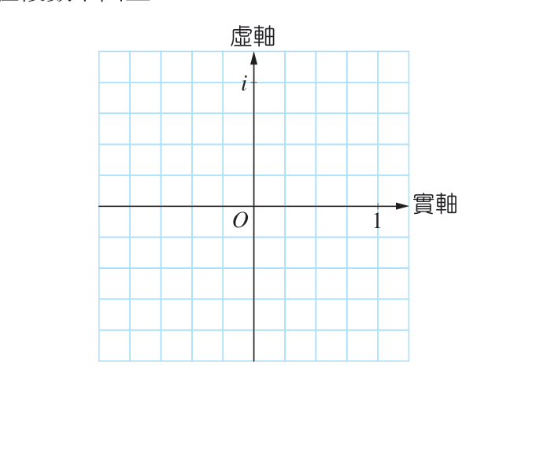
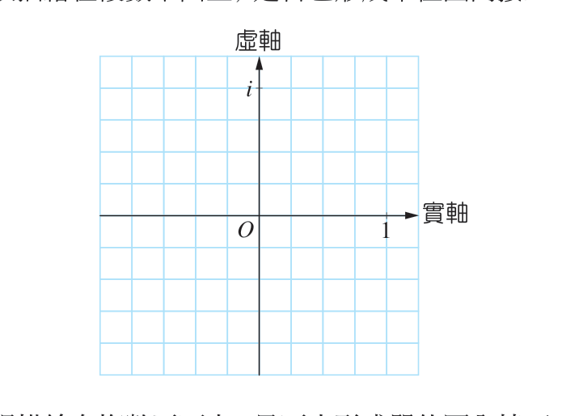
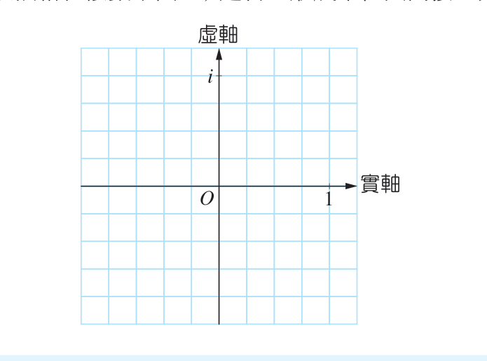

# ⭕ 第 2 章 學習活動：根的位置與幾何

[📚 目錄總覽](README.md) ｜ [⏮️ 第一頁](01_選修數學乙(下)_編輯大意與目次.md) ｜ [⬅️ 上一頁：2-2 多項式方程式](06_選修數學乙(下)_CH2-2_多項式方程式.md) ｜ [下一頁：第 2 章綜合演練 ➡️](08_選修數學乙(下)_CH2_綜合演練.md) ｜ [⏭️ 最終頁](15_選修數學乙(下)_習題參考解答.md)

---

> [!NOTE]
> **章節快速跳轉**：
> - **Ch 1 線性規劃**：[1 線性規劃](02_選修數學乙(下)_CH1_線性規劃.md) ｜ [第 1 章學習活動](03_選修數學乙(下)_CH1_學習活動.md) ｜ [數學家小傳（丹齊格）](04_選修數學乙(下)_CH1_數學家小傳_丹齊格.md)
> - **Ch 2 複數與多項式方程式**：[2-1 複數](05_選修數學乙(下)_CH2-1_複數.md) ｜ [2-2 多項式方程式](06_選修數學乙(下)_CH2-2_多項式方程式.md) ｜ **第 2 章學習活動** ｜ [第 2 章綜合演練](08_選修數學乙(下)_CH2_綜合演練.md) ｜ [數學家小傳（阿貝爾）](09_選修數學乙(下)_CH2_數學家小傳_阿貝爾.md)
> - **Ch 3 機率統計**：[3-1 離散型隨機變數](10_選修數學乙(下)_CH3-1_離散型隨機變數.md) ｜ [3-2 二項分布](11_選修數學乙(下)_CH3-2_二項分布.md) ｜ [第 3 章學習活動](12_選修數學乙(下)_CH3_學習活動.md) ｜ [第 3 章綜合演練](13_選修數學乙(下)_CH3_綜合演練.md)
> - **參考資料**：[隨堂練習參考解答](14_選修數學乙(下)_隨堂練習參考解答.md) ｜ [習題參考解答](15_選修數學乙(下)_習題參考解答.md)

---

[TOC]

---

## 🔍 活動探究：解多項式方程式的根與幾何圖形

在這個學習活動中，我們從「找根」來體會**解多項式方程式的根**與**幾何圖形**之間的奇妙聯繫。

在學習這一章之前，如果想要找個數字，它的六次方等於 $1$（即 $x^6 = 1$），多半的人都只能找到 $1$ 與 $-1$ 這兩個實數解。

但是現在我們在[2-2 多項式方程式](06_選修數學乙(下)_CH2-2_多項式方程式.md)中學到了**代數基本定理**：
> 一個複係數 $n$ 次方程式在複數系中**恰有 $n$ 個根**（計入重根）。

這表示方程式：
$$x^6 = 1$$
在複數系中必定有**六個根**——也就是說，我們可以在複數系中找到六個互異的複數，它們的六次方都等於 $1$！

---

## ✍️ 同學想一想 (思考與演算)

解 $x^6 = 1$ 就是解 $x^6 - 1 = 0$。首先利用乘法公式做因式分解，通常我們因式分解到係數都是實數即可。

:::info [問題 1：因式分解]
試將 $x^6 - 1 = 0$ 做實係數因式分解。（提示：利用平方差與立方差公式）

$$\begin{aligned}
x^6 - 1 &= (x^3 - 1)(x^3 + 1) \\
&= (x - 1)(x^2 + x + 1)(x + 1)(x^2 - x + 1) = 0
\end{aligned}$$
:::

:::info [問題 2：求出六個複數根]
試求出 $x^6 = 1$ 的六個根：
1. 由 $x - 1 = 0 \implies x = 1$
2. 由 $x + 1 = 0 \implies x = -1$
3. 由 $x^2 + x + 1 = 0 \implies x = \frac{-1 \pm \sqrt{3}i}{2}$
4. 由 $x^2 - x + 1 = 0 \implies x = \frac{1 \pm \sqrt{3}i}{2}$

故方程式 $x^6 = 1$ 的六個根為：
$$x = 1, \quad -1, \quad \frac{1}{2} + \frac{\sqrt{3}}{2}i, \quad \frac{1}{2} - \frac{\sqrt{3}}{2}i, \quad -\frac{1}{2} + \frac{\sqrt{3}}{2}i, \quad -\frac{1}{2} - \frac{\sqrt{3}}{2}i$$
:::

---

## 📐 幾何視覺化：複數平面上的對稱之美

這六個根看起來很繁複，但是當我們把這六個複數視為複數平面（高斯平面）上的點時，隱含著極為漂亮的幾何對稱規律！

:::success [問題 3：在複數平面上描繪六個根]
將這六個根對應的坐標描繪在複數平面上：
- $P_0(1, 0)$
- $P_1\left(\frac{1}{2}, \frac{\sqrt{3}}{2}\right)$
- $P_2\left(-\frac{1}{2}, \frac{\sqrt{3}}{2}\right)$
- $P_3(-1, 0)$
- $P_4\left(-\frac{1}{2}, -\frac{\sqrt{3}}{2}\right)$
- $P_5\left(\frac{1}{2}, -\frac{\sqrt{3}}{2}\right)$

  
   
  <b>圖 1：$x^6 = 1$ 的六個根在複數平面上的分布</b>

> **重要發現**：
> 同學會發現，$x^6 = 1$ 的六個根剛好是**複數平面上單位圓內接正六邊形的六個頂點**！
> 且相鄰兩點與原點連線的夾角恰為 $\frac{360^\circ}{6} = 60^\circ$！
:::

---

## 🔺 探索其他 $n$ 次方根：正三角形與正方形

:::info [問題 4：$x^3 = 1$ 的三個根]
解 $x^3 - 1 = (x - 1)(x^2 + x + 1) = 0$，得三個根：
$$x = 1, \quad -\frac{1}{2} + \frac{\sqrt{3}}{2}i, \quad -\frac{1}{2} - \frac{\sqrt{3}}{2}i$$
將其描繪在複數平面上，是否形成單位圓內接正三角形的頂點？

  
   
  <b>圖 2：$x^3 = 1$ 的三個根（單位圓內接正三角形）</b>

**答案**：是的！三點到原點距離皆為 $1$，且相鄰兩點與原點連線夾角為 $120^\circ$。
:::

:::info [問題 5：$x^4 = 1$ 的四個根]
解 $x^4 - 1 = (x^2 - 1)(x^2 + 1) = 0$，得四個根：
$$x = 1, \quad -1, \quad i, \quad -i$$
將其描繪在複數平面上，是否形成單位圓內接正方形的頂點？

  
   
  <b>圖 3：$x^4 = 1$ 的四個根（單位圓內接正方形）</b>

**答案**：是的！頂點分別為 $(1, 0)$, $(0, 1)$, $(-1, 0)$, $(0, -1)$，構成頂點在坐標軸上的正方形。
:::

---

## 🌟 統整概念：單位根與正 $n$ 邊形

這些幾何現象絕非巧合！

一般來說，方程式：
$$x^n = 1$$
的 $n$ 個複數根（稱為 **$n$ 次單位根**），在複數平面上**恰好會均勻分布在以原點為圓心、半徑為 $1$ 的單位圓上，形成單位圓內接正 $n$ 邊形的頂點**！

因為 $x = 1$ 必定是根，所以其中必有一個頂點落在實軸上的點 $(1, 0)$（即 $1 + 0i$）。

這個美麗而深刻的幾何關聯在高等數學中稱為**棣美弗定理（de Moivre's Formula）**與複數的極式。

---

## 🧠 進階挑戰題

:::warning [問題 6：寫出 $x^8 = 1$ 的八個根]
既然 $x^8 = 1$ 的八個根構成單位圓內接正八邊形的頂點，且每個頂點與原點夾角為 $\frac{360^\circ}{8} = 45^\circ$：
- 位於四個象限角平分線上的根為：$\pm \frac{\sqrt{2}}{2} \pm \frac{\sqrt{2}}{2}i$
- 位於坐標軸上的根為：$\pm 1, \pm i$

故八個根為：
$$x = \pm 1, \quad \pm i, \quad \frac{\sqrt{2}}{2} \pm \frac{\sqrt{2}}{2}i, \quad -\frac{\sqrt{2}}{2} \pm \frac{\sqrt{2}}{2}i$$
:::

:::warning [問題 7：求 $x^4 + 1 = 0$ 的四個根]
利用 $x^8 - 1 = (x^4 - 1)(x^4 + 1) = 0$：
因為 $x^4 - 1 = 0$ 的根為 $\pm 1, \pm i$，
所以由問題 6 中排除這四個根後，剩下四個即為 $x^4 + 1 = 0$ 的四個根：
$$x = \frac{\sqrt{2}}{2} + \frac{\sqrt{2}}{2}i, \quad \frac{\sqrt{2}}{2} - \frac{\sqrt{2}}{2}i, \quad -\frac{\sqrt{2}}{2} + \frac{\sqrt{2}}{2}i, \quad -\frac{\sqrt{2}}{2} - \frac{\sqrt{2}}{2}i$$

👉 [點此查看習題解答中相關因式分解與驗算](15_選修數學乙(下)_習題參考解答.md#ch2-學習活動參考解)
:::

---

[⬅️ 上一頁：2-2 多項式方程式](06_選修數學乙(下)_CH2-2_多項式方程式.md) ｜ [🔝 回到頂端](#) ｜ [📚 目錄總覽](README.md) ｜ [下一頁：第 2 章綜合演練 ➡️](08_選修數學乙(下)_CH2_綜合演練.md)

