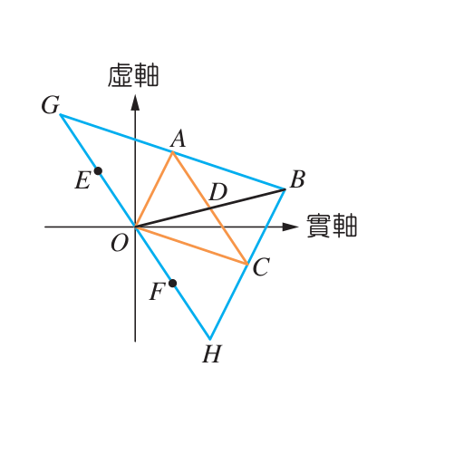
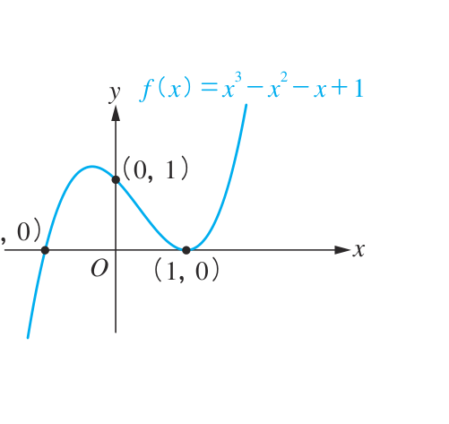

# 📝 第 2 章 綜合演練

[📚 目錄總覽](README.md) ｜ [⏮️ 第一頁](01_選修數學乙(下)_編輯大意與目次.md) ｜ [⬅️ 上一頁：第 2 章學習活動](07_選修數學乙(下)_CH2_學習活動.md) ｜ [下一頁：數學家小傳（阿貝爾） ➡️](09_選修數學乙(下)_CH2_數學家小傳_阿貝爾.md) ｜ [⏭️ 最終頁](15_選修數學乙(下)_習題參考解答.md)

---

> [!NOTE]
> **章節快速跳轉**：
> - **Ch 1 線性規劃**：[1 線性規劃](02_選修數學乙(下)_CH1_線性規劃.md) ｜ [第 1 章學習活動](03_選修數學乙(下)_CH1_學習活動.md) ｜ [數學家小傳（丹齊格）](04_選修數學乙(下)_CH1_數學家小傳_丹齊格.md)
> - **Ch 2 複數與多項式方程式**：[2-1 複數](05_選修數學乙(下)_CH2-1_複數.md) ｜ [2-2 多項式方程式](06_選修數學乙(下)_CH2-2_多項式方程式.md) ｜ [第 2 章學習活動](07_選修數學乙(下)_CH2_學習活動.md) ｜ **第 2 章綜合演練** ｜ [數學家小傳（阿貝爾）](09_選修數學乙(下)_CH2_數學家小傳_阿貝爾.md)
> - **Ch 3 機率統計**：[3-1 離散型隨機變數](10_選修數學乙(下)_CH3-1_離散型隨機變數.md) ｜ [3-2 二項分布](11_選修數學乙(下)_CH3-2_二項分布.md) ｜ [第 3 章學習活動](12_選修數學乙(下)_CH3_學習活動.md) ｜ [第 3 章綜合演練](13_選修數學乙(下)_CH3_綜合演練.md)
> - **參考資料**：[隨堂練習參考解答](14_選修數學乙(下)_隨堂練習參考解答.md) ｜ [習題參考解答](15_選修數學乙(下)_習題參考解答.md)

---

[TOC]

---

> *註：標註「＊」者為進階挑戰題。*

### 基礎題與觀念題

:::info [第 1 題：負數根號相乘]
試求 $\sqrt{-1}\sqrt{-2}\sqrt{-3}\sqrt{-4}\sqrt{-6}\sqrt{-8}$ 的值。

👉 [查看解答](15_選修數學乙(下)_習題參考解答.md#ch2-綜合演練-第-1-題)
:::

:::info [第 2 題：複數觀念是非與運算性質]
下列敘述何者正確？（多選題）
- (A) $\sqrt{3}\sqrt{-5} = \sqrt{3 \times (-5)}$
- (B) $\sqrt{-3}\sqrt{-5} = \sqrt{(-3) \times (-5)}$
- (C) $\frac{\sqrt{3}}{\sqrt{-5}} = \sqrt{\frac{3}{-5}}$
- (D) 若 $a, b$ 為複數，則 $a^2 + b^2 = 0 \implies a = b = 0$
- (E) 若 $x + 4i = 2 + yi$（$x, y$ 為實數），則 $x = 2$ 且 $y = 4$

👉 [查看解答](15_選修數學乙(下)_習題參考解答.md#ch2-綜合演練-第-2-題)
:::

:::info [第 3 題：三次方程式三重根]
已知實係數多項式方程式 $x^3 + ax^2 + bx + 8 = 0$ 的三根相同，試求實數 $a$ 的值。

👉 [查看解答](15_選修數學乙(下)_習題參考解答.md#ch2-綜合演練-第-3-題)
:::

:::info [第 4 題：三角不等式與絕對值極值]
已知複數 $z_1, z_2$ 滿足 $|z_1| = 2$，$|z_2| = 3$，試求下列各值：
1. $|z_1 + z_2|$ 的最大值。
2. $|z_1 - z_2|$ 的最小值。

👉 [查看解答](15_選修數學乙(下)_習題參考解答.md#ch2-綜合演練-第-4-題)
:::

---

### 進階題與綜合應用

:::info [第 5 題：雙二次方程式實根個數]
試求方程式 $x^4 + 2x^2 - 1 = 0$ 有多少個實根？（提示：先令 $t = x^2$）

👉 [查看解答](15_選修數學乙(下)_習題參考解答.md#ch2-綜合演練-第-5-題)
:::

:::warning [＊ 第 6 題：複數平面幾何中點表示法]
如右圖所示，$O, A, C$ 分別為 $\triangle BHG$ 三邊 $GH, GB, BH$ 之邊中點；$D, E, F$ 分別為線段 $OB, OG, OH$ 之邊中點。
若以 $P(z)$ 表示點 $P$ 在複數平面上所代表的複數，已知 $C(z) = z_1 + z_2$，$A(z) = z_1 - z_2$。

  
   
  <b>圖：複數平面上的中點向量幾何關係</b>

試問：
1. $z_1$ 可用圖中哪個點所代表的複數來表示？
2. $z_2$ 可用圖中哪個點所代表的複數來表示？

👉 [查看解答](15_選修數學乙(下)_習題參考解答.md#ch2-綜合演練-第-6-題)
:::

:::info [第 7 題：複數夾角餘弦值]
已知複數平面上 $A, B$ 兩點分別代表複數 $1 - 2i$ 與 $2 + 3i$，$O$ 為原點，試求 $\cos\angle AOB$ 之值。

👉 [查看解答](15_選修數學乙(下)_習題參考解答.md#ch2-綜合演練-第-7-題)
:::

:::info [第 8 題：高次方代入求值]
設多項式 $f(x) = x^{100} + x^{50} + 1$，試求 $f\left(\frac{-1 + i}{\sqrt{2}}\right)$ 的值。

👉 [查看解答](15_選修數學乙(下)_習題參考解答.md#ch2-綜合演練-第-8-題)
:::

:::info [第 9 題：三次函數作圖與實根]
1. 試描繪三次函數 $f(x) = -x^3 - 3x^2 + 3$ 的圖形。
2. 承(1)，判斷三次多項式方程式 $x^3 + 3x^2 - 3 = 0$ 有幾個相異實根？

👉 [查看解答](15_選修數學乙(下)_習題參考解答.md#ch2-綜合演練-第-9-題)
:::

:::warning [＊ 第 10 題：圖形判讀與多項式分解]
已知三次函數 $f(x) = x^3 - x^2 - x + 1$ 的圖形如圖所示，通過點 $(-1, 0)$、$(0, 1)$、$(1, 0)$：

  
   
  <b>圖：三次函數 $f(x) = x^3 - x^2 - x + 1$ 之圖形</b>

試回答下列問題：
1. 試將 $f(x)$ 分解成一次或二次實係數多項式的乘積。
2. 試求三次多項式方程式 $f(x) = 0$ 的三個實根。
3. 若 $g(x) = f(x) - 1$，則函數 $g(x)$ 的圖形與 $x$ 軸有幾個相異交點？

👉 [查看解答](15_選修數學乙(下)_習題參考解答.md#ch2-綜合演練-第-10-題)
:::

---

[⬅️ 上一頁：第 2 章學習活動](07_選修數學乙(下)_CH2_學習活動.md) ｜ [🔝 回到頂端](#) ｜ [📚 目錄總覽](README.md) ｜ [下一頁：數學家小傳（阿貝爾） ➡️](09_選修數學乙(下)_CH2_數學家小傳_阿貝爾.md)

