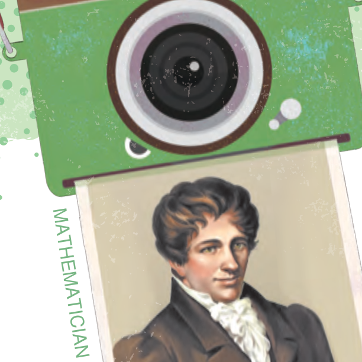

# 👨‍🏫 數學家小傳：阿貝爾 (Niels Henrik Abel)

[📚 目錄總覽](README.md) ｜ [⏮️ 第一頁](01_選修數學乙(下)_編輯大意與目次.md) ｜ [⬅️ 上一頁：第 2 章綜合演練](08_選修數學乙(下)_CH2_綜合演練.md) ｜ [下一頁：3-1 離散型隨機變數 ➡️](10_選修數學乙(下)_CH3-1_離散型隨機變數.md) ｜ [⏭️ 最終頁](15_選修數學乙(下)_習題參考解答.md)

---

> [!NOTE]
> **章節快速跳轉**：
> - **Ch 1 線性規劃**：[1 線性規劃](02_選修數學乙(下)_CH1_線性規劃.md) ｜ [第 1 章學習活動](03_選修數學乙(下)_CH1_學習活動.md) ｜ [數學家小傳（丹齊格）](04_選修數學乙(下)_CH1_數學家小傳_丹齊格.md)
> - **Ch 2 複數與多項式方程式**：[2-1 複數](05_選修數學乙(下)_CH2-1_複數.md) ｜ [2-2 多項式方程式](06_選修數學乙(下)_CH2-2_多項式方程式.md) ｜ [第 2 章學習活動](07_選修數學乙(下)_CH2_學習活動.md) ｜ [第 2 章綜合演練](08_選修數學乙(下)_CH2_綜合演練.md) ｜ **數學家小傳（阿貝爾）**
> - **Ch 3 機率統計**：[3-1 離散型隨機變數](10_選修數學乙(下)_CH3-1_離散型隨機變數.md) ｜ [3-2 二項分布](11_選修數學乙(下)_CH3-2_二項分布.md) ｜ [第 3 章學習活動](12_選修數學乙(下)_CH3_學習活動.md) ｜ [第 3 章綜合演練](13_選修數學乙(下)_CH3_綜合演練.md)
> - **參考資料**：[隨堂練習參考解答](14_選修數學乙(下)_隨堂練習參考解答.md) ｜ [習題參考解答](15_選修數學乙(下)_習題參考解答.md)

---

  
  <h3>阿貝爾</h3>
  
<b>Niels Henrik Abel（1802 ～ 1829）</b> 
  <i>挪威天才數學家、現代代數學與橢圓函數論奠基人</i>

---

## 🌟 早年天分與求學歷程

阿貝爾是挪威著名的天才數學家。他的祖父與父親原本都是牧師，但在 1814 年挪威自丹麥獨立後，阿貝爾的父親被選為挪威議會的議員，於是將年輕的阿貝爾接到首都奧斯陸主教堂學校就讀中學。

在學校裡，阿貝爾展露了無比的數學天分。當時的數學老師霍恩波（Bernt Michael Holmboe）敏銳地發掘了他的才華，積極鼓勵他閱讀歐拉（Euler）、拉格朗日（Lagrange）與高斯（Gauss）的高等數學著作，並於課後免費主動指導阿貝爾。

18 歲時，阿貝爾進入奧斯陸大學就讀，當時他就已經是小有名氣的數學新星。然而不久後父親過世，家中陷入嚴重的經濟困境。高中數學老師全力為他爭取獎學金，甚至自己發起民間募款資助他繼續進行研究。

---

## 💥 世紀突破：五次方程式無根式解

這段期間，阿貝爾開始挑戰數學史上懸宕數百年的世紀大難題——**一元五次方程式的公式解（根式解）**。

在文藝復興時期的十六世紀，數學家卡當諾（Cardano）與塔塔利亞（Tartaglia）找出了三次方程式的公式解，費拉里（Ferrari）找出了四次方程式的公式解。此後近三百年，全世界無數頂尖數學家前仆後繼，試圖尋找一元五次多項式方程式的一般根號代數公式解，但都鎩羽而歸。

阿貝爾另闢蹊徑，他發現五次多項式方程式的根與對稱群之間存在著深刻而微妙的關係。1824 年，年僅 22 歲的阿貝爾以嚴密的天才論證證明了：
> **一般的一元五次及五次以上多項式方程式，不可能用係數經過有限次的加、減、乘、除與開方根（根式）表示其根！**

這就是著名的**阿貝爾–魯菲尼定理（Abel-Ruffini Theorem）**。

對照高斯在[2-2 多項式方程式](06_選修數學乙(下)_CH2-2_多項式方程式.md)中證明的**代數基本定理**：
- 代數基本定理保證了：任何一個複係數 $n$ 次方程式**在複數平面上必定恰有 $n$ 個根**（計入重根）。
- 阿貝爾的定理則宣告：雖然根確實存在，但當次數 $n \ge 5$ 時，**無法用有限的加減乘除開方公式把根寫出來**！這徹底打破了人類追求「萬能多項式求根公式」的千年夢想，開啟了現代抽象代數學（群論）的大門。

---

## 🏛️ 不朽遺產與歷史評價

除了方程式的代數求解理論之外，阿貝爾還在**群論（Group Theory）**、**橢圓函數論（Elliptic Functions）**、**冪級數收斂性**等領域做出了跨時代的奠基性突破。現代數學中許多核心名詞均以他的名字命名，例如：
- 符合交換律的群稱為**阿貝爾群（Abelian Group）**
- **阿貝爾積分（Abelian Integral）**
- 國際數學界為紀念他而設立的**阿貝爾獎（Abel Prize）**，被譽為數學界的「諾貝爾獎」。

可惜由於當時挪威學術環境封閉，阿貝爾長期貧困交加，為了尋求歐洲頂尖數學界的認同與支持到處奔走旅行，受寒染疾。1829 年，年僅 26 歲的他因肺結核在貧寒中英年早逝。

在阿貝爾過世兩天後，柏林大學寄來了聘任他擔任數學教授的正式聘書，可惜為時已晚。法國當代大數學家埃爾米特（Charles Hermite）在研讀阿貝爾的手稿後，由衷地讚嘆：
> **「阿貝爾留下來的豐厚遺產，足夠讓全世界的數學家們忙上整整五百年！」**

---

[⬅️ 上一頁：第 2 章綜合演練](08_選修數學乙(下)_CH2_綜合演練.md) ｜ [🔝 回到頂端](#) ｜ [📚 目錄總覽](README.md) ｜ [下一頁：3-1 離散型隨機變數 ➡️](10_選修數學乙(下)_CH3-1_離散型隨機變數.md)

