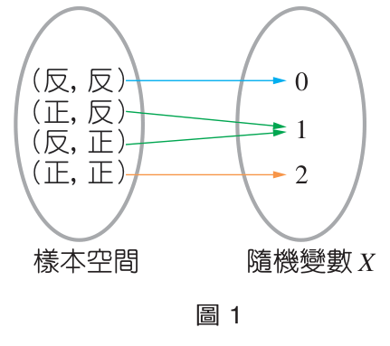
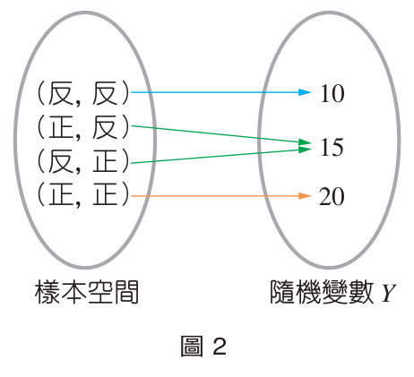
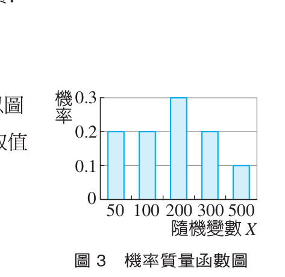
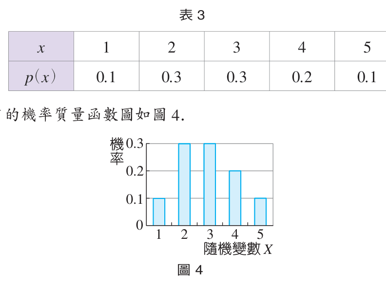
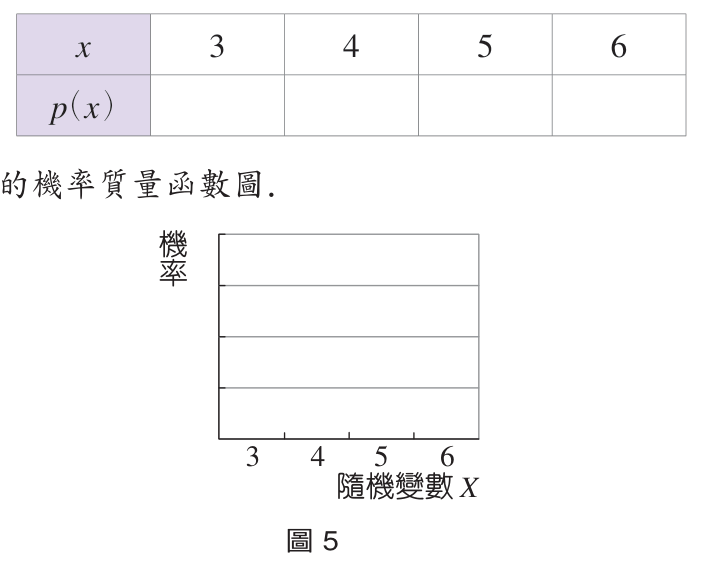
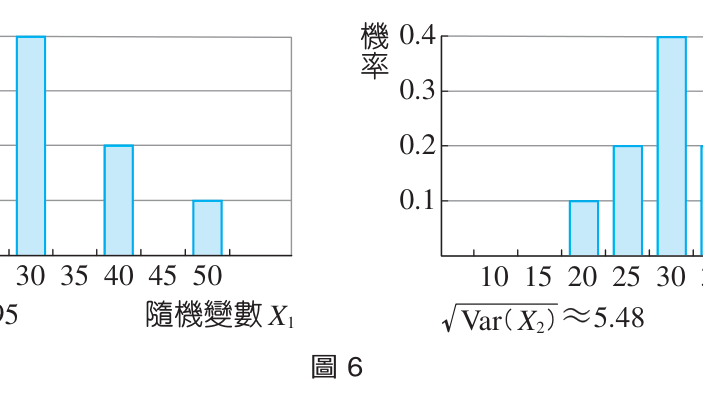

# 📊 3-1 離散型隨機變數

[📚 目錄總覽](README.md) ｜ [⏮️ 第一頁](01_選修數學乙(下)_編輯大意與目次.md) ｜ [⬅️ 上一頁：數學家小傳（阿貝爾）](09_選修數學乙(下)_CH2_數學家小傳_阿貝爾.md) ｜ [下一頁：3-2 二項分布 ➡️](11_選修數學乙(下)_CH3-2_二項分布.md) ｜ [⏭️ 最終頁](15_選修數學乙(下)_習題參考解答.md)

---

> [!NOTE]
> **章節快速跳轉**：
> - **Ch 1 線性規劃**：[1 線性規劃](02_選修數學乙(下)_CH1_線性規劃.md) ｜ [第 1 章學習活動](03_選修數學乙(下)_CH1_學習活動.md) ｜ [數學家小傳（丹齊格）](04_選修數學乙(下)_CH1_數學家小傳_丹齊格.md)
> - **Ch 2 複數與多項式方程式**：[2-1 複數](05_選修數學乙(下)_CH2-1_複數.md) ｜ [2-2 多項式方程式](06_選修數學乙(下)_CH2-2_多項式方程式.md) ｜ [第 2 章學習活動](07_選修數學乙(下)_CH2_學習活動.md) ｜ [第 2 章綜合演練](08_選修數學乙(下)_CH2_綜合演練.md) ｜ [數學家小傳（阿貝爾）](09_選修數學乙(下)_CH2_數學家小傳_阿貝爾.md)
> - **Ch 3 機率統計**：**3-1 離散型隨機變數** ｜ [3-2 二項分布](11_選修數學乙(下)_CH3-2_二項分布.md) ｜ [第 3 章學習活動](12_選修數學乙(下)_CH3_學習活動.md) ｜ [第 3 章綜合演練](13_選修數學乙(下)_CH3_綜合演練.md)
> - **參考資料**：[隨堂練習參考解答](14_選修數學乙(下)_隨堂練習參考解答.md#ch-3-1-離散型隨機變數) ｜ [習題參考解答](15_選修數學乙(下)_習題參考解答.md#ch-3-1-離散型隨機變數習題解答)

---

[TOC]

---

## 🎯 章前引言與生活情境

生活中充滿了不確定的現象：明年全臺灣新生兒的人數、下個月公司的業績、隨機擲一顆公正骰子是否會出現六點等等。在數學上，機率與統計用來處理與研究這些不確定的現象。

本章從隨機的意義出發，介紹**離散型隨機變數**的基本性質。而丟了一百次骰子平均會出現幾次六點？這就是接著要介紹的**二項分布理論**。最後並介紹**假設檢定**的基本概念。

:::info
### 🕊️ 鴿舍覓食之謎
臺灣田間養鴿人家常在透天厝屋頂架設鴿舍，鴿舍由於飼料充足，亦常會有其他鳥類混入覓食。

若一間鴿舍開了三個窗口，但只有一個窗口裡面有飼料。鳥飛入窗口後如果發現沒有飼料，就會飛離鴿舍，一陣盤旋後重新再選一個進入鴿舍。
1. **聰明的鸚鵡**欲飛進鴿舍中尋找食物，如果牠選擇的窗口沒有飼料，往後就不會再選這個窗口。那麼牠要吃到飼料，**平均要選擇窗口幾次？**
2. 另有一隻**糊塗的信天翁**，永遠不記得之前選過哪些窗口，每次都從三個窗口隨機挑一個飛入，結果又是如何？

學完本節隨機變數與期望值的概念後，就能清楚解答這個有趣的問題！
:::

---

## 1. 隨機的意義

### 1-1 隨機現象與隨機試驗

- **確定性現象**：向上拋擲一石子，石子因地心引力而自然下墜；兩個磁鐵靠近時，異極相吸。像這種在相同條件下必然發生的現象稱為確定性現象。
- **隨機現象**：投擲一顆公正骰子朝上所出現的點數；投擲一枚均勻硬幣出現正反面的情況；某速食餐廳下個月所售出的漢堡個數。像這種結果無法事先確定的現象，稱為隨機現象。
- **隨機試驗**：如果一個試驗的結果具有隨機性，且進行試驗前無法確定該次試驗的結果為何，我們就稱這種試驗為隨機試驗。

:::success
#### ✍️ 隨堂練習 (P.73)
下列各試驗是否為隨機試驗？
1. 將一枚均勻硬幣投擲 $2$ 次，觀察正面出現的次數。
2. 同時投擲兩顆公正骰子，觀察出現的點數和。
3. 將一副紅、黑兩色的象棋共 $32$ 顆棋子隨機平分兩堆，觀察第一堆中紅色棋子的個數與第二堆中黑色棋子的個數之差。

👉 [查看隨堂練習解答](14_選修數學乙(下)_隨堂練習參考解答.md#p73-隨堂練習)
:::

---

### 1-2 隨機變數 (Random Variable)

隨機試驗所有可能結果的集合稱為**樣本空間 $S$**。而隨機變數可視為由**樣本空間對應至實數的函數**，通常以大寫英文字母 $X, Y, Z, \dots$ 表示。

例如：投擲一顆公正骰子，樣本空間 $S = \{1, 2, 3, 4, 5, 6\}$。令隨機變數 $X$ 表示出現的點數，則 $X$ 可能的取值為 $1, 2, 3, 4, 5, 6$。
投擲一枚均勻硬幣，亦可令隨機變數 $Y$ 表示結果：出現反面時 $Y = 0$，出現正面時 $Y = 1$。

---

### 💡 例題 1：隨機變數的取值

投擲一枚均勻硬幣 $2$ 次，令隨機變數 $X$ 表示正面出現的次數，試求隨機變數 $X$ 可能的取值。

  
   
  <small>▲ 圖 1：樣本空間各樣本點對應到隨機變數 $X$ 的取值</small>

:::info
#### 【解】
投擲一枚均勻硬幣 $2$ 次，樣本空間為：
$$S = \{(\text{正}, \text{正}), (\text{正}, \text{反}), (\text{反}, \text{正}), (\text{反}, \text{反})\}$$
1. 當出現 $(\text{反}, \text{反})$ 時，隨機變數 $X$ 的取值為 $0$。
2. 當出現 $(\text{正}, \text{反})$ 或 $(\text{反}, \text{正})$ 時，隨機變數 $X$ 的取值為 $1$。
3. 當出現 $(\text{正}, \text{正})$ 時，隨機變數 $X$ 的取值為 $2$。

故隨機變數 $X$ 可能的取值為 **$0, 1, 2$**。
:::

:::success
#### ✍️ 隨堂練習 (P.74)
投擲一枚均勻硬幣 $3$ 次，令隨機變數 $X$ 表示反面出現的次數，試求 $X$ 可能的取值。

👉 [查看隨堂練習解答](14_選修數學乙(下)_隨堂練習參考解答.md#p74-隨堂練習)
:::

---

### 💡 例題 2：不同觀察目的下的隨機變數

投擲一枚均勻硬幣 $2$ 次，每一次出現正面得 $10$ 元，出現反面得 $5$ 元。令隨機變數 $Y$ 表示投擲一枚均勻硬幣 $2$ 次所得的總金額，試求隨機變數 $Y$ 可能的取值。

  
   
  <small>▲ 圖 2：相同樣本空間依不同規則對應至金額隨機變數 $Y$</small>

:::info
#### 【解】
投擲一枚均勻硬幣 $2$ 次的結果如圖 2：
1. 當出現 $(\text{反}, \text{反})$ 時，得 $2$ 個 $5$ 元，隨機變數 $Y = 5 + 5 = 10$。
2. 當出現 $(\text{正}, \text{反})$ 或 $(\text{反}, \text{正})$ 時，得 $1$ 個 $5$ 元、$1$ 個 $10$ 元，隨機變數 $Y = 15$。
3. 當出現 $(\text{正}, \text{正})$ 時，得 $2$ 個 $10$ 元，隨機變數 $Y = 10 + 10 = 20$。

故隨機變數 $Y$ 可能的取值為 **$10, 15, 20$**。
:::

:::success
#### ✍️ 隨堂練習 (P.75)
承例題 2，令隨機變數 $Z$ 表示投擲一枚均勻硬幣 $3$ 次所得的總金額，試求隨機變數 $Z$ 可能的取值。

👉 [查看隨堂練習解答](14_選修數學乙(下)_隨堂練習參考解答.md#p75-隨堂練習)
:::

> [!NOTE]
> **離散型 vs 連續型隨機變數**：
> - 若隨機變數的取值是有限個或是可數個（例如：正面次數、飲料店一日賣出杯數），稱為**離散型隨機變數 (Discrete Random Variable)**。高中階段僅討論離散型隨機變數。
> - 若取值充滿某個連續區間（例如：身高、體重、降雨量），則稱為**連續型隨機變數 (Continuous Random Variable)**。

---

### 1-3 機率分布與機率質量函數

今有面值分別為 $50, 50, 100, 100, 200, 200, 200, 300, 300, 500$ 元等園遊券分裝在 $10$ 個信封中。小偉任意抽取一個信封，令隨機變數 $X$ 表示抽中園遊券的金額：
- 抽中 $500$ 元的機率以 $P(X = 500) = 0.1$ 表示。
- 條列所有可能取值的機率：
  $$P(X = 50) = 0.2, \quad P(X = 100) = 0.2, \quad P(X = 200) = 0.3, \quad P(X = 300) = 0.2, \quad P(X = 500) = 0.1$$

這是一個函數關係，稱為隨機變數 $X$ 的**機率質量函數 (Probability Mass Function, PMF)**，記為 $p(x) = P(X = x)$。將其列成表格稱為**機率分布表**：

| $x$ | $50$ | $100$ | $200$ | $300$ | $500$ |
| :---: | :---: | :---: | :---: | :---: | :---: |
| **$p(x)$** | $0.2$ | $0.2$ | $0.3$ | $0.2$ | $0.1$ |

  
   
  <small>▲ 圖 3：園遊券金額之機率質量函數圖</small>

:::warning
### 📌 機率質量函數的兩大基本性質
設隨機變數 $X$ 可能的取值為 $x_1, x_2, \dots, x_n$，則其機率質量函數 $p(x)$ 必滿足：
1. **非負性**：$p(x_k) \ge 0, \quad k = 1, 2, \dots, n$
2. **總和為 1**：$\sum_{k=1}^n p(x_k) = p(x_1) + p(x_2) + \dots + p(x_n) = 1$
:::

---

### 💡 例題 3：求機率分布與繪圖

一袋裝有大小相同的 $10$ 顆球，其編號分別為 $2, 3, 3, 2, 2, 3, 1, 4, 5, 4$。今自袋中任取 $1$ 球，每球被取出的機會均等。假設隨機變數 $X$ 表示取出球的編號，試回答下列問題：
1. 隨機變數 $X$ 的機率質量函數。
2. 隨機變數 $X$ 的機率分布表。
3. 繪出隨機變數 $X$ 的機率質量函數圖。

:::info
#### 【解】
1. 隨機變數 $X$ 可能取值為 $1, 2, 3, 4, 5$：
   $$P(X = 1) = \frac{1}{10} = 0.1, \quad P(X = 2) = \frac{3}{10} = 0.3, \quad P(X = 3) = \frac{3}{10} = 0.3$$
   $$P(X = 4) = \frac{2}{10} = 0.2, \quad P(X = 5) = \frac{1}{10} = 0.1$$
2. 機率分布表：

| $x$ | $1$ | $2$ | $3$ | $4$ | $5$ |
| :---: | :---: | :---: | :---: | :---: | :---: |
| **$p(x)$** | $0.1$ | $0.3$ | $0.3$ | $0.2$ | $0.1$ |

3. 機率質量函數圖如下圖 4：
:::

  
   
  <small>▲ 圖 4：例題 3 之機率質量函數長條圖</small>

:::success
#### ✍️ 隨堂練習 (P.78)
一袋裝有大小相同的 $8$ 顆球，其編號分別為 $6, 5, 3, 4, 4, 5, 3, 5$。自袋中任取 $1$ 球，假設隨機變數 $X$ 表示取出球的編號，試求機率分布表並繪圖。

  

👉 [查看隨堂練習解答](14_選修數學乙(下)_隨堂練習參考解答.md#p78-隨堂練習)
:::

---

### 💡 例題 4：由機率分布表還原數據

某校共 $500$ 位學生參加學科能力測驗，假設隨機變數 $X$ 表示隨機選出一位學生的數學科成績級分，每位學生被選出的機會均等，其機率分布表如下：

| $x$ | $8$ | $9$ | $10$ | $11$ | $12$ | $13$ | $14$ | $15$ |
| :---: | :---: | :---: | :---: | :---: | :---: | :---: | :---: | :---: |
| **$p(x)$** | $0.05$ | $0.10$ | $0.15$ | $0.15$ | $0.25$ | $0.15$ | $0.10$ | $0.05$ |

1. 數學成績為 $13$ 級分的學生，所占的比例為何？
2. 數學成績 $13$ 級分以上（含）的人數為何？

:::info
#### 【解】
1. 數學成績為 $13$ 級分的學生所占比例為 $P(X = 13) = \mathbf{0.15}$。
2. 級分大於或等於 $13$ 的機率為：
   $$P(X \ge 13) = P(X = 13) + P(X = 14) + P(X = 15) = 0.15 + 0.10 + 0.05 = 0.30$$
   因此人數為 $500 \times 0.30 = \mathbf{150}$ 人。
:::

:::success
#### ✍️ 隨堂練習 (P.79)
承例題 4，試求數學成績 $10$ 級分以下（含）的人數？

👉 [查看隨堂練習解答](14_選修數學乙(下)_隨堂練習參考解答.md#p79-隨堂練習)
:::

---

## 2. 隨機變數的期望值、變異數與標準差

### 2-1 期望值 (Expected Value)

:::info
### 📌 隨機變數的期望值定義
設離散型隨機變數 $X$ 的可能取值為 $x_1, x_2, \dots, x_n$，對應的機率為 $p(x_1), p(x_2), \dots, p(x_n)$，則隨機變數 $X$ 的**期望值**定義為：
$$\mu = E(X) = \sum_{i=1}^n x_i p(x_i) = x_1 p(x_1) + x_2 p(x_2) + \dots + x_n p(x_n)$$
:::

> [!TIP]
> **期望值的本質**：
> 期望值 $E(X)$ 就是所有可能取值的**加權平均 (Weighted Average)**，其權數即為各取值發生的機率。若將此試驗重複進行極多次，試驗結果的算術平均值將會非常接近期望值。

例如擲一顆公正骰子的點數期望值：
$$E(X) = 1\left(\frac{1}{6}\right) + 2\left(\frac{1}{6}\right) + 3\left(\frac{1}{6}\right) + 4\left(\frac{1}{6}\right) + 5\left(\frac{1}{6}\right) + 6\left(\frac{1}{6}\right) = \frac{21}{6} = \frac{7}{2}$$

---

### 💡 例題 5：禮券金額的期望值

將面值分別為 $100$ 元、$100$ 元、$500$ 元、$500$ 元及 $1000$ 元的圖書禮券分別裝入 $5$ 個大小相同的信封中。設隨機變數 $X$ 表示任取 $1$ 個信封所得的禮券金額，試求隨機變數 $X$ 的期望值。

:::info
#### 【解】
隨機變數 $X$ 的機率分布表如下：

| $x$ | $100$ | $500$ | $1000$ |
| :---: | :---: | :---: | :---: |
| **$p(x)$** | $\frac{2}{5}$ | $\frac{2}{5}$ | $\frac{1}{5}$ |

由期望值定義：
$$\mu = E(X) = 100 \times \frac{2}{5} + 500 \times \frac{2}{5} + 1000 \times \frac{1}{5} = 40 + 200 + 200 = \mathbf{440} \text{ (元)}$$
:::

:::success
#### ✍️ 隨堂練習 (P.81)
若隨機變數 $Y$ 表示同時投擲兩顆公正骰子的點數和，試求隨機變數 $Y$ 的期望值。

👉 [查看隨堂練習解答](14_選修數學乙(下)_隨堂練習參考解答.md#p81-隨堂練習)
:::

---

### 💡 例題 6：保險公司防疫險的獲利期望值

已知某公司推出的防疫險理賠金額為 $10$ 萬元，保險費為 $500$ 元。依過去經驗，在某地區民眾染疫的機率為 $0.004$。當該地區某人投保時，若不計其他營運成本，試問保險公司獲利的期望值是多少元？

:::info
#### 【解】
設隨機變數 $X$ 表示保險公司在該張保單的淨獲利金額：
- 未染疫：獲利 $+500$ 元，機率為 $1 - 0.004 = 0.996$。
- 染疫理賠：獲利 $500 - 100000 = -99500$ 元，機率為 $0.004$。

| $x$ | $500$ | $-99500$ |
| :---: | :---: | :---: |
| **$p(x)$** | $0.996$ | $0.004$ |

$$\mu = E(X) = 500 \times 0.996 + (-99500) \times 0.004 = 500(0.996 + 0.004) - 100000 \times 0.004 = 500 - 400 = \mathbf{100} \text{ (元)}$$
即保險公司平均每售出一張保單，獲利期望值為 **$100$ 元**。
:::

:::success
#### ✍️ 隨堂練習 (P.83)
小明投保某保險公司的旅遊平安險，保額為 $500$ 萬元，保費為 $100$ 元。已知旅遊途中發生意外的機率為 $0.00001$，若不計其他成本，試求保險公司獲利的期望值。

👉 [查看隨堂練習解答](14_選修數學乙(下)_隨堂練習參考解答.md#p83-隨堂練習)
:::

---

### 2-2 變異數與標準差 (Variance and Standard Deviation)

期望值代表隨機變數的「中心集中位置」，而**變異數與標準差**則用來衡量數值分佈相對於期望值的**分散程度**。

:::warning
### 📌 隨機變數的變異數與標準差定義
設隨機變數 $X$ 的期望值為 $\mu = E(X)$，可能取值為 $x_1, \dots, x_n$，機率分別為 $p(x_1), \dots, p(x_n)$：
1. **變異數 (Variance)**：
   $$\sigma^2 = \mathrm{Var}(X) = \sum_{i=1}^n (x_i - \mu)^2 p(x_i)$$
2. **標準差 (Standard Deviation)**：
   $$\sigma = \sqrt{\mathrm{Var}(X)} = \sqrt{\sum_{i=1}^n (x_i - \mu)^2 p(x_i)}$$

> [!TIP]
> **變異數的化簡計算公式**：
> $$\mathrm{Var}(X) = E(X^2) - [E(X)]^2$$
> 即「**平方的期望值 減去 期望值的平方**」。
:::

---

### 💡 例題 7：導航誤差的變異數計算

將某廠牌汽車 GPS 導航機的誤差值（公尺）以隨機變數 $X$ 表示，機率分布表如下：

| $x$ | $0$ | $10$ | $20$ | $30$ | $40$ | $50$ |
| :---: | :---: | :---: | :---: | :---: | :---: | :---: |
| **$p(x)$** | $0.05$ | $0.10$ | $0.15$ | $0.30$ | $0.30$ | $0.10$ |

試求隨機變數 $X$ 的期望值、變異數與標準差。

:::info
#### 【解】
1. **期望值**：
   $$\mu = E(X) = 0(0.05) + 10(0.1) + 20(0.15) + 30(0.3) + 40(0.3) + 50(0.1) = 0 + 1 + 3 + 9 + 12 + 5 = \mathbf{30} \text{ (公尺)}$$

2. **變異數**：
   - **〔解法一〕定義法**：
     $$\mathrm{Var}(X) = (0-30)^2(0.05) + (10-30)^2(0.1) + (20-30)^2(0.15) + (30-30)^2(0.3) + (40-30)^2(0.3) + (50-30)^2(0.1)$$
     $$= 900(0.05) + 400(0.1) + 100(0.15) + 0 + 100(0.3) + 400(0.1) = 45 + 40 + 15 + 0 + 30 + 40 = \mathbf{170}$$
   - **〔解法二〕化簡公式 $E(X^2) - [E(X)]^2$**：
     $$E(X^2) = 0^2(0.05) + 10^2(0.1) + 20^2(0.15) + 30^2(0.3) + 40^2(0.3) + 50^2(0.1)$$
     $$= 0 + 10 + 60 + 270 + 480 + 250 = 1070$$
     $$\mathrm{Var}(X) = 1070 - 30^2 = 1070 - 900 = \mathbf{170}$$

3. **標準差**：
   $$\sigma = \sqrt{\mathrm{Var}(X)} = \sqrt{170} \approx \mathbf{13.04} \text{ (公尺)}$$
:::

:::success
#### ✍️ 隨堂練習 (P.86)
將某寵物店小型犬每胎所生的幼犬數目以隨機變數 $X$ 表示，機率分布表如下，試求期望值、變異數與標準差。

| $x$ | $1$ | $2$ | $3$ | $4$ | $5$ |
| :---: | :---: | :---: | :---: | :---: | :---: |
| **$p(x)$** | $0.10$ | $0.15$ | $0.45$ | $0.25$ | $0.05$ |

👉 [查看隨堂練習解答](14_選修數學乙(下)_隨堂練習參考解答.md#p86-隨堂練習)
:::

---

### 💡 例題 8：代幣抽取金額之離散分布

一袋裝有大小相同的 $10$ 元與 $50$ 元代幣各兩枚。小毅從袋中隨機抽出兩枚代幣，設各枚被抽出的機會均等，隨機變數 $X$ 代表抽出的代幣總額。試求：
1. 隨機變數 $X$ 的機率分布表。
2. 隨機變數 $X$ 的期望值、變異數與標準差。

:::info
#### 【解】
1. 樣本空間大小為 $C^4_2 = 6$。取出的代幣可能為兩枚 $10$ 元（$20$ 元）、一 $10$ 一 $50$（$60$ 元）、兩枚 $50$ 元（$100$ 元）：
   $$P(X = 20) = \frac{C^2_2}{C^4_2} = \frac{1}{6}, \quad P(X = 60) = \frac{C^2_1 C^2_1}{C^4_2} = \frac{4}{6}, \quad P(X = 100) = \frac{C^2_2}{C^4_2} = \frac{1}{6}$$

| $x$ | $20$ | $60$ | $100$ |
| :---: | :---: | :---: | :---: |
| **$p(x)$** | $\frac{1}{6}$ | $\frac{4}{6}$ | $\frac{1}{6}$ |

2. **期望值**：
   $$\mu = E(X) = 20\left(\frac{1}{6}\right) + 60\left(\frac{4}{6}\right) + 100\left(\frac{1}{6}\right) = \frac{20 + 240 + 100}{6} = \frac{360}{6} = \mathbf{60} \text{ (元)}$$
3. **變異數**：
   $$\mathrm{Var}(X) = (20-60)^2\left(\frac{1}{6}\right) + (60-60)^2\left(\frac{4}{6}\right) + (100-60)^2\left(\frac{1}{6}\right) = 1600\left(\frac{1}{6}\right) + 0 + 1600\left(\frac{1}{6}\right) = \frac{3200}{6} = \mathbf{\frac{1600}{3}}$$
4. **標準差**：
   $$\sigma = \sqrt{\frac{1600}{3}} = \frac{40\sqrt{3}}{3} \approx \mathbf{23.1} \text{ (元)}$$
:::

:::success
#### ✍️ 隨堂練習 (P.87)
一袋裝有大小相同的 $10$ 元與 $50$ 元代幣各三枚。隨機變數 $X$ 為隨機抽出兩枚代幣的總額，試求隨機變數 $X$ 的期望值、變異數與標準差。

👉 [查看隨堂練習解答](14_選修數學乙(下)_隨堂練習參考解答.md#p87-隨堂練習)
:::

---

### 💡 例題 9：變異數與標準差的幾何與統計意義

已知隨機變數 $X_1, X_2$ 的機率分布表分別如下：

| $x$ | $10$ | $20$ | $30$ | $40$ | $50$ |
| :---: | :---: | :---: | :---: | :---: | :---: |
| **$p_1(x)$** | $0.1$ | $0.2$ | $0.4$ | $0.2$ | $0.1$ |

| $x$ | $20$ | $25$ | $30$ | $35$ | $40$ |
| :---: | :---: | :---: | :---: | :---: | :---: |
| **$p_2(x)$** | $0.1$ | $0.2$ | $0.4$ | $0.2$ | $0.1$ |

試分別求這兩個隨機變數的期望值、變異數與標準差。

:::info
#### 【解】
1. **隨機變數 $X_1$**：
   $$\mu_1 = 10(0.1) + 20(0.2) + 30(0.4) + 40(0.2) + 50(0.1) = \mathbf{30}$$
   $$\mathrm{Var}(X_1) = (-20)^2(0.1) + (-10)^2(0.2) + 0 + 10^2(0.2) + 20^2(0.1) = 40 + 20 + 0 + 20 + 40 = \mathbf{120}$$
   $$\sigma_1 = \sqrt{120} = 2\sqrt{30} \approx \mathbf{10.95}$$
2. **隨機變數 $X_2$**：
   $$\mu_2 = 20(0.1) + 25(0.2) + 30(0.4) + 35(0.2) + 40(0.1) = \mathbf{30}$$
   $$\mathrm{Var}(X_2) = (-10)^2(0.1) + (-5)^2(0.2) + 0 + 5^2(0.2) + 10^2(0.1) = 10 + 5 + 0 + 5 + 10 = \mathbf{30}$$
   $$\sigma_2 = \sqrt{30} \approx \mathbf{5.48}$$
:::

  
   
  <small>▲ 圖 6：$X_1$ 與 $X_2$ 的期望值同為 30，但 $X_1$ 較分散（標準差較大），$X_2$ 較集中（標準差較小）</small>

:::success
#### ✍️ 隨堂練習 (P.89)
同時投擲四枚均勻硬幣 $1$ 次，設隨機變數 $X_1$ 表示出現正面的個數。
1. 試求 $X_1$ 的期望值、變異數與標準差。
2. 若出現 $1$ 個正面可得 $10$ 元獎金，令隨機變數 $X_2$ 表示獲得的獎金，求 $X_2$ 的機率分布表及期望值、變異數與標準差。

👉 [查看隨堂練習解答](14_選修數學乙(下)_隨堂練習參考解答.md#p89-隨堂練習)
:::

---

### 2-3 隨機變數的線性變換（伸縮與平移）

在例題 9 中，觀察可發現 $X_2 = \frac{1}{2}X_1 + 15$。其期望值、變異數與標準差滿足：
$$E(X_2) = \frac{1}{2}E(X_1) + 15 = 15 + 15 = 30$$
$$\mathrm{Var}(X_2) = \left(\frac{1}{2}\right)^2 \mathrm{Var}(X_1) = \frac{1}{4}(120) = 30$$
$$\sigma(X_2) = \frac{1}{2}\sigma(X_1) = \frac{1}{2}(2\sqrt{30}) = \sqrt{30}$$

:::warning
### 📌 隨機變數線性變換之性質
設 $X$ 為一隨機變數，$a, b$ 為實數常數，令新隨機變數 $Y = aX + b$，則：
1. **期望值（受平移與伸縮影響）**：
   $$E(aX + b) = aE(X) + b$$
2. **變異數（不受平移影響，伸縮平方倍）**：
   $$\mathrm{Var}(aX + b) = a^2 \mathrm{Var}(X)$$
3. **標準差（不受平移影響，伸縮絕對值倍）**：
   $$\sigma(aX + b) = |a|\sigma(X)$$
:::

:::success
#### ✍️ 隨堂練習 (P.90)
設隨機變數 $X$ 代表某批鉛筆以英吋測量的長度，其期望值為 $6$ 英吋，變異數為 $1.44$。若令隨機變數 $Y$ 代表以公分為單位測得的長度（$1 \text{ 英吋} = 2.54 \text{ 公分}$，即 $Y = 2.54X$），試求隨機變數 $Y$ 的期望值、變異數與標準差。

👉 [查看隨堂練習解答](14_選修數學乙(下)_隨堂練習參考解答.md#p90-隨堂練習)
:::

---

## 3. 重複試驗

### 3-1 獨立事件 (Independent Events)

- **兩事件獨立**：若 $P(A \cap B) = P(A)P(B)$，稱 $A$ 與 $B$ 為獨立事件。
- **三事件獨立**：$A, B, C$ 兩兩獨立且三者交集滿足 $P(A \cap B \cap C) = P(A)P(B)P(C)$。
- **重要推論**：若事件 $A_1, A_2, \dots, A_n$ 互相獨立，則將其中任意若干事件換成其餘事件（補集），所得的事件仍互相獨立。

### 3-2 伯努力試驗 (Bernoulli Trial)

如果一個隨機試驗的結果**僅有兩種情形**，就稱為一個**伯努力試驗**，習慣上分別稱為「**成功**」或「**失敗**」。
- 丟硬幣：正面（成功）、反面（失敗）。
- 擲骰子：出現 $1$ 點（成功）、非 $1$ 點（失敗）。
- 廟裡擲筊（圖 7）：一陽一陰「聖筊」（成功），兩陰「笑筊」或兩陽「陰筊」（失敗）。

  
   
  <small>▲ 圖 7：民間信仰擲筊——聖筊、笑筊、陰筊</small>

### 3-3 獨立重複試驗的機率公式

設單次伯努力試驗成功的機率為 $p$（$0 < p < 1$），失敗機率為 $q = 1 - p$。
若在相同條件下獨立重複執行 $n$ 次試驗，則**恰出現 $k$ 次成功**的機率為：
$$P(X = k) = C^n_k p^k (1-p)^{n-k}, \quad k = 0, 1, 2, \dots, n$$

> **推導邏輯**：在 $n$ 次試驗中選取 $k$ 次成功的組合數有 $C^n_k$ 種，每一種特定路徑發生的機率皆為 $p^k(1-p)^{n-k}$。

---

### 💡 例題 10：射擊命中率重複試驗

某射擊選手每次射擊擊中目標的機率為 $\frac{4}{5}$，各次射擊互相獨立。試問他射擊 $5$ 次中恰擊中 $3$ 次的機率為何？

:::info
#### 【解】
擊中目標為成功，$p = \frac{4}{5}$；未擊中為失敗，$q = 1 - \frac{4}{5} = \frac{1}{5}$。
射擊 $5$ 次中恰有 $3$ 次成功、$2$ 次失敗，方法數為 $C^5_3$ 種：
$$P(X = 3) = C^5_3 \left(\frac{4}{5}\right)^3 \left(\frac{1}{5}\right)^2 = 10 \times \frac{64}{125} \times \frac{1}{25} = \frac{640}{3125} = \mathbf{\frac{128}{625}}$$
:::

:::success
#### ✍️ 隨堂練習 (P.94)
某保險業務員向客戶推銷保險，成功的機率固定為 $0.2$。若連續向 $6$ 個人推銷，每人購買與否互不影響，求恰有 $4$ 個人買保險的機率。

👉 [查看隨堂練習解答](14_選修數學乙(下)_隨堂練習參考解答.md#p94-隨堂練習)
:::

---

### 🕊️ 延伸解答：引言中鴿舍問題的數學解

回到章前引言中鸚鵡與信天翁的問題：
1. **聰明的鸚鵡（無放回隨機試驗）**：
   令 $X$ 為鸚鵡試飛次數。因為牠不會再選錯過的窗口：
   - 第 $1$ 次就選中：$P(X = 1) = \frac{1}{3}$
   - 第 $2$ 次才選中：$P(X = 2) = \frac{2}{3} \times \frac{1}{2} = \frac{1}{3}$
   - 第 $3$ 次才選中：$P(X = 3) = \frac{2}{3} \times \frac{1}{2} \times 1 = \frac{1}{3}$
   - 期望值：$E(X) = 1\left(\frac{1}{3}\right) + 2\left(\frac{1}{3}\right) + 3\left(\frac{1}{3}\right) = \mathbf{2} \text{ (次)}$。
2. **糊塗的信天翁（獨立重複試驗，幾何分布）**：
   信天翁每次選中機率固定為 $\frac{1}{3}$，選錯為 $\frac{2}{3}$：
   $$P(Y = k) = \left(\frac{2}{3}\right)^{k-1} \times \frac{1}{3}, \quad k = 1, 2, 3, \dots$$
   信天翁試飛次數的期望值為 $\frac{1}{p} = \frac{1}{1/3} = \mathbf{3} \text{ (次)}$。

---

## 📝 習題 3-1

👉 [點此查看：習題 3-1 完整參考解答與詳解](15_選修數學乙(下)_習題參考解答.md#ch-3-1-離散型隨機變數習題解答)

### 一、基本題

1. 下列哪些例子是隨機現象？
   (A) 臺灣每年的新生兒人數
   (B) 臺灣每年發布颱風警報的次數
   (C) 臺北市每年的降雨天數
   (D) 臺灣每個月新增的新型冠狀病毒境外移入感染人數

2. 以下哪些選項可能是隨機變數 $X$ 的機率分布表？
   - **(A)**
     | $x$ | $0$ | $1$ | $2$ | $3$ |
     | :---: | :---: | :---: | :---: | :---: |
     | **$p(x)$** | $0.1$ | $0.2$ | $0.3$ | $0.4$ |
   - **(B)**
     | $x$ | $0$ | $1$ | $2$ | $3$ |
     | :---: | :---: | :---: | :---: | :---: |
     | **$p(x)$** | $0.25$ | $0.25$ | $0.25$ | $0.25$ |
   - **(C)**
     | $x$ | $0$ | $1$ | $2$ | $3$ |
     | :---: | :---: | :---: | :---: | :---: |
     | **$p(x)$** | $0.15$ | $0.25$ | $0.35$ | $0.45$ |
   - **(D)**
     | $x$ | $0$ | $1$ | $2$ | $3$ |
     | :---: | :---: | :---: | :---: | :---: |
     | **$p(x)$** | $0.3$ | $0.35$ | $-0.1$ | $0.45$ |

3. 連續投擲一枚均勻硬幣 $3$ 次，試求出現正面次數的期望值。

4. 已知一離散型隨機變數 $X$ 的機率分布表如下，試求 $X$ 的期望值、變異數與標準差。
   | $x$ | $0$ | $1$ | $2$ | $3$ | $4$ |
   | :---: | :---: | :---: | :---: | :---: | :---: |
   | **$p(x)$** | $0.1$ | $0.2$ | $0.4$ | $0.2$ | $0.1$ |

5. 設某藥物對一般病人有過敏反應的機率為 $0.2$，今有三位病人接受此藥物治療，如果這三位病人是否有過敏反應互不影響，試求至少有兩位病人有過敏反應的機率為何？

---

### 二、進階題

6. 某農場母豬每胎所生小豬數目，若以隨機變數 $X$ 表示，其機率分布表如下：
   | $x$ | $2$ | $3$ | $4$ | $5$ | $6$ | $7$ |
   | :---: | :---: | :---: | :---: | :---: | :---: | :---: |
   | **$p(x)$** | $0.05$ | $0.10$ | $0.10$ | $0.40$ | $0.25$ | $0.10$ |
   試回答下列問題：
   (1) 母豬每胎所生小豬數目小於 $5$ 的機率。
   (2) 母豬每胎所生小豬數目的期望值。

7. 學校為保險起見，替每位學生投保意外險，每人的保費是 $500$ 元，保險公司的保額為 $30$ 萬元。若某學生發生意外的機率為 $0.08\%$，則售出一份契約，保險公司的獲利期望值為多少元？

8. 擲一公正骰子兩次，設隨機變數 $X$ 表示兩次出現的點數和，試求：
   (1) $P(X \ge 10)$
   (2) $P(1 < X \le 6)$

9. 假設隨機變數 $X$ 表示某地區冬天用電量，已知其期望值為 $1800$ 萬瓩，標準差為 $200$ 萬瓩。若隨機變數 $Y$ 表示該地區在夏天的用電量且 $Y = 2X - 400$，試求隨機變數 $Y$ 的期望值與標準差。

---

### 三、素養題

10. 袋中有 $2$ 顆紅球、$4$ 顆白球，每次取一球，假設每球被取出的機會均等，且**取後不放回**，直到紅球取完為止。設隨機變數 $X$ 表示取完紅球所需的次數，試求隨機變數 $X$ 的期望值與變異數。

---

[⬅️ 上一頁：數學家小傳（阿貝爾）](09_選修數學乙(下)_CH2_數學家小傳_阿貝爾.md) ｜ [🔝 回到頂端](#) ｜ [📚 目錄總覽](README.md) ｜ [下一頁：3-2 二項分布 ➡️](11_選修數學乙(下)_CH3-2_二項分布.md)

