# 🎲 3-2 二項分布

[📚 目錄總覽](README.md) ｜ [⏮️ 第一頁](01_選修數學乙(下)_編輯大意與目次.md) ｜ [⬅️ 上一頁：3-1 離散型隨機變數](10_選修數學乙(下)_CH3-1_離散型隨機變數.md) ｜ [下一頁：第 3 章學習活動 ➡️](12_選修數學乙(下)_CH3_學習活動.md) ｜ [⏭️ 最終頁](15_選修數學乙(下)_習題參考解答.md)

---

> [!NOTE]
> **章節快速跳轉**：
> - **Ch 1 線性規劃**：[1 線性規劃](02_選修數學乙(下)_CH1_線性規劃.md) ｜ [第 1 章學習活動](03_選修數學乙(下)_CH1_學習活動.md) ｜ [數學家小傳（丹齊格）](04_選修數學乙(下)_CH1_數學家小傳_丹齊格.md)
> - **Ch 2 複數與多項式方程式**：[2-1 複數](05_選修數學乙(下)_CH2-1_複數.md) ｜ [2-2 多項式方程式](06_選修數學乙(下)_CH2-2_多項式方程式.md) ｜ [第 2 章學習活動](07_選修數學乙(下)_CH2_學習活動.md) ｜ [第 2 章綜合演練](08_選修數學乙(下)_CH2_綜合演練.md) ｜ [數學家小傳（阿貝爾）](09_選修數學乙(下)_CH2_數學家小傳_阿貝爾.md)
> - **Ch 3 機率統計**：[3-1 離散型隨機變數](10_選修數學乙(下)_CH3-1_離散型隨機變數.md) ｜ **3-2 二項分布** ｜ [第 3 章學習活動](12_選修數學乙(下)_CH3_學習活動.md) ｜ [第 3 章綜合演練](13_選修數學乙(下)_CH3_綜合演練.md)
> - **參考資料**：[隨堂練習參考解答](14_選修數學乙(下)_隨堂練習參考解答.md#ch-3-2-二項分布) ｜ [習題參考解答](15_選修數學乙(下)_習題參考解答.md#ch-3-2-二項分布習題解答)

---

[TOC]

---

## 🎯 章前引言與生活情境

:::info
### ☕ 鮮奶茶之謎：著名的「品茶女士」實驗
我們平時常喝的鮮奶茶，是由牛奶和茶混合調配而成的。

小毅說他可以喝出鮮奶茶是「先倒茶後倒牛奶（TM）」還是「先倒牛奶後倒茶（MT）」。於是小雪設計了一個統計試驗來檢驗小毅的說法是否屬實：
- 小雪準備了 TM 與 MT 各 $4$ 杯（共 $8$ 杯），隨機調換順序。
- 讓小毅品嘗後，指出哪 $4$ 杯是 TM。
- 若小毅 **$4$ 杯全說對了**，面對以下兩種說法：
  1. 小毅對 TM 與 MT 並無鑑別能力，所得結果純屬瞎猜。
  2. 小毅對 TM 與 MT 確實具有鑑別能力。

哪一個說法才是統計學上合理的判斷？這正是近代統計學之父費雪（R. A. Fisher）所提出的著名實驗。學完本節**二項分布**與**假設檢定**後，你將能給出精確的科學解答！
:::

---

## 1. 二項分布 (Binomial Distribution)

### 1-1 二項分布的定義

在前一節中，我們學到只有「成功」與「失敗」兩種情形的隨機試驗稱為**伯努力試驗**。如果重複執行該試驗 $n$ 次，且各次試驗互相獨立，則隨機變數 $X$（成功的次數）所服從的機率分布，就稱為**二項分布**。

以取球為例：一袋裝有 $1$ 顆紅球及 $2$ 顆白球，自袋中取出一球，**取後放回**，連取 $4$ 次。設取到紅球為成功（機率 $p = \frac{1}{3}$，失敗機率 $q = \frac{2}{3}$）：
- 出現 $k$ 次成功的機率為：
  $$P(X = k) = C^4_k \left(\frac{1}{3}\right)^k \left(\frac{2}{3}\right)^{4-k}, \quad k = 0, 1, 2, 3, 4$$

列出機率分布表：

| $x$ | $0$ | $1$ | $2$ | $3$ | $4$ |
| :---: | :---: | :---: | :---: | :---: | :---: |
| **$p(x)$** | $C^4_0 (\frac{1}{3})^0 (\frac{2}{3})^4 = \frac{16}{81}$ | $C^4_1 (\frac{1}{3})^1 (\frac{2}{3})^3 = \frac{32}{81}$ | $C^4_2 (\frac{1}{3})^2 (\frac{2}{3})^2 = \frac{24}{81}$ | $C^4_3 (\frac{1}{3})^3 (\frac{2}{3})^1 = \frac{8}{81}$ | $C^4_4 (\frac{1}{3})^4 (\frac{2}{3})^0 = \frac{1}{81}$ |

由**二項式定理**可知，所有機率的總和為：
$$\sum_{k=0}^4 C^4_k \left(\frac{1}{3}\right)^k \left(\frac{2}{3}\right)^{4-k} = \left(\frac{1}{3} + \frac{2}{3}\right)^4 = 1^4 = 1$$
因為每一項恰為二項展開式 $(p+q)^n$ 中的項，因此稱隨機變數 $X$ 的機率分布為**二項分布 (Binomial Distribution)**。

:::warning
### 📌 二項分布記號與機率質量函數
設單次試驗成功的機率為 $p$（$0 < p < 1$），失敗機率為 $q = 1 - p$。
隨機變數 $X$ 代表獨立重複進行 $n$ 次伯努力試驗中的成功次數，則記為：
$$X \sim B(n, p)$$
其機率質量函數為：
$$P(X = k) = C^n_k p^k q^{n-k} = C^n_k p^k (1-p)^{n-k}, \quad k = 0, 1, 2, \dots, n$$
:::

---

### 💡 例題 1：二項分布之機率質量函數

投擲一公正骰子 $10$ 次，設隨機變數 $X$ 表示出現紅色點數（$1$ 點、$4$ 點）的次數，試求隨機變數 $X$ 的機率質量函數。

:::info
#### 【解】
令出現紅色點數視為成功，則單次成功的機率為 $p = \frac{2}{6} = \frac{1}{3}$，失敗機率為 $q = 1 - \frac{1}{3} = \frac{2}{3}$。
投擲 $10$ 次且每次獨立，故隨機變數 $X \sim B\left(10, \frac{1}{3}\right)$。
隨機變數 $X$ 的機率質量函數為：
$$P(X = k) = C^{10}_k \left(\frac{1}{3}\right)^k \left(\frac{2}{3}\right)^{10-k}, \quad k = 0, 1, 2, \dots, 10$$
:::

:::success
#### ✍️ 隨堂練習 (P.101)
投擲一公正骰子 $5$ 次，設隨機變數 $X$ 表示出現 $1$ 點（么點）的次數，試求隨機變數 $X$ 的機率質量函數。

👉 [查看隨堂練習解答](14_選修數學乙(下)_隨堂練習參考解答.md#p101-隨堂練習)
:::

---

### 💡 例題 2：通勤路口紅綠燈之二項分布

小毅從住家到學校的途中會經過 $5$ 個設有紅綠燈的路口，假設他在各路口遇到紅燈的事件是互相獨立的，而各路口遇到紅燈的機率皆為 $\frac{1}{4}$。設隨機變數 $X$ 表示小毅在 $5$ 個路口遇到紅燈的總次數，試求下列事件發生的機率：
1. 恰遇到 $2$ 次紅燈。
2. 至少遇到 $3$ 次以上紅燈。

:::info
#### 【解】
令遇到紅燈為成功，$p = \frac{1}{4}$，$q = \frac{3}{4}$，則 $X \sim B\left(5, \frac{1}{4}\right)$。
機率質量函數為：
$$P(X = k) = C^5_k \left(\frac{1}{4}\right)^k \left(\frac{3}{4}\right)^{5-k}, \quad k = 0, 1, 2, 3, 4, 5$$

1. **恰遇到 $2$ 次紅燈**：
   $$P(X = 2) = C^5_2 \left(\frac{1}{4}\right)^2 \left(\frac{3}{4}\right)^3 = 10 \times \frac{1}{16} \times \frac{27}{64} = \frac{270}{1024} = \mathbf{\frac{135}{512}}$$

2. **至少遇到 $3$ 次以上紅燈**：
   $$P(X \ge 3) = P(X = 3) + P(X = 4) + P(X = 5)$$
   $$= C^5_3 \left(\frac{1}{4}\right)^3 \left(\frac{3}{4}\right)^2 + C^5_4 \left(\frac{1}{4}\right)^4 \left(\frac{3}{4}\right)^1 + C^5_5 \left(\frac{1}{4}\right)^5 \left(\frac{3}{4}\right)^0$$
   $$= \frac{10 \times 9}{1024} + \frac{5 \times 3}{1024} + \frac{1 \times 1}{1024} = \frac{90 + 15 + 1}{1024} = \frac{106}{1024} = \mathbf{\frac{53}{512}}$$
:::

:::success
#### ✍️ 隨堂練習 (P.103)
根據經驗，豌豆種子在室溫下發芽的機會為 $60\%$。小毅從一堆種子中隨機挑選 $5$ 顆放在培養皿上，假設種子發芽與否互不影響。設隨機變數 $X$ 代表發芽數目，試求：
1. 恰有 $2$ 顆種子發芽的機率。
2. 至少有 $3$ 顆種子發芽的機率。

👉 [查看隨堂練習解答](14_選修數學乙(下)_隨堂練習參考解答.md#p103-隨堂練習)
:::

---

## 2. 二項分布的期望值、變異數與標準差

### 2-1 期望值與變異數公式推導

:::info
### 📌 二項分布期望值與變異數公式
若隨機變數 $X \sim B(n, p)$，令 $q = 1 - p$，則：
1. **期望值**：
   $$\mu = E(X) = np$$
2. **變異數**：
   $$\sigma^2 = \mathrm{Var}(X) = np(1-p) = npq$$
3. **標準差**：
   $$\sigma = \sqrt{\mathrm{Var}(X)} = \sqrt{np(1-p)} = \sqrt{npq}$$
:::

> [!TIP]
> **期望值公式代數推導**：
> 利用組合數恆等式 $k C^n_k = n C^{n-1}_{k-1}$：
> $$E(X) = \sum_{k=0}^n k C^n_k p^k q^{n-k} = \sum_{k=1}^n n C^{n-1}_{k-1} p^k q^{n-k} = np \sum_{k=1}^n C^{n-1}_{k-1} p^{k-1} q^{(n-1)-(k-1)}$$
> 令指標 $j = k-1$：
> $$E(X) = np \sum_{j=0}^{n-1} C^{n-1}_j p^j q^{n-1-j} = np (p + q)^{n-1} = np(1)^{n-1} = \mathbf{np}$$
> 這清楚展現出：**進行 $n$ 次獨立試驗的期望值，恰好等於作 $1$ 次試驗期望值（$1 \times p$）的 $n$ 倍**！

---

### 💡 例題 3：不均勻硬幣之機率質量函數與計算

假設隨機變數 $X$ 表示投擲一枚不均勻硬幣 $4$ 次後正面出現的總次數，已知出現正面機率為 $p = \frac{1}{3}$。試繪出機率質量函數圖，並求隨機變數 $X$ 的期望值與變異數。

:::info
#### 【解】
$X \sim B\left(4, \frac{1}{3}\right)$，機率分布表如下：

| $x$ | $0$ | $1$ | $2$ | $3$ | $4$ |
| :---: | :---: | :---: | :---: | :---: | :---: |
| **$p(x)$** | $\frac{16}{81}$ | $\frac{32}{81}$ | $\frac{24}{81}$ | $\frac{8}{81}$ | $\frac{1}{81}$ |

由公式直接驗證：
- **期望值**：$E(X) = np = 4 \times \frac{1}{3} = \mathbf{\frac{4}{3}} \text{ (次)}$
- **變異數**：$\mathrm{Var}(X) = npq = 4 \times \frac{1}{3} \times \frac{2}{3} = \mathbf{\frac{8}{9}}$
:::

  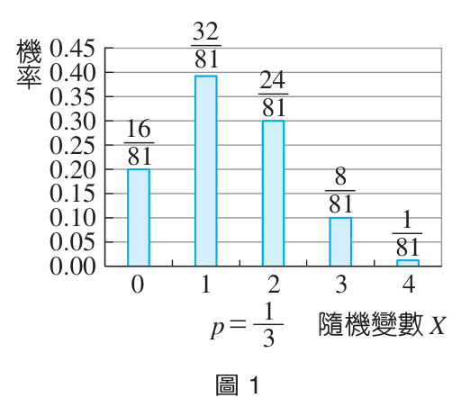
   
  <small>▲ 圖 1：$B(4, 1/3)$ 機率質量函數圖（峰值偏左側，因 $p < 0.5$）</small>

:::success
#### ✍️ 隨堂練習 (P.105)
假設隨機變數 $X$ 表示投擲一枚正面機率為 $p = \frac{1}{4}$ 的硬幣 $4$ 次後正面出現的總次數。試求其期望值與變異數。

  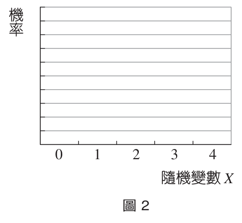

👉 [查看隨堂練習解答](14_選修數學乙(下)_隨堂練習參考解答.md#p105-隨堂練習)
:::

---

### 💡 例題 4：投擲硬幣 100 次之統計量

投擲一枚均勻硬幣 $100$ 次，試求正面出現次數的期望值、變異數與標準差。

:::info
#### 【解】
均勻硬幣 $p = \frac{1}{2}$，$q = \frac{1}{2}$，重複 $n = 100$ 次，故 $X \sim B\left(100, \frac{1}{2}\right)$。
1. **期望值**：$E(X) = np = 100 \times \frac{1}{2} = \mathbf{50} \text{ (次)}$
2. **變異數**：$\mathrm{Var}(X) = npq = 100 \times \frac{1}{2} \times \frac{1}{2} = \mathbf{25}$
3. **標準差**：$\sigma = \sqrt{npq} = \sqrt{25} = \mathbf{5} \text{ (次)}$
:::

:::success
#### ✍️ 隨堂練習 (P.107)
投擲一顆公正骰子 $180$ 次，試求 $1$ 點（么點）出現次數的期望值、變異數與標準差。

👉 [查看隨堂練習解答](14_選修數學乙(下)_隨堂練習參考解答.md#p107-隨堂練習)
:::

---

### 💡 例題 5：單選題隨機猜題之期望值

某次測驗共有 $20$ 題單選題，每題有 $4$ 個選項且恰有一個正確答案。小毅在每題中隨機猜選一個選項作答，每題猜對與否互相獨立：
1. 試求小毅在這次測驗中答對題數的期望值與標準差。
2. 若每題答對給 $5$ 分，不答或答錯不給分亦不倒扣，總分 $100$ 分，試求小毅這次測驗成績的期望值。

:::info
#### 【解】
1. 每題猜對機率 $p = 0.25 = \frac{1}{4}$，$q = 0.75 = \frac{3}{4}$，$n = 20$，答對題數 $X \sim B(20, 0.25)$：
   - 答對題數期望值：$E(X) = 20 \times 0.25 = \mathbf{5} \text{ (題)}$
   - 答對題數標準差：$\sigma = \sqrt{20 \times 0.25 \times 0.75} = \sqrt{3.75} = \frac{\sqrt{15}}{2} \approx \mathbf{1.94} \text{ (題)}$
2. 令成績隨機變數為 $Y = 5X$：
   - 成績期望值：$E(Y) = 5 \times E(X) = 5 \times 5 = \mathbf{25} \text{ (分)}$
:::

:::success
#### ✍️ 隨堂練習 (P.108)
某次測驗共有 $20$ 題五選一單選題，小毅全用猜的。
1. 試求小毅答對題數的期望值與標準差。
2. 若每題答對給 $5$ 分，求小毅成績的期望值。

👉 [查看隨堂練習解答](14_選修數學乙(下)_隨堂練習參考解答.md#p108-隨堂練習)
:::

---

### 💡 例題 6：夜市彈珠檯模型

夜市裡有一種釘板彈珠檯（如圖 3），彈珠從上方落入檯內，每次碰到鐵釘後以相等機率 $\frac{1}{2}$ 往左或往右往下滾落，最後落入下方標有分數的球槽內。設隨機變數 $X$ 表示所得分數，試回答下列問題：
1. 試求隨機變數 $X$ 的機率分布表。
2. 試求投入一顆彈珠所得分數的期望值。

  
  &emsp;&emsp;
  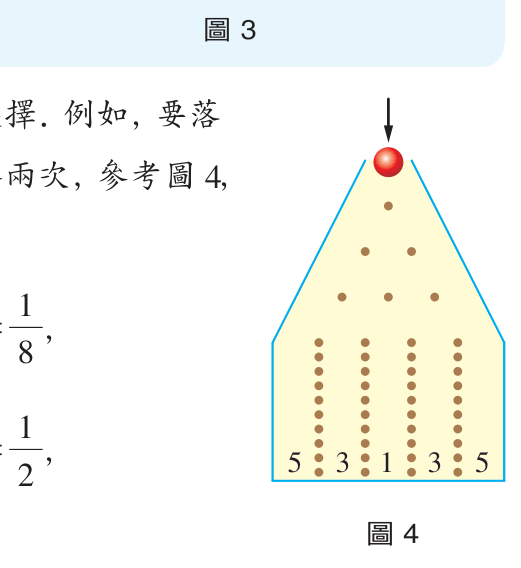
   
  <small>▲ 圖 3：夜市彈珠檯 &emsp;&emsp; ▲ 圖 4：彈珠碰撞釘子之二項路徑圖</small>

:::info
#### 【解】
彈珠落入球槽前經過 $4$ 層鐵釘，共向左或向右選擇 $4$ 次：
- 落入最兩側 $5$ 分槽：需 $4$ 次皆向左或 $4$ 次皆向右：
  $$P(X = 5) = C^4_0 \left(\frac{1}{2}\right)^4 + C^4_4 \left(\frac{1}{2}\right)^4 = \frac{1}{16} + \frac{1}{16} = \frac{2}{16} = \frac{1}{8}$$
- 落入 $3$ 分槽：需 $3$ 左 $1$ 右或 $1$ 左 $3$ 右：
  $$P(X = 3) = C^4_1 \left(\frac{1}{2}\right)^4 + C^4_3 \left(\frac{1}{2}\right)^4 = \frac{4}{16} + \frac{4}{16} = \frac{8}{16} = \frac{1}{2}$$
- 落入中間 $1$ 分槽：需 $2$ 左 $2$ 右：
  $$P(X = 1) = C^4_2 \left(\frac{1}{2}\right)^4 = \frac{6}{16} = \frac{3}{8}$$

1. 機率分布表：

| $x$ | $1$ | $3$ | $5$ |
| :---: | :---: | :---: | :---: |
| **$p(x)$** | $\frac{3}{8}$ | $\frac{1}{2}$ | $\frac{1}{8}$ |

2. 所得分數期望值：
   $$E(X) = 1\left(\frac{3}{8}\right) + 3\left(\frac{1}{2}\right) + 5\left(\frac{1}{8}\right) = \frac{3}{8} + \frac{12}{8} + \frac{5}{8} = \frac{20}{8} = \mathbf{\frac{5}{2} = 2.5} \text{ (分)}$$
:::

:::success
#### ✍️ 隨堂練習 (P.110)
承例題 6，試求投入一顆彈珠所得分數的變異數。

👉 [查看隨堂練習解答](14_選修數學乙(下)_隨堂練習參考解答.md#p110-隨堂練習)
:::

---

## 3. Excel 的輔助計算

當試驗次數 $n$ 很大時，手工計算二項分布的組合數與冪次相當困難，此時可利用試算表軟體 Excel 的 `BINOM.DIST` 函數進行計算。

:::info
### 💻 BINOM.DIST 語法說明
語法：`=BINOM.DIST(Number_s, Trials, Probability_s, Cumulative)`
- `Number_s`：成功次數 $k$。
- `Trials`：試驗總次數 $n$。
- `Probability_s`：單次成功機率 $p$。
- `Cumulative`：布林值
  - 輸入 `FALSE`：計算**單點機率質量函數** $P(X = k) = C^n_k p^k (1-p)^{n-k}$
  - 輸入 `TRUE`：計算**累積機率** $P(X \le k) = \sum_{i=0}^k C^n_i p^i (1-p)^{n-i}$
:::

  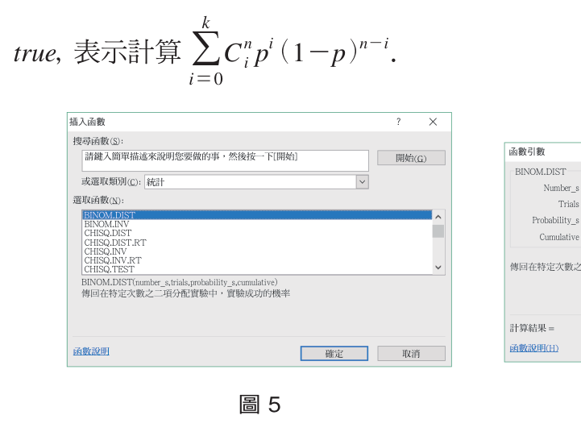
  &emsp;
  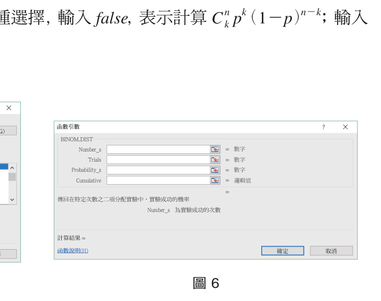
   
  <small>▲ 圖 5：Excel 插入函數選取 BINOM.DIST &emsp; ▲ 圖 6：函數引數輸入介面</small>

  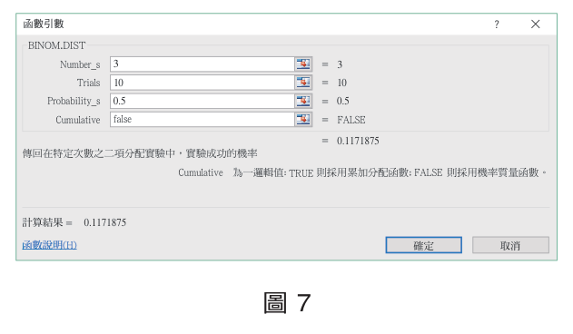
  &emsp;
  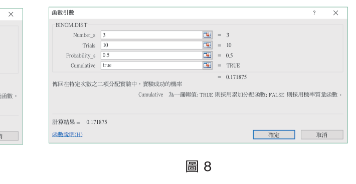
   
  <small>▲ 圖 7：計算恰 3 次成功（FALSE，結果 0.1171875） &emsp; ▲ 圖 8：累積 0~3 次成功（TRUE，結果 0.171875）</small>

---

## 4. 假設檢定 (Hypothesis Testing)

### 4-1 事件發生機率的合理性檢定

假設我們在地上撿到一枚硬幣，想要檢定它是否為一枚「均勻硬幣（正面機率 $p = 0.5$）」。
直觀上的做法是將它投擲多次（例如 $15$ 次），觀察正面出現次數 $X$。

若硬幣是均勻的，$X \sim B(15, 0.5)$，各次數機率分布如下表與長條圖：

| $x$ | $0$ | $1$ | $2$ | $3$ | $4$ | $5$ | $6$ | $7$ |
| :---: | :---: | :---: | :---: | :---: | :---: | :---: | :---: | :---: |
| **$p(x)$** | $0.000031$ | $0.000458$ | $0.003204$ | $0.013885$ | $0.041656$ | $0.091644$ | $0.152740$ | $0.196381$ |

| $x$ | $8$ | $9$ | $10$ | $11$ | $12$ | $13$ | $14$ | $15$ |
| :---: | :---: | :---: | :---: | :---: | :---: | :---: | :---: | :---: |
| **$p(x)$** | $0.196381$ | $0.152740$ | $0.091644$ | $0.041656$ | $0.013885$ | $0.003204$ | $0.000458$ | $0.000031$ |

  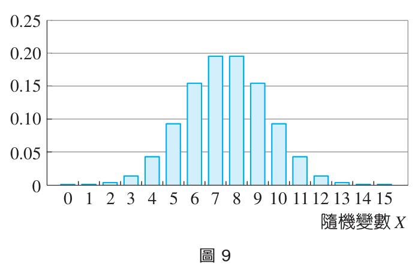
   
  <small>▲ 圖 9：$B(15, 0.5)$ 對稱鐘形機率分布圖</small>

:::warning
### 🎯 檢定邏輯與顯著水準
1. 若擲 $15$ 次只出現 $2$ 次正面，由於 $P(X \le 2) \approx 0.003693$ 極為罕見，我們很難相信這是一枚均勻硬幣，因而**拒絕**該假設。
2. 我們設定一個極端事件發生的機率門檻 $\alpha$（通常取 $\alpha = 0.05$，稱為**顯著水準 (Significance Level)**）。
3. 尋找兩端極端區域（左尾與右尾各分擔 $\frac{\alpha}{2} = 0.025$）：
   - $P(X \le 3) \approx 0.017578 < 0.025$
   - $P(X \ge 12) \approx 0.017578 < 0.025$
   - 兩端極端事件的機率和為 $0.017578 \times 2 = 0.035156 < 0.05$。
4. 因此，當 $X < 4$（即 $X \le 3$）或 $X > 11$（即 $X \ge 12$）時，我們拒絕均勻假設。此區間稱為**拒絕域 (Rejection Region)**。
:::

  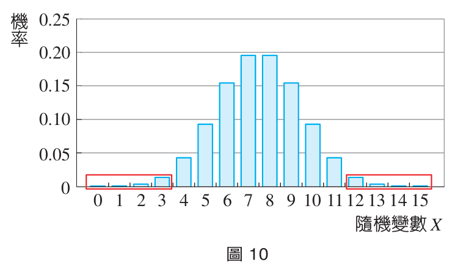
   
  <small>▲ 圖 10：兩側紅框區域即為顯著水準 $\alpha = 0.05$ 下的拒絕域（$X < 4$ 或 $X > 11$）</small>

### 4-2 假設檢定的五大步驟

1. **提出假設**：設定欲檢驗的主張（如：此為均勻硬幣 $p = 0.5$）。
2. **設定檢定統計量**：選取試驗觀察值（如：擲 $15$ 次出現正面的次數 $X$）。
3. **設定顯著水準**：給定檢驗門檻 $\alpha$（如 $\alpha = 0.05$ 或 $\alpha = 0.1$）。
4. **計算得出拒絕域**：在假設成立的前提下，計算使尾端機率小於 $\alpha$ 的極端數值區間。
5. **依試驗結果得出判斷**：若觀測數據落在拒絕域內，則**拒絕假設**；否則**不能拒絕（接受）假設**。

:::success
#### ✍️ 隨堂練習 (P.113)
連續投擲硬幣 $15$ 次，顯著水準 $\alpha = 0.05$（拒絕域為 $X < 4$ 或 $X > 11$）：
1. 甲擲出 $5$ 次正面，是否在拒絕域內？經檢定後是否該接受此為均勻硬幣的假設？
2. 乙擲出 $3$ 次正面，是否在拒絕域內？經檢定後是否該接受此為均勻硬幣的假設？

👉 [查看隨堂練習解答](14_選修數學乙(下)_隨堂練習參考解答.md#p113-隨堂練習)
:::

---

### 💡 例題 7：雙尾假設檢定

某人宣稱一枚硬幣正面出現的機率為 $0.6$。甲連續投擲該枚硬幣 $15$ 次，共擲出 $5$ 次正面。設隨機變數 $X \sim B(15, 0.6)$，其機率分布表如下，顯著水準設為 $\alpha = 0.1$：
1. 拒絕域為何？
2. 此硬幣出現正面機率為 $0.6$ 的說法是否可以拒絕？

| $x$ | $p(x)$ | $x$ | $p(x)$ |
| :---: | :---: | :---: | :---: |
| $0$ | $0.000001$ | $8$ | $0.177084$ |
| $1$ | $0.000024$ | $9$ | $0.206598$ |
| $2$ | $0.000254$ | $10$ | $0.185938$ |
| $3$ | $0.001649$ | $11$ | $0.126776$ |
| $4$ | $0.007420$ | $12$ | $0.063388$ |
| $5$ | $0.024486$ | $13$ | $0.021942$ |
| $6$ | $0.061214$ | $14$ | $0.004702$ |
| $7$ | $0.118056$ | $15$ | $0.000470$ |

  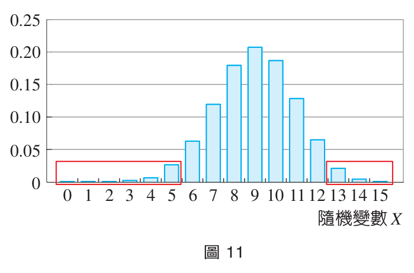
   
  <small>▲ 圖 11：$B(15, 0.6)$ 之機率質量函數圖與雙尾拒絕域判定</small>

:::info
#### 【解】
1. 顯著水準 $\alpha = 0.1$，分配到兩側各 $\frac{\alpha}{2} = 0.05$：
   - 左尾：$P(X \le 5) = 0.000001 + \dots + 0.024486 \approx 0.033834 < 0.05$（若取到 $6$ 則機率為 $0.033834 + 0.061214 = 0.095048 > 0.05$ 超過門檻），故左側拒絕域為 $X \le 5$（即 $X < 6$）。
   - 右尾：$P(X \ge 13) = 0.021942 + 0.004702 + 0.000470 \approx 0.027114 < 0.05$（若包含 $12$ 則超過 $0.05$），故右側拒絕域為 $X \ge 13$（即 $X > 12$）。
   - 故拒絕域為 **$X < 6$ 或 $X > 12$**。
2. 試驗結果 $X = 5$ 落在拒絕域（$X < 6$）內，因此**拒絕**該硬幣正面機率為 $0.6$ 的說法。
:::

:::success
#### ✍️ 隨堂練習 (P.115)
承例題 7，若乙連續投擲此枚硬幣 $15$ 次，共擲出 $11$ 次正面，請以 $\alpha = 0.1$ 檢定此硬幣出現正面的機率為 $0.6$ 的說法。

👉 [查看隨堂練習解答](14_選修數學乙(下)_隨堂練習參考解答.md#p115-隨堂練習)
:::

---

### 💡 例題 8：單尾假設檢定（「至少八成」宣稱）

小毅對外宣稱投擲飛鏢有 $80\%$ 以上的命中率。某日小毅在小如面前表演投飛鏢，投 $10$ 次中 $7$ 次。設隨機變數 $X \sim B(10, 0.8)$，顯著水準設為 $\alpha = 0.05$：
1. 拒絕域為何？
2. 小毅命中率有 $80\%$ 以上的說法是否可以拒絕？

| $x$ | $p(x)$ | $x$ | $p(x)$ |
| :---: | :---: | :---: | :---: |
| $0$ | $0.000000$ | $6$ | $0.088080$ |
| $1$ | $0.000004$ | $7$ | $0.201327$ |
| $2$ | $0.000074$ | $8$ | $0.301990$ |
| $3$ | $0.000786$ | $9$ | $0.268435$ |
| $4$ | $0.005505$ | $10$ | $0.107374$ |
| $5$ | $0.026424$ | | |

  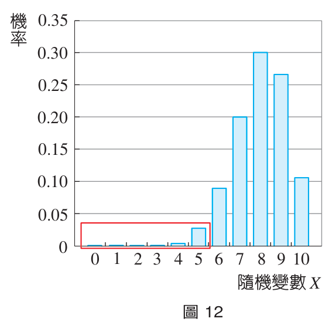
   
  <small>▲ 圖 12：單尾檢定拒絕域（命中次數過低時拒絕）</small>

:::info
#### 【解】
1. 欲檢驗「命中率至少八成」，因此只有命中次數「太少」才會引起懷疑，拒絕域只位於左側：
   $$P(X \le 5) = 0.000000 + 0.000004 + 0.000074 + 0.000786 + 0.005505 + 0.026424 \approx 0.032793 < \alpha = 0.05$$
   若包含 $6$ 則累積機率變為 $0.032793 + 0.088080 = 0.120873 > 0.05$。
   故拒絕域為 **$X < 6$**（即 $X \le 5$）。
2. 試驗結果 $X = 7$ **並未落在拒絕域**內，故**接受（無法拒絕）**小毅宣稱命中率有 $80\%$ 以上的說法。
:::

:::success
#### ✍️ 隨堂練習 (P.116)
一臺機器廣告宣稱產品劣品率不超過 $10\%$。某次生產 $20$ 個產品中發現有 $5$ 個劣品。設隨機變數 $X$ 為劣品數，顯著水準取 $\alpha = 0.05$：
1. 拒絕域為何？
2. 產品劣品率不超過 $10\%$ 的說法是否可以拒絕？

👉 [查看隨堂練習解答](14_選修數學乙(下)_隨堂練習參考解答.md#p116-隨堂練習)
:::

---

### ☕ 引言解答：品茶女士問題的檢定解答

回到章前引言中喝奶茶的鑑別能力：
- 假設小毅完全沒有鑑別能力，純靠隨機盲猜。
- 從 $8$ 杯中挑出 $4$ 杯 TM，挑法共有 $C^8_4 = 70$ 種。
- $4$ 杯全對的機率為：
  $$P(\text{全對}) = \frac{1}{C^8_4} = \frac{1}{70} \approx 0.0142857$$
- **統計判斷**：
  - 若選擇顯著水準 $\alpha = 0.05$：因 $0.0143 < 0.05$，我們**拒絕**「純屬猜測」的假設，承認小毅具有品茶鑑別能力！
  - 若標準極為嚴格取 $\alpha = 0.01$：因 $0.0143 > 0.01$，則不能拒絕純屬盲猜的假設。

---

## 📝 習題 3-2

👉 [點此查看：習題 3-2 完整參考解答與詳解](15_選修數學乙(下)_習題參考解答.md#ch-3-2-二項分布習題解答)

### 一、基本題

1. 阿偉在三分線投籃的命中率為 $\frac{2}{5}$，設每次投籃是否投進互相獨立。他連續在三分線投籃 $100$ 次，試求投進次數的期望值、變異數與標準差。

2. 一棟五層樓大樓，每樓各裝有 $1$ 臺同類型的飲水機，假設各臺飲水機是否被使用互相獨立。根據調查，在任一時刻，每臺飲水機被使用的機率是 $0.1$，試回答下列問題：
   (1) 同一時刻恰有兩臺飲水機被使用的機率是多少？
   (2) 同一時刻至少有三臺飲水機被使用的機率是多少？

3. 擲一公正骰子兩次，設隨機變數 $X$ 表示兩次出現的點數和，試求下列各機率：
   (1) $P(X \le 3)$
   (2) $P(5 < X \le 8)$

4. 袋中有 $20$ 個紅球、$80$ 個白球，每次隨機取出一球，每球被取出的機會均等，取後放回，連取 $100$ 次。令隨機變數 $X$ 表示取出紅球的個數，試求隨機變數 $X$ 的期望值與標準差。

5. 在一個二項分布 $B(n, p)$ 中，其期望值為 $20$ 且其標準差為 $\sqrt{15}$，試求 $n, p$ 的值。

---

### 二、進階題

6. 某硬幣不知道其是否均勻，若擲該硬幣 $n$ 次的正面次數期望值為 $240$ 次，標準差為 $12$ 次，試求 $n$ 值。

7. 有一新型肺炎，若假定在某城市中隨機抽驗一人，檢驗結果為陽性的機率為 $0.00001$，陰性的機率為 $0.99999$。已知此城市有 $80$ 萬人，試回答下列問題：
   (1) 此城市進行普篩出現陽性的期望值為何？
   (2) 至少篩檢多少人，才會使得篩檢出陽性的機率不小於 $\frac{1}{2}$？

8. 某日本職棒選手甲對外宣稱打擊率有 $3$ 成以上，即每 $10$ 次打擊出現 $3$ 次以上安打。某週甲在比賽中上場打擊 $12$ 次，只擊出 $1$ 支安打，設顯著水準 $\alpha = 0.1$：
   (1) 設隨機變數 $X$ 表示上場打擊 $12$ 次擊出安打的次數，試求拒絕域為何？
   (2) 選手甲打擊率有 $3$ 成以上的說法是否可以拒絕？

9. 設擲某硬幣出現正面的機率為 $p$，今擲該硬幣 $n$ 次，若硬幣出現正面次數的期望值為 $24$ 次，標準差為 $4$ 次，試求數對 $(n, p)$。

---

### 三、素養題

10. 小明自稱猜拳獲勝的機率是 $0.6$。今猜拳 $12$ 次，假設每次結果都是獨立的。若隨機變數 $X$ 表示獲勝次數，試回答下列問題：
    (1) 若顯著水準採用 $\alpha = 0.1$，則拒絕域為何？
    (2) 若小明贏了 $3$ 次，能夠拒絕機率為 $0.6$ 的說法嗎？
    (3) 若小明贏了 $9$ 次，能夠拒絕機率為 $0.6$ 的說法嗎？

---

[⬅️ 上一頁：3-1 離散型隨機變數](10_選修數學乙(下)_CH3-1_離散型隨機變數.md) ｜ [🔝 回到頂端](#) ｜ [📚 目錄總覽](README.md) ｜ [下一頁：第 3 章學習活動 ➡️](12_選修數學乙(下)_CH3_學習活動.md)

