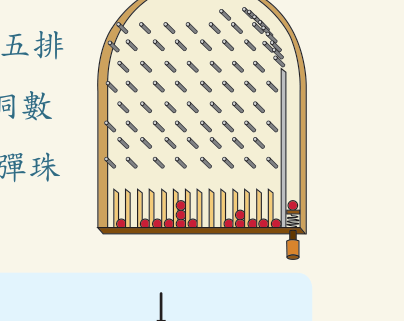
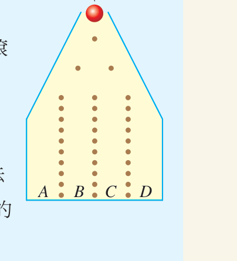

# ⚪ 第 3 章 學習活動：夜市的彈珠檯

[📚 目錄總覽](README.md) ｜ [⏮️ 第一頁](01_選修數學乙(下)_編輯大意與目次.md) ｜ [⬅️ 上一頁：3-2 二項分布](11_選修數學乙(下)_CH3-2_二項分布.md) ｜ [下一頁：第 3 章綜合演練 ➡️](13_選修數學乙(下)_CH3_綜合演練.md) ｜ [⏭️ 最終頁](15_選修數學乙(下)_習題參考解答.md)

---

> [!NOTE]
> **章節快速跳轉**：
> - **Ch 1 線性規劃**：[1 線性規劃](02_選修數學乙(下)_CH1_線性規劃.md) ｜ [第 1 章學習活動](03_選修數學乙(下)_CH1_學習活動.md) ｜ [數學家小傳（丹齊格）](04_選修數學乙(下)_CH1_數學家小傳_丹齊格.md)
> - **Ch 2 複數與多項式方程式**：[2-1 複數](05_選修數學乙(下)_CH2-1_複數.md) ｜ [2-2 多項式方程式](06_選修數學乙(下)_CH2-2_多項式方程式.md) ｜ [第 2 章學習活動](07_選修數學乙(下)_CH2_學習活動.md) ｜ [第 2 章綜合演練](08_選修數學乙(下)_CH2_綜合演練.md) ｜ [數學家小傳（阿貝爾）](09_選修數學乙(下)_CH2_數學家小傳_阿貝爾.md)
> - **Ch 3 機率統計**：[3-1 離散型隨機變數](10_選修數學乙(下)_CH3-1_離散型隨機變數.md) ｜ [3-2 二項分布](11_選修數學乙(下)_CH3-2_二項分布.md) ｜ **第 3 章學習活動** ｜ [第 3 章綜合演練](13_選修數學乙(下)_CH3_綜合演練.md)
> - **參考資料**：[隨堂練習參考解答](14_選修數學乙(下)_隨堂練習參考解答.md) ｜ [習題參考解答](15_選修數學乙(下)_習題參考解答.md)

---

[TOC]

---

## 🎯 活動背景：夜市彈珠檯與高爾頓釘板

臺灣夜市裡不可或缺的經典童年遊戲是彈珠檯。常見的傳統彈珠檯，下方通常設有十五排洞口。玩家一開始拿十五顆彈珠，依次拉動彈簧讓彈珠滾落，依照彈珠最終所占據的「不重複洞數」多寡兌換相應等級的獎品。

在這個學習活動中，我們利用本章所學的**獨立事件**、**隨機變數**與**二項分布**，來建立數學模型，分析簡易版本的彈珠檯！

  <table style="border: none;">
    <tr style="border: none;">
      <td align="center" style="border: none; padding: 10px;">
         
        <b>夜市常見的 15 洞彈珠檯</b>
      </td>
      <td align="center" style="border: none; padding: 10px;">
         
        <b>簡易版 4 洞彈珠模型</b>
      </td>
    </tr>
  </table>

---

## 🧮 數學建模：簡易 4 洞彈珠檯模型

如上圖右所示，我們考慮一個只有四個洞口（標記為 $A, B, C, D$）的簡易彈珠檯：
1. 假設彈珠每碰到一個釘子時，往左彈或往右彈的機率各為 $\frac{1}{2}$。
2. 每顆彈珠均由最上方的頂部入口釘子開始滾落，碰到釘子後隨機彈跳向左或向右，接著碰下一層的釘子繼續滾落。
3. 依此類推，每顆彈珠一共會彈跳三次，最後掉入下方的 $A, B, C, D$ 四個洞口之一。

### 彈跳路徑與符號表示
- 每次往左彈跳記為「左」，往右彈跳記為「右」。
- 掉入 $A$ 洞的唯一路徑為「左左左」，其發生的機率為：
  $$P(A) = \left(\frac{1}{2}\right) \times \left(\frac{1}{2}\right) \times \left(\frac{1}{2}\right) = \left(\frac{1}{2}\right)^3 = \frac{1}{8}$$

---

## ✍️ 同學想一想 (思考與演算)

:::info [問題 1：掉入各洞的路徑與機率]
寫出所有掉入 $B$ 洞的彈跳路徑，並分別求出彈珠掉入 $B, C, D$ 洞的機率：

1. **掉入 $B$ 洞**：
   三步中必須有**兩次向左、一次向右**：
   - 路徑有 3 種：「左右左」、「左左右」、「右左左」。
   - 機率：$P(B) = C^3_1 \left(\frac{1}{2}\right)^3 = \frac{3}{8}$。
2. **掉入 $C$ 洞**：
   三步中必須有**一次向左、兩次向右**：
   - 路徑有 3 種：「右左右」、「右右左」、「左右右」。
   - 機率：$P(C) = C^3_2 \left(\frac{1}{2}\right)^3 = \frac{3}{8}$。
3. **掉入 $D$ 洞**：
   三步中必須**三次均向右**：「右右右」。
   - 機率：$P(D) = \left(\frac{1}{2}\right)^3 = \frac{1}{8}$。

> **小結：各洞機率分布**
> $$P(A) = \frac{1}{8}, \quad P(B) = \frac{3}{8}, \quad P(C) = \frac{3}{8}, \quad P(D) = \frac{1}{8}$$
> 這正是二項分布 $B\left(3, \frac{1}{2}\right)$ 的各項係數！
:::

---

## 🎲 連續滾落四顆彈珠的洞數分布

接下來，我們分析將**四顆彈珠依序滾落**時，會占據幾個洞（令隨機變數 $X$ 代表四顆彈珠占據的相異洞數，$X \in \{1, 2, 3, 4\}$）。

每顆彈珠掉入各洞的結果是相互獨立的。四顆彈珠掉落的總情境樣本空間共有 $4^4$ 種可能。但因為各洞機率不同（$B, C$ 為 $\frac{3}{8}$，$A, D$ 為 $\frac{1}{8}$），必須以各洞機率加權計算：

:::success [問題 2：四顆彈珠在同一洞的機率 ($X = 1$)]
四顆彈珠全部集中在同一個洞：
$$\begin{aligned}
P(X = 1) &= P(\text{全在 } A) + P(\text{全在 } B) + P(\text{全在 } C) + P(\text{全在 } D) \\
&= \left(\frac{1}{8}\right)^4 + \left(\frac{3}{8}\right)^4 + \left(\frac{3}{8}\right)^4 + \left(\frac{1}{8}\right)^4 \\
&= \frac{1 + 81 + 81 + 1}{8^4} = \frac{164}{4096} = \frac{41}{1024} \approx 0.0400
\end{aligned}$$
:::

:::success [問題 3：四個洞均有彈珠的機率 ($X = 4$)]
四顆彈珠剛好分別掉入 $A, B, C, D$ 四個洞（依序掉入的一種排列，例如 $ABCD, ABDC, \dots$，共有 $4! = 24$ 種排列）：
$$\begin{aligned}
P(X = 4) &= 4! \times P(A)P(B)P(C)P(D) \\
&= 24 \times \left(\frac{1}{8} \times \frac{3}{8} \times \frac{3}{8} \times \frac{1}{8}\right) \\
&= 24 \times \frac{9}{4096} = \frac{216}{4096} = \frac{27}{512} \approx 0.0527
\end{aligned}$$

> **觀察發現**：
> 四個洞都有彈珠的機率（$\frac{216}{4096}$）比四顆彈珠集中在同一洞的機率（$\frac{164}{4096}$）還要高一點！
:::

---

## 📊 隨機變數 $X$ 的機率分布表與期望值

利用排列組合與多項式機率分布，可進一步計算出恰占據 2 個洞與 3 個洞的機率：
- 恰占據 2 個洞：$P(X = 2) = \frac{1844}{4096} = \frac{461}{1024} \approx 0.4502$
- 恰占據 3 個洞：$P(X = 3) = \frac{1872}{4096} = \frac{117}{256} \approx 0.4570$

:::info [問題 4：$X$ 的機率分布表]

| 占據洞數 $x$ | $1$ | $2$ | $3$ | $4$ | 合計 |
| :---: | :---: | :---: | :---: | :---: | :---: |
| **機率 $P(X = x)$** | $\frac{164}{4096}$ | $\frac{1844}{4096}$ | $\frac{1872}{4096}$ | $\frac{216}{4096}$ | $1$ |
| **約當小數** | $0.0400$ | $0.4502$ | $0.4570$ | $0.0527$ | $1.0000$ |

:::

:::info [問題 5：期望值與變異數計算]
1. **期望值 $E(X)$**：
   $$\begin{aligned}
   E(X) &= 1 \times \frac{164}{4096} + 2 \times \frac{1844}{4096} + 3 \times \frac{1872}{4096} + 4 \times \frac{216}{4096} \\
   &= \frac{164 + 3688 + 5616 + 864}{4096} = \frac{10332}{4096} \approx 2.52 \text{ (個洞)}
   \end{aligned}$$

2. **平方期望值 $E(X^2)$**：
   $$\begin{aligned}
   E(X^2) &= 1^2 \times \frac{164}{4096} + 2^2 \times \frac{1844}{4096} + 3^2 \times \frac{1872}{4096} + 4^2 \times \frac{216}{4096} \\
   &= \frac{164 + 7376 + 16848 + 3456}{4096} = \frac{27844}{4096} \approx 6.7979
   \end{aligned}$$

3. **變異數 $\mathrm{Var}(X)$**：
   $$\mathrm{Var}(X) = E(X^2) - [E(X)]^2 \approx 6.7979 - (2.5225)^2 \approx 0.43$$
:::

---

## 🏪 夜市老閭的數學秘密

同學可以仿照上面的模型，進一步分析實際夜市中十五個洞的彈珠檯：
- 依十五次二項隨機漫步，中間的第 7、8、9 洞機率極高，而邊緣的 1 洞、15 洞機率幾近於零。
- 當十五顆彈珠打完後，計算其占據相異洞數的期望值約為 **$8 \sim 9$ 個洞**。
- 對照夜市老闆張貼的獎品規則：
  > - **「1 洞、2 洞、3 洞」或「13 洞、14 洞、15 洞」**：大獎（巨型娃娃、遙控車、Switch）
  > - **「8 洞、9 洞、10 洞」**：安慰獎（棒棒糖一顆、口香糖一片）

利用機率與期望值分析，同學就會恍然大悟：**絕大多數玩家有超過 90% 的極高機率最終落在 8 到 10 洞，只能抱回一顆糖果！** 這正是數學應用在生活與商業設計上的經典案例！

---

[⬅️ 上一頁：3-2 二項分布](11_選修數學乙(下)_CH3-2_二項分布.md) ｜ [🔝 回到頂端](#) ｜ [📚 目錄總覽](README.md) ｜ [下一頁：第 3 章綜合演練 ➡️](13_選修數學乙(下)_CH3_綜合演練.md)

