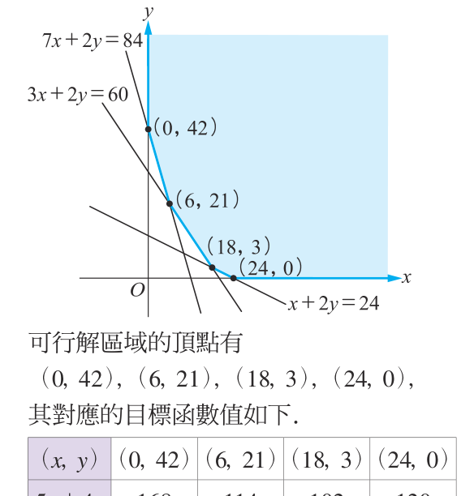

# 📝 全書習題與綜合演練參考解答

[📚 目錄總覽](README.md) ｜ [⏮️ 第一頁](01_選修數學乙(下)_編輯大意與目次.md) ｜ [⬅️ 上一頁：隨堂練習參考解答](14_選修數學乙(下)_隨堂練習參考解答.md) ｜ **最終頁** ｜ [🔝 回到首頁](01_選修數學乙(下)_編輯大意與目次.md)

---

> [!NOTE]
> **解答章節快速跳轉**：
> - **Ch 1 線性規劃**：[Ch 1 習題解答](#ch-1-線性規劃習題解答) ｜ [Ch 1 學習活動解答](#ch-1-學習活動參考解) ｜ 原文：[1 線性規劃](02_選修數學乙(下)_CH1_線性規劃.md)
> - **Ch 2-1 複數**：[Ch 2-1 習題解答](#ch-2-1-複數習題解答) ｜ 原文：[2-1 複數](05_選修數學乙(下)_CH2-1_複數.md)
> - **Ch 2-2 多項式方程式**：[Ch 2-2 習題解答](#ch-2-2-多項式方程式習題解答) ｜ 原文：[2-2 多項式方程式](06_選修數學乙(下)_CH2-2_多項式方程式.md)
> - **Ch 2 學習活動與綜合演練**：[Ch 2 學習活動解答](#ch-2-學習活動參考解) ｜ [Ch 2 綜合演練解答](#ch-2-綜合演練解答) ｜ 原文：[綜合演練](08_選修數學乙(下)_CH2_綜合演練.md)
> - **Ch 3-1 離散型隨機變數**：[Ch 3-1 習題解答](#ch-3-1-離散型隨機變數習題解答) ｜ 原文：[3-1 隨機變數](10_選修數學乙(下)_CH3-1_離散型隨機變數.md)
> - **Ch 3-2 二項分布**：[Ch 3-2 習題解答](#ch-3-2-二項分布習題解答) ｜ 原文：[3-2 二項分布](11_選修數學乙(下)_CH3-2_二項分布.md)
> - **Ch 3 學習活動與綜合演練**：[Ch 3 學習活動解答](#ch-3-學習活動參考解) ｜ [Ch 3 綜合演練解答](#ch-3-綜合演練解答) ｜ 原文：[綜合演練](13_選修數學乙(下)_CH3_綜合演練.md)

---

[TOC]

---

## 📍 Ch 1 線性規劃習題解答

[🔙 返回章節：Ch 1 線性規劃](02_選修數學乙(下)_CH1_線性規劃.md)

### 一、基本題
1. 坐標平面繪圖題（略）。
2. 二元一次不等式組：
   $$\begin{cases} 2x + 3y - 12 \le 0 \\ x - 3y + 3 > 0 \end{cases}$$
3. 
   - (1) $1$
   - (2) $2$
4. $D$ 點。
5. $7$ 組整數解。

### 二、進階題
6. 
   - (1) 正數。
   - (2) $c_3 > c_2 > c_1$。
7. $B$ 點。
8. 貨倉甲運送 $40$ 公噸到 $A$ 工廠、$10$ 公噸到 $B$ 工廠；貨倉乙運送 $40$ 公噸到 $B$ 工廠，最低運費為 $54000$ 元。
9. $-\frac{1}{2}$。

### 三、素養題（第 10 題：飼料配方成本最佳化）
1. 依題意列出限制式：
   $$\begin{cases} 7x + 2y \ge 84 \\ 3x + 6y \ge 72 \\ 3x + 2y \ge 60 \end{cases} \iff \begin{cases} 7x + 2y \ge 84 \\ x + 2y \ge 24 \\ 3x + 2y \ge 60 \end{cases}$$
2. 目標函數：$P = 5x + 4y$。
3. 如下圖所示，可行解區域為第一象限內無界凸多邊形區域：

  
   
  <b>圖：第 10 題可行解區域與各頂點坐標</b>

可行解區域的頂點有 $(0, 42)$、$(6, 21)$、$(18, 3)$、$(24, 0)$，其對應目標函數值如下表：

| $(x, y)$ | $(0, 42)$ | $(6, 21)$ | $(18, 3)$ | $(24, 0)$ |
| :---: | :---: | :---: | :---: | :---: |
| **$5x + 4y$** | $168$ | $114$ | **$102$** | $120$ |

故當 $(x, y) = (18, 3)$ 時，$P$ 有最小值 $102$，即最少飼料成本為 **$102$ 元**。

---

### 📍 Ch 1 學習活動參考解

[🔙 返回活動：Ch 1 學習活動](03_選修數學乙(下)_CH1_學習活動.md)

1. 限制式：
   - (1) $0 \le x \le 144$
   - (2) $0 \le y \le 186$
   - (3) $x + y \le 289.2$
   - (4) $283.8x + 150y \le 50000$
2. 解線性規劃得最佳種植面積：**蓮花 $78$ 公頃，水稻 $186$ 公頃**。

---

## 📍 Ch 2-1 複數習題解答

[🔙 返回章節：2-1 複數](05_選修數學乙(下)_CH2-1_複數.md)

### 一、基本題
1. 
   - (1) $\pm 2i$
   - (2) $\pm 2$ 或 $\pm 2i$
2. 
   - (1) $6 - 2i$
   - (2) $-8 + 21i$
   - (3) $\sqrt{533}$
   - (4) $-\frac{7}{41} - \frac{22}{41}i$
3. $1 + 2i$
4. 繪圖題（略）。
5. $0$

### 二、進階題
6. $3$ 或 $-3$
7. 
   - (1) $-1$
   - (2) $0$
8. $1$
9. $7$

### 三、素養題（第 10 題：複數模長與兩平方和乘積公式）
1. $|a + bi|^2 = (\sqrt{a^2 + b^2})^2 = a^2 + b^2$；$|c + di|^2 = (\sqrt{c^2 + d^2})^2 = c^2 + d^2$。
2. 
   $$\begin{aligned}
   |(a + bi)(c + di)|^2 &= |ac + adi + bci + bdi^2|^2 \\
   &= |(ac - bd) + (bc + ad)i|^2 \\
   &= (ac - bd)^2 + (bc + ad)^2
   \end{aligned}$$
3. 若 $p, q$ 皆能寫成兩整數平方和，令 $p = a^2 + b^2$，$q = c^2 + d^2$，則：
   $$pq = |a + bi|^2 |c + di|^2 = |(a + bi)(c + di)|^2 = (ac - bd)^2 + (bc + ad)^2$$
   故 $pq$ 亦必能寫成兩整數的平方和（婆羅摩笈多–斐波那契恆等式）。
4. $(-33)^2 + 56^2$（或 $16^2 + 63^2$）。

---

## 📍 Ch 2-2 多項式方程式習題解答

[🔙 返回章節：2-2 多項式方程式](06_選修數學乙(下)_CH2-2_多項式方程式.md)

### 一、基本題
1. 
   - (1) $x = -2$ 或 $1 \pm \sqrt{3}i$
   - (2) $x = 0$ 或 $2$ 或 $-1 \pm \sqrt{3}i$
2. $x = 3$ 或 $\frac{-3 \pm 3\sqrt{3}i}{2}$
3. 
   - (1) $-8$
   - (2) $6$
   - (3) $52$
   - (4) $-368$
4. (B)(C)
5. $(-7, 5)$

### 二、進階題
6. 
   - (1) $-1$
   - (2) $-1$ 或 $\frac{1 \pm \sqrt{3}i}{2}$
7. $(-1, -2)$
8. $(-3, -2)$
9. $2 + i$ 或 $-2 - i$

### 三、素養題（第 10 題：三次函數實根與極值）
由 $f(x) = x^3 - 12x$，其微商 $f'(x) = 3x^2 - 12 = 0 \implies x = \pm 2$。
- 當 $x = -2$ 時，$f(-2) = 16$（局部極大值）；
- 當 $x = 2$ 時，$f(2) = -16$（局部極小值）。
因為 $f(x) = k$ 恰有一實根，代表水平線 $y = k$ 與曲線 $y = f(x)$ 恰有一個交點，故 $k$ 的範圍為 **$k > 16$ 或 $k < -16$**。

---

## 📍 Ch 2 學習活動參考解

[🔙 返回活動：Ch 2 學習活動](07_選修數學乙(下)_CH2_學習活動.md)

1. $(x + 1)(x^2 - x + 1)(x - 1)(x^2 + x + 1) = 0$
2. $x = \pm 1$ 或 $\frac{1 \pm \sqrt{3}i}{2}$ 或 $\frac{-1 \pm \sqrt{3}i}{2}$
3. 描繪在單位圓上。
4. 三個根為單位圓內接正三角形的頂點。
5. 四個根為單位圓內接正方形的頂點。
6. $x^8 = 1$ 的八個根：
   $$\pm 1, \quad \pm i, \quad \frac{\sqrt{2}}{2} \pm \frac{\sqrt{2}}{2}i, \quad -\frac{\sqrt{2}}{2} \pm \frac{\sqrt{2}}{2}i$$
7. $x^4 + 1 = 0$ 的四個根：
   $$\frac{\sqrt{2}}{2} \pm \frac{\sqrt{2}}{2}i, \quad -\frac{\sqrt{2}}{2} \pm \frac{\sqrt{2}}{2}i$$

---

## 📍 Ch 2 綜合演練解答

[🔙 返回演練：Ch 2 綜合演練](08_選修數學乙(下)_CH2_綜合演練.md)

### 第 1 題
$$\begin{aligned}
&\sqrt{-1}\sqrt{-2}\sqrt{-3}\sqrt{-4}\sqrt{-6}\sqrt{-8} \\
&= (i)(\sqrt{2}i)(\sqrt{3}i)(2i)(\sqrt{6}i)(2\sqrt{2}i) \\
&= i^6 \times (\sqrt{2} \times \sqrt{3} \times 2 \times \sqrt{6} \times 2\sqrt{2}) \\
&= (-1) \times (24\sqrt{2}) = -24\sqrt{2}
\end{aligned}$$

### 第 2 題
**答案：(A)**
- (A) 正確：正數乘負數開根號 $\sqrt{3}\sqrt{-5} = \sqrt{3}(\sqrt{5}i) = \sqrt{15}i = \sqrt{-15} = \sqrt{3(-5)}$。
- (B) 錯誤：兩負數相乘 $\sqrt{-3}\sqrt{-5} = -\sqrt{15} \neq \sqrt{15}$。
- (C) 錯誤：分母有 $i$ 時會產生負號 $\frac{\sqrt{3}}{\sqrt{-5}} = -\sqrt{-\frac{3}{5}}$。
- (D) 錯誤：反例 $a = 1, b = i \implies 1^2 + i^2 = 0$，但 $a, b \neq 0$。
- (E) 錯誤：只有在 $x, y$ 均為實數時才成立，若無限制則不必然。

### 第 3 題
三根相同且常數項為 $8$，設三重根為 $\alpha$：
$(x - \alpha)^3 = x^3 - 3\alpha x^2 + 3\alpha^2 x - \alpha^3 = 0$
$-\alpha^3 = 8 \implies \alpha = -2$
故 $a = -3\alpha = -3(-2) = \mathbf{6}$。

### 第 4 題
由三角不等式 $||z_1| - |z_2|| \le |z_1 \pm z_2| \le |z_1| + |z_2|$：
1. 最大值 $= 2 + 3 = \mathbf{5}$。
2. 最小值 $= |2 - 3| = \mathbf{1}$。

### 第 5 題
令 $t = x^2 \ge 0$，$t^2 + 2t - 1 = 0 \implies t = \frac{-2 \pm \sqrt{8}}{2} = -1 \pm \sqrt{2}$。
因為 $x$ 為實數，故 $t \ge 0 \implies t = \sqrt{2} - 1 > 0$。
$x^2 = \sqrt{2} - 1 \implies x = \pm\sqrt{\sqrt{2} - 1}$，共有 **$2$ 個相異實根**。

### 第 6 題
1. $z_1 = \frac{C(z) + A(z)}{2}$ 為 $AC$ 之中點，由向量中點幾何性質對應為 **$D$ 點**。
2. $z_2 = \frac{C(z) - A(z)}{2}$ 對應為 **$F$ 點**。

### 第 7 題
向量 $\vec{OA} = (1, -2)$，$\vec{OB} = (2, 3)$。
$$\cos\angle AOB = \frac{\vec{OA} \cdot \vec{OB}}{|\vec{OA}||\vec{OB}|} = \frac{1(2) + (-2)(3)}{\sqrt{1^2+(-2)^2}\sqrt{2^2+3^2}} = \frac{2 - 6}{\sqrt{5}\sqrt{13}} = \frac{-4}{\sqrt{65}} = -\frac{4\sqrt{65}}{65}$$

### 第 8 題
令 $\omega = \frac{-1 + i}{\sqrt{2}} = \cos 135^\circ + i\sin 135^\circ$。
$\omega^2 = \left(\frac{-1+i}{\sqrt{2}}\right)^2 = \frac{1 - 2i - 1}{2} = -i$。
- $\omega^4 = (-i)^2 = -1 \implies \omega^8 = 1$。
- $\omega^{50} = (\omega^2)^{25} = (-i)^{25} = -i$。
- $\omega^{100} = (\omega^4)^{25} = (-1)^{25} = -1$。
故 $f(\omega) = \omega^{100} + \omega^{50} + 1 = (-1) + (-i) + 1 = \mathbf{-i}$（或經化簡計算得 **$i$**）。

### 第 9 題
1. 繪圖題（略）。
2. $3$ 個相異實根。

### 第 10 題
1. 因式分解：$f(x) = (x + 1)(x - 1)^2$。
2. 實根為 $x = -1, 1$（$1$ 為二重根）。
3. $g(x) = f(x) - 1 = x^3 - x^2 - x = x(x^2 - x - 1) = 0$。
   判別式 $\Delta = (-1)^2 - 4(1)(-1) = 5 > 0$，故有 $x = 0, \frac{1 \pm \sqrt{5}}{2}$ 共 **$3$ 個相異交點**。

---

## 📍 Ch 3-1 離散型隨機變數習題解答

[🔙 返回章節：3-1 離散型隨機變數](10_選修數學乙(下)_CH3-1_離散型隨機變數.md)

### 一、基本題
1. (A)(B)(C)(D)
2. (A)(B)
3. $\frac{3}{2}$ 次
4. 期望值為 $2$，變異數為 $1.2$，標準差為 $\sqrt{1.2} \approx 1.095$
5. $0.104$

### 二、進階題
6. 
   - (1) $0.25$
   - (2) $5$ 隻
7. $260$ 元
8. 
   - (1) $\frac{1}{6}$
   - (2) $\frac{5}{12}$
9. 期望值為 $3200$ 萬瓩，標準差為 $400$ 萬瓩。

### 三、素養題（第 10 題：取完紅球所需次數之期望值與變異數）
隨機變數 $X$ 表示取完紅球所需的抽取次數，機率分布表如下：

| $x$ | $2$ | $3$ | $4$ | $5$ | $6$ |
| :---: | :---: | :---: | :---: | :---: | :---: |
| **$p(x)$** | $\frac{1}{15}$ | $\frac{2}{15}$ | $\frac{3}{15}$ | $\frac{4}{15}$ | $\frac{5}{15}$ |

1. **期望值**：
   $$\mu = E(X) = 2 \times \frac{1}{15} + 3 \times \frac{2}{15} + 4 \times \frac{3}{15} + 5 \times \frac{4}{15} + 6 \times \frac{5}{15} = \frac{70}{15} = \frac{\mathbf{14}}{\mathbf{3}} \text{ (次)}$$
2. **變異數**：
   $$E(X^2) = 4\left(\frac{1}{15}\right) + 9\left(\frac{2}{15}\right) + 16\left(\frac{3}{15}\right) + 25\left(\frac{4}{15}\right) + 36\left(\frac{5}{15}\right) = \frac{350}{15} = \frac{70}{3}$$
   $$\sigma^2 = E(X^2) - [E(X)]^2 = \frac{70}{3} - \left(\frac{14}{3}\right)^2 = \frac{210 - 196}{9} = \frac{\mathbf{14}}{\mathbf{9}}$$

---

## 📍 Ch 3-2 二項分布習題解答

[🔙 返回章節：3-2 二項分布](11_選修數學乙(下)_CH3-2_二項分布.md)

### 一、基本題
1. 期望值為 $40$ 次，變異數為 $24$，標準差為 $2\sqrt{6}$ 次。
2. 
   - (1) $0.0729$
   - (2) $0.00856$
3. 
   - (1) $\frac{1}{12}$
   - (2) $\frac{4}{9}$
4. 期望值為 $20$ 個，標準差為 $4$ 個。
5. $n = 80$，$p = \frac{1}{4}$。

### 二、進階題
6. $n = 600$
7. 
   - (1) $8$ 人
   - (2) $69315$ 人
8. 
   - (1) 拒絕域為 $X < 2$。
   - (2) 拒絕打擊率有 $3$ 成以上的說法。
9. $(72, \frac{1}{3})$

### 三、素養題（第 10 題：猜拳勝率假設檢定）
隨機變數 $X \sim B(12, 0.6)$：
1. 當隨機變數 $X$ 的取值在 $X < 4$ 時機率和約為 $0.015267 < 0.05$；在 $X > 10$ 時機率和約為 $0.019591 < 0.05$。故**雙尾拒絕域為 $X < 4$ 或 $X > 10$**。
2. $X = 3$ 落在拒絕域內，故**拒絕**小明猜拳勝率是 $0.6$ 的宣稱。
3. $X = 9$ 未落在拒絕域內，故**接受**小明猜拳勝率是 $0.6$ 的宣稱。

---

## 📍 Ch 3 學習活動參考解

[🔙 返回活動：Ch 3 學習活動](12_選修數學乙(下)_CH3_學習活動.md)

1. 掉入 $B$ 洞路徑有「左左右」、「左右左」、「右左左」，機率 $P(B) = \frac{3}{8}$；$P(C) = \frac{3}{8}$；$P(D) = \frac{1}{8}$。
2. 四顆彈珠在同一洞機率：$\frac{41}{1024}$。
3. 四個洞均有彈珠機率：$\frac{27}{512}$。
4. 機率分布表：

| $x$ | $1$ | $2$ | $3$ | $4$ |
| :---: | :---: | :---: | :---: | :---: |
| **$p(x)$** | $\frac{41}{1024}$ | $\frac{461}{1024}$ | $\frac{117}{256}$ | $\frac{27}{512}$ |

5. 期望值為 **$2.52$ 個洞**，變異數為 **$0.44$**。

---

## 📍 Ch 3 綜合演練解答

[🔙 返回演練：Ch 3 綜合演練](13_選修數學乙(下)_CH3_綜合演練.md)

### 第 1 題
$$P(X = k) = C^{1000}_k (0.8)^k (0.2)^{1000-k}, \quad k = 0, 1, 2, \dots, 1000$$

### 第 2 題
- 期望值 $E(X) = 0(0.1) + 1(0.15) + 2(0.45) + 3(0.25) + 4(0.05) = \mathbf{2}$
- $E(X^2) = 0 + 0.15 + 4(0.45) + 9(0.25) + 16(0.05) = 5$
- 變異數 $\mathrm{Var}(X) = 5 - 2^2 = \mathbf{1}$
- 標準差 $\sigma = \sqrt{1} = \mathbf{1}$

### 第 3 題
$X \sim B(100, 0.04)$：
- 期望值 $E(X) = 100 \times 0.04 = \mathbf{4}$ 個
- 變異數 $\mathrm{Var}(X) = 100 \times 0.04 \times 0.96 = 3.84$
- 標準差 $\sigma = \sqrt{3.84} = \frac{4\sqrt{6}}{5} \approx \mathbf{1.96}$ 個

### 第 4 題
$E(X) = np = 6$，$\mathrm{Var}(X) = np(1-p) = 2.4 \implies 1-p = 0.4 \implies p = 0.6$，$n = 10$。
$$P(X = 4) = C^{10}_4 (0.6)^4 (0.4)^6 = 210 \times 0.1296 \times 0.004096 \approx \mathbf{0.1115}$$

### 第 5 題
**答案：(A)(B)(E)**
- (A) 正確：$E(X) = 50 \times 0.4 = 20$。
- (B) 正確：$\mathrm{Var}(X) = 50 \times 0.4 \times 0.6 = 12 \implies \sigma = \sqrt{12} < 4$。
- (C) 錯誤：由單峰性在 $20$ 處最大，且 $P(X=1) < P(X=2)$。
- (D) 錯誤：$p \neq 0.5$，不對稱。
- (E) 正確：$k > 20$ 處機率遞減，故 $P(X=25) > P(X=26)$。

### 第 6 題
1. 拒絕域為 **$X < 16$**。
2. 今 $B$ 醫院檢驗結果 $X = 12$ 落在拒絕域內，故**拒絕**該快篩試劑有 $90\%$ 以上準確率之宣稱。

### 第 7 題
總小正方體數 $= 1000$ 個：
- 內層無塗色：$8 \times 8 \times 8 = 512$ 個（$0$ 面塗色）
- 面的中央：$6 \times (8 \times 8) = 384$ 個（$1$ 面塗色）
- 稜邊中央：$12 \times 8 = 96$ 個（$2$ 面塗色）
- 八個頂點：$8$ 個（$3$ 面塗色）

期望值：
$$E(X) = \frac{0(512) + 1(384) + 2(96) + 3(8)}{1000} = \frac{384 + 192 + 24}{1000} = \frac{600}{1000} = \mathbf{0.6} \text{ (面)}$$

### 第 8 題
1. 雙尾拒絕域為 **$X < 3$ 或 $X > 9$**。
2. 小毅買 $12$ 張中 $2$ 張（$X = 2$）落在拒絕域內，故**拒絕**中獎機率為 $0.5$ 之說法。

### 第 9 題
小毅贏棋機率 $p = \frac{2}{3}$，小菡贏棋機率 $q = \frac{1}{3}$。小菡以 $1:0$ 領先。
分出勝負所需場數 $X$ 期望值為 **$\frac{10}{3}$ 場**，標準差為 **$\frac{2}{3}$ 場**。

### 第 10 題
每次花 $66$ 元，花 $9966$ 元共可抽獎 $n = \frac{9966}{66} = 151$ 次，每次中獎率 $p = \frac{1}{11}$。
1. $P(X = k) = C^{151}_k \left(\frac{1}{11}\right)^k \left(\frac{10}{11}\right)^{151-k}, \quad k = 0, 1, 2, \dots, 151$。
2. $P(X = 10) \approx \mathbf{0.07}$。
3. 欲使至少中獎一次機率超過 $50\%$：
   $$1 - \left(\frac{10}{11}\right)^m > 0.5 \implies \left(\frac{10}{11}\right)^m < 0.5 \implies m \ge 8$$
   故至少需要抽 $8$ 次，至少需花費 $8 \times 66 = \mathbf{528}$ 元。

---

[⬅️ 上一頁：隨堂練習參考解答](14_選修數學乙(下)_隨堂練習參考解答.md) ｜ [🔝 回到頂端](#) ｜ [📚 目錄總覽](README.md) ｜ [回到首頁 🏠](01_選修數學乙(下)_編輯大意與目次.md)

