# 📚 普通型高級中學 選修數學乙(下) 數位互動教材

### 108 課綱普通高級中學三下數學教科書（翰林版）
**教育部審定用書 ｜ 作者：游森棚、林延輯、柯建彰、洪士薰、洪育祥、張宮明**

[📖 開始閱讀（第一頁）](01_選修數學乙(下)_編輯大意與目次.md) ｜ [📝 隨堂練習參考解答](14_選修數學乙(下)_隨堂練習參考解答.md) ｜ [🎯 習題參考解答](15_選修數學乙(下)_習題參考解答.md)

---

> [!TIP]
> **HackMD 書本模式 (Book Mode) 支援**：
> 本筆記支援 HackMD 書本模式。點選左側或頂部導覽列，即可在全書各章節、學習活動、數學家小傳與解答篇之間無縫跳轉。
> 所有數學公式皆採用標準 KaTeX 渲染（行內公式 `$...$`、獨立展示區塊 `$$...$$`），圖表皆高解析度向量轉換（200 DPI）並置中排版。

---

[TOC]

---

## 🗺️ 全書知識地圖 (Curriculum Mindmap)

```mermaid
flowchart TD
    ROOT["選修數學乙 (下)"]
    
    CH1["第 1 章：線性規劃<br/>(P.6 ~ P.29)"]
    CH2["第 2 章：複數與多項式方程式<br/>(P.30 ~ P.69)"]
    CH3["第 3 章：機率統計<br/>(P.70 ~ P.121)"]
    SOL["參考解答庫<br/>(P.122 ~ P.133)"]
    
    ROOT --> CH1
    ROOT --> CH2
    ROOT --> CH3
    ROOT --> SOL
    
    CH1 --> C1_1["1 線性規劃 (二元一次不等式 / 可行解區域 / 頂點法 / 平行線法)"]
    CH1 --> C1_ACT["學習活動：飲食問題與減重食譜配置"]
    CH1 --> C1_BIO["數學家小傳：線性規劃之父 丹齊格 (George Dantzig)"]
    
    CH2 --> C2_1["2-1 複數 (虛數單位 i / 複數四則運算 / 高斯平面 / 絕對值)"]
    CH2 --> C2_2["2-2 多項式方程式 (代數基本定理 / 虛根成對 / 勘根定理 / 實係數因式分解)"]
    CH2 --> C2_ACT["學習活動：中點多邊形與複數運算迭代"]
    CH2 --> C2_REV["第 2 章 綜合演練 (基礎觀念與整合進階題)"]
    CH2 --> C2_BIO["數學家小傳：挪威天才數學家 阿貝爾 (Niels Henrik Abel)"]
    
    CH3 --> C3_1["3-1 離散型隨機變數 (隨機試驗 / 機率質量函數 / 期望值 / 變異數與標準差 / 伯努力試驗)"]
    CH3 --> C3_2["3-2 二項分布 (二項分布 B(n, p) / 期望值 np / 變異數 npq / Excel BINOM.DIST / 假設檢定 / 拒絕域)"]
    CH3 --> C3_ACT["學習活動：夜市的彈珠檯 (高爾頓釘板與隨機路徑模型)"]
    CH3 --> C3_REV["第 3 章 綜合演練 (全章跨主題挑戰題)"]
    
    SOL --> SOL_PRAC["隨堂練習參考解答 (全書 14 節即時練習題詳解)"]
    SOL --> SOL_EXER["習題參考解答 (全書 15 節基礎、進階與素養題解答)"]
```

---

## 📑 HackMD 書本模式目錄結構 (Book Navigation)

複製以下清單結構至 HackMD 書本模式主頁，即可自動生成左側樹狀導覽目錄：

- [首頁：全書目錄總覽與學習地圖](README.md)
- [前言：編輯大意與全書目次](01_選修數學乙(下)_編輯大意與目次.md)
- [第 1 章 線性規劃](02_選修數學乙(下)_CH1_線性規劃.md)
    - [1 線性規劃](02_選修數學乙(下)_CH1_線性規劃.md)
        - [二元一次不等式的圖形](02_選修數學乙(下)_CH1_線性規劃.md#1-二元一次不等式的圖形)
        - [二元一次不等式組與可行解區域](02_選修數學乙(下)_CH1_線性規劃.md#2-二元一次不等式組與可行解區域)
        - [線性規劃的解法：平行線法與頂點法](02_選修數學乙(下)_CH1_線性規劃.md#3-線性規劃)
        - [習題 1](02_選修數學乙(下)_CH1_線性規劃.md#-習題-1)
    - [第 1 章 學習活動：飲食問題](03_選修數學乙(下)_CH1_學習活動.md)
    - [數學家小傳：丹齊格](04_選修數學乙(下)_CH1_數學家小傳_丹齊格.md)
- [第 2 章 複數與多項式方程式](05_選修數學乙(下)_CH2-1_複數.md)
    - [2-1 複數](05_選修數學乙(下)_CH2-1_複數.md)
        - [複數的引進與四則運算](05_選修數學乙(下)_CH2-1_複數.md#1-複數的引進與四則運算)
        - [複數的幾何意涵：高斯複數平面](05_選修數學乙(下)_CH2-1_複數.md#2-複數的幾何意涵)
        - [複數的絕對值與幾何距離](05_選修數學乙(下)_CH2-1_複數.md#3-複數的絕對值)
        - [習題 2-1](05_選修數學乙(下)_CH2-1_複數.md#-習題-2-1)
    - [2-2 多項式方程式](06_選修數學乙(下)_CH2-2_多項式方程式.md)
        - [一次與二次方程式的根](06_選修數學乙(下)_CH2-2_多項式方程式.md#1-一元一次與二次方程式的根)
        - [代數基本定理與根與係數關係](06_選修數學乙(下)_CH2-2_多項式方程式.md#2-代數基本定理)
        - [實係數多項式的虛根成對定理](06_選修數學乙(下)_CH2-2_多項式方程式.md#3-虛根成對定理)
        - [實係數多項式因式分解定理](06_選修數學乙(下)_CH2-2_多項式方程式.md#4-因式分解定理)
        - [實係數多項式方程式的實根判定（勘根定理）](06_選修數學乙(下)_CH2-2_多項式方程式.md#5-實係數多項式方程式的實根判定)
        - [習題 2-2](06_選修數學乙(下)_CH2-2_多項式方程式.md#-習題-2-2)
    - [第 2 章 學習活動：幾何中點多邊形](07_選修數學乙(下)_CH2_學習活動.md)
    - [第 2 章 綜合演練](08_選修數學乙(下)_CH2_綜合演練.md)
    - [數學家小傳：阿貝爾](09_選修數學乙(下)_CH2_數學家小傳_阿貝爾.md)
- [第 3 章 機率統計](10_選修數學乙(下)_CH3-1_離散型隨機變數.md)
    - [3-1 離散型隨機變數](10_選修數學乙(下)_CH3-1_離散型隨機變數.md)
        - [隨機的意義與隨機變數](10_選修數學乙(下)_CH3-1_離散型隨機變數.md#1-隨機的意義)
        - [機率質量函數與機率分布表](10_選修數學乙(下)_CH3-1_離散型隨機變數.md#1-3-機率分布與機率質量函數)
        - [隨機變數的期望值、變異數與標準差](10_選修數學乙(下)_CH3-1_離散型隨機變數.md#2-隨機變數的期望值變異數與標準差)
        - [隨機變數的線性變換性質](10_選修數學乙(下)_CH3-1_離散型隨機變數.md#2-3-隨機變數的線性變換伸縮與平移)
        - [獨立事件與伯努力試驗](10_選修數學乙(下)_CH3-1_離散型隨機變數.md#3-重複試驗)
        - [習題 3-1](10_選修數學乙(下)_CH3-1_離散型隨機變數.md#-習題-3-1)
    - [3-2 二項分布](11_選修數學乙(下)_CH3-2_二項分布.md)
        - [二項分布 B(n, p) 的定義與機率質量函數](11_選修數學乙(下)_CH3-2_二項分布.md#1-二項分布-binomial-distribution)
        - [二項分布的期望值 np、變異數 npq 與標準差](11_選修數學乙(下)_CH3-2_二項分布.md#2-二項分布的期望值變異數與標準差)
        - [Excel BINOM.DIST 函數試算教學](11_選修數學乙(下)_CH3-2_二項分布.md#3-excel-的輔助計算)
        - [假設檢定基本步驟與合理性檢定](11_選修數學乙(下)_CH3-2_二項分布.md#4-假設檢定-hypothesis-testing)
        - [顯著水準 α 與拒絕域判定（單尾與雙尾檢定）](11_選修數學乙(下)_CH3-2_二項分布.md#4-1-事件發生機率的合理性檢定)
        - [習題 3-2](11_選修數學乙(下)_CH3-2_二項分布.md#-習題-3-2)
    - [第 3 章 學習活動：夜市的彈珠檯](12_選修數學乙(下)_CH3_學習活動.md)
    - [第 3 章 綜合演練](13_選修數學乙(下)_CH3_綜合演練.md)
- [參考解答庫](14_選修數學乙(下)_隨堂練習參考解答.md)
    - [全書隨堂練習參考解答](14_選修數學乙(下)_隨堂練習參考解答.md)
    - [全書習題參考解答](15_選修數學乙(下)_習題參考解答.md)

---

## 📚 全書單元索引一覽表 (Master Table of Contents)

| 編號 | 文件檔案名稱 | 課本頁碼 | 單元核心主題 | 內嵌圖表數量 | 隨堂解答跳轉 | 習題解答跳轉 |
| :---: | :--- | :---: | :--- | :---: | :---: | :---: |
| **01** | [`01_選修數學乙(下)_編輯大意與目次.md`](01_選修數學乙(下)_編輯大意與目次.md) | P.1 ~ P.5 | 課綱大意、編寫特色、全書目錄、作者陣容 | 1 張 (封面) | — | — |
| **02** | [`02_選修數學乙(下)_CH1_線性規劃.md`](02_選修數學乙(下)_CH1_線性規劃.md) | P.6 ~ P.21 | 二元一次不等式、半平面、可行解區域、頂點法與平行線法、最佳化 | 15 張 | [👉 前往解答](14_選修數學乙(下)_隨堂練習參考解答.md#ch-1-線性規劃) | [👉 前往解答](15_選修數學乙(下)_習題參考解答.md#ch-1-線性規劃習題解答) |
| **03** | [`03_選修數學乙(下)_CH1_學習活動.md`](03_選修數學乙(下)_CH1_學習活動.md) | P.22 ~ P.27 | 飲食問題、營養成分與熱量限制、生活減重最佳化配方建模 | 1 張 | — | [👉 前往解答](15_選修數學乙(下)_習題參考解答.md#ch-1-學習活動參考解答) |
| **04** | [`04_選修數學乙(下)_CH1_數學家小傳_丹齊格.md`](04_選修數學乙(下)_CH1_數學家小傳_丹齊格.md) | P.28 ~ P.29 | 單純形法 (Simplex Method) 發明人、誤解作業成世界難題傳奇 | 1 張 (肖像) | — | — |
| **05** | [`05_選修數學乙(下)_CH2-1_複數.md`](05_選修數學乙(下)_CH2-1_複數.md) | P.30 ~ P.47 | 虛數 $i$ 歷史、複數代數運算、共軛複數、高斯平面、複數絕對值與三角不等式 | 18 張 | [👉 前往解答](14_選修數學乙(下)_隨堂練習參考解答.md#ch-2-1-複數) | [👉 前往解答](15_選修數學乙(下)_習題參考解答.md#ch-2-1-複數習題解答) |
| **06** | [`06_選修數學乙(下)_CH2-2_多項式方程式.md`](06_選修數學乙(下)_CH2-2_多項式方程式.md) | P.48 ~ P.61 | 根與係數、代數基本定理、虛根共軛成對、實係數因式分解、勘根定理 | 5 張 | [👉 前往解答](14_選修數學乙(下)_隨堂練習參考解答.md#ch-2-2-多項式方程式) | [👉 前往解答](15_選修數學乙(下)_習題參考解答.md#ch-2-2-多項式方程式習題解答) |
| **07** | [`07_選修數學乙(下)_CH2_學習活動.md`](07_選修數學乙(下)_CH2_學習活動.md) | P.62 ~ P.65 | 中點多邊形迭代收斂、高斯平面上的複數線性加權分析 | 3 張 | — | [👉 前往解答](15_選修數學乙(下)_習題參考解答.md#ch-2-學習活動參考解) |
| **08** | [`08_選修數學乙(下)_CH2_綜合演練.md`](08_選修數學乙(下)_CH2_綜合演練.md) | P.66 ~ P.67 | 複數幾何、單位圓內接多邊形、高次實係數多項式根綜合試題 (10 題) | 2 張 | — | [👉 前往解答](15_選修數學乙(下)_習題參考解答.md#ch-2-綜合演練解答) |
| **09** | [`09_選修數學乙(下)_CH2_數學家小傳_阿貝爾.md`](09_選修數學乙(下)_CH2_數學家小傳_阿貝爾.md) | P.68 ~ P.69 | 五次方程式不可根式解定理、阿貝爾群、貧病交加的數學流星 | 1 張 (肖像) | — | — |
| **10** | [`10_選修數學乙(下)_CH3-1_離散型隨機變數.md`](10_選修數學乙(下)_CH3-1_離散型隨機變數.md) | P.70 ~ P.98 | 隨機試驗、機率質量函數、期望值加權平均、變異數與標準差、平移伸縮、伯努力試驗 | 7 張 | [👉 前往解答](14_選修數學乙(下)_隨堂練習參考解答.md#ch-3-1-離散型隨機變數) | [👉 前往解答](15_選修數學乙(下)_習題參考解答.md#ch-3-1-離散型隨機變數習題解答) |
| **11** | [`11_選修數學乙(下)_CH3-2_二項分布.md`](11_選修數學乙(下)_CH3-2_二項分布.md) | P.99 ~ P.121 | 二項分布 $B(n, p)$、期望值與變異數推導、Excel 計算、假設檢定、顯著水準、拒絕域 | 12 張 | [👉 前往解答](14_選修數學乙(下)_隨堂練習參考解答.md#ch-3-2-二項分布) | [👉 前往解答](15_選修數學乙(下)_習題參考解答.md#ch-3-2-二項分布習題解答) |
| **12** | [`12_選修數學乙(下)_CH3_學習活動.md`](12_選修數學乙(下)_CH3_學習活動.md) | P.117 ~ P.120 | 夜市彈珠檯機率模型、高爾頓板二項隨機路徑、期望值與獲利模擬 | 3 張 | — | [👉 前往解答](15_選修數學乙(下)_習題參考解答.md#ch-3-學習活動參考解) |
| **13** | [`13_選修數學乙(下)_CH3_綜合演練.md`](13_選修數學乙(下)_CH3_綜合演練.md) | P.121 ~ P.123 | 隨機變數、期望值與變異數、二項分布綜合素養試題 (10 題) | 1 張 | — | [👉 前往解答](15_選修數學乙(下)_習題參考解答.md#ch-3-綜合演練解答) |
| **14** | [`14_選修數學乙(下)_隨堂練習參考解答.md`](14_選修數學乙(下)_隨堂練習參考解答.md) | P.124 ~ P.128 | 全書 Ch1 ~ Ch3 各節隨堂練習精確解答與步驟對照 | 0 張 | — | — |
| **15** | [`15_選修數學乙(下)_習題參考解答.md`](15_選修數學乙(下)_習題參考解答.md) | P.129 ~ P.133 | 全書基本題、進階題、素養題、活動與演練完整解答與詳細解析 | 2 張 (圖解) | — | — |

---

## 🛠️ 排版規範與特色支援

### 1. 雙向完整互聯導覽系統
- **全域導覽列**：每一頁 Markdown 頂部與底部皆設有「目錄總覽」、「第一頁」、「上一頁」、「下一頁」、「最終頁」標準按鈕。
- **章節快速跳轉面板**：包含 Ch 1、Ch 2、Ch 3 與解答篇的即時跳轉捷徑。
- **題目與解答雙向錨點互聯**：隨堂練習與習題皆附有一鍵直達解答的超連結，解答篇亦有一鍵返回題目的反向連結。

### 2. KaTeX 數學公式優化
- 行內公式使用 `$...$`，展示公式使用 `$$...$$`。
- 針對翰林版字型特殊編碼進行完整校正：
  - $\le$（小於等於）、$\ge$（大於等於）、$\approx$（約等於）皆正規化為標準 LaTeX 符號。
  - $\sqrt{\dots}$ 根號符號與二項式係數 $C^n_k$ 完整修復。
  - 期望值 $E(X)$、變異數 $\mathrm{Var}(X)$、標準差 $\sigma$、二項分布 $B(n, p)$ 符號統一。

### 3. 高解析度圖形資源庫 (`images/`)
全書 70+ 張向量圖、函數分布圖、肖像照與活動模型圖，皆經 PyMuPDF（Fitz）以 **200 DPI** 擷取或重繪：
- 線性規劃可行解區域圖（多邊形頂點標註清晰）
- 複數高斯平面向量旋轉與單位圓圖
- 機率質量函數長條圖與假設檢定拒絕域紅框示意圖
- Excel `BINOM.DIST` 試算表介面教學截圖

---

[📚 回到頂端](#) ｜ [📖 開始閱讀第一篇：編輯大意與目次 ➡️](01_選修數學乙(下)_編輯大意與目次.md)

